# Vectrex_EMU

**A Vectrex emulator that doesn't try to be perfect. It tries to be a Vectrex.**

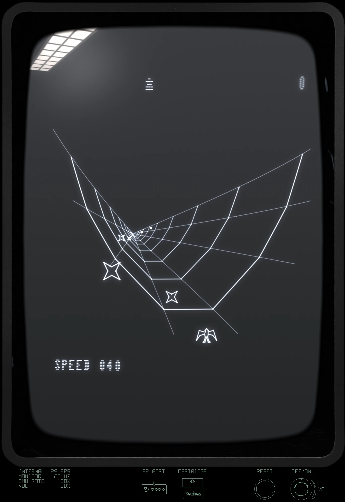

The Vectrex (GCE / Milton Bradley, 1982) is the only home console that ever drew its games with a real
vector beam: one electron beam, steered by analog circuits, tracing every line straight onto the
phosphor of its own built-in 9-inch screen. Most emulators show what the games *meant* to draw: clean,
sharp lines on black. A real Vectrex never looks like that. Its lines are made of moving light; corners
glow where the beam rests; shapes don't quite close because the analog circuits drift; text has gaps;
the picture wobbles with the mains hum; everything leaves a fading trail; and the speaker buzzes along
with whatever is on screen.

**Vectrex_EMU is built to show all of that** - measured on a real Vectrex, not guessed. Ready to run on
**Windows, macOS and Linux**: [download it from Releases](../../releases).

**Author:** Hugo Bokhorst ([@hugonl31](https://github.com/hugonl31)) - the idea, the real Vectrex, every
photo, recording and measurement, and every call on how it should look, sound and feel. 
**Development assistant and programmer:** Claude (Anthropic).

## Contents

* [Download and play](#download-and-play) - [what you add](#what-you-add) - [requirements](#requirements)
* [What it looks like](#what-it-looks-like) - [Features](#features)
* [The story: measuring a Vectrex](#the-story-measuring-a-vectrex) -
  [1. photographing the beam](#1-photographing-the-beam), [2. filming the glow](#2-filming-the-glow),
  [3. listening](#3-listening), [4. asking the chips](#4-asking-the-chips-directly),
  [5. the Mine Storm bug](#5-the-mine-storm-bug), [6. the analog side](#6-the-analog-side),
  [7. how wide the gaps are](#7-one-choice-how-wide-the-gaps-are), [8. speech](#8-speech-two-rare-modules),
  [9. overlays and scratches](#9-overlays---and-forty-years-of-scratches)
* [Using it](#using-it) - [switching on](#switching-on), [menus](#menus-and-sliders), [keys](#keys),
  [controls](#controls), [overlays](#overlays), [speech modules](#speech-modules),
  [cartridge hardware](#cartridge-hardware), [Mac and Linux notes](#mac-and-linux-notes)
* [Building from source](#building-from-source) - for tinkerers
* [Technical details](docs/TECHNICAL.md) - what it models, number by number
* [Credits and license](#credits-and-license)

---

## Download and play

Get the zip for your computer from [Releases](../../releases), unzip it anywhere and start the program:

| | Download | Start |
|---|---|---|
| **Windows** (10 / 11, 64-bit) | `Vectrex_EMU-windows.zip` | `Vectrex_EMU.exe` |
| **macOS** (10.13 or later, Intel and Apple Silicon) | `Vectrex_EMU-mac-app.zip` | `Vectrex_EMU.app` |
| **Linux** (x86-64: Ubuntu 22.04, Debian 12, Fedora 36 or later) | `Vectrex_EMU-linux-bin.zip` | `./Vectrex_EMU` |

The programs are not signed, so the first start needs one extra step:

* **Windows**: if SmartScreen says "Windows protected your PC": **More info > Run anyway**.
* **Mac**: right-click (or Ctrl+click) the app > **Open** > **Open**; on macOS 15 or later double-click it
  once, then **System Settings > Privacy & Security > Open Anyway**. Keep the app, `bios` and `roms`
  together in one folder.
* **Linux**: if unzipping dropped the run permission: `chmod +x Vectrex_EMU`.

It starts switched off, like a real Vectrex: **turn the volume knob up** (Page Up, or the mouse wheel
over the knob below the picture). Without a cartridge it plays its built-in game, **Mine Storm**.

**In the zip:** the emulator, the Vectrex BIOS (with Mine Storm; Smith Engineering allows it to be copied
freely for non-commercial use) and Mine Storm's overlay - inside `Vectrex_EMU.exe` on Windows, in the
`bios` folder on Mac and Linux - plus the folders `roms`, `roms/overlays` and `bios`, each with a short
note on what goes there.

### What you add

| What | Where | Where to get it |
|---|---|---|
| **Cartridge ROMs** (`.bin`, `.vec`, `.gam`, `.rom`) | `roms` (subfolders too) | your own cartridges |
| **Overlays** (optional) | `roms/overlays` | the MiSTer Vectrex core's `overlays.zip` ([Vectrex_MiSTer](https://github.com/Videodr0me/Vectrex_MiSTer)), or PNGs - see [Overlays](#overlays) |
| **Speech ROM** (optional, for the VecVoice / VecVox speech modules) | `bios` | `al2.bin`, a free download - see [Speech modules](#speech-modules) |

Then click the cartridge below the picture (or press **L**) and pick a game.

### Requirements

A graphics card with OpenGL (any from the last 15 years; the phosphor, bloom and overlay scratches run on
it), sound, and for Linux an X11 or Wayland desktop (through XWayland) with PulseAudio or PipeWire. On a
computer without a real graphics card (a virtual machine, Apple's software renderer) it still runs, with
a shorter afterglow and without the scratches.

---

## What it looks like

<a href="docs/images/gallery/overlay_mine_storm.png">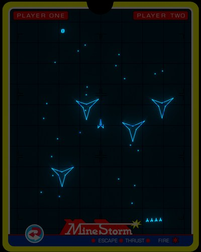</a>
<a href="docs/images/gallery/overlay_bedlam.png">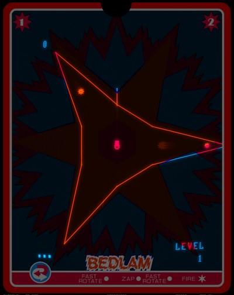</a>
<a href="docs/images/gallery/overlay_armor_attack.png">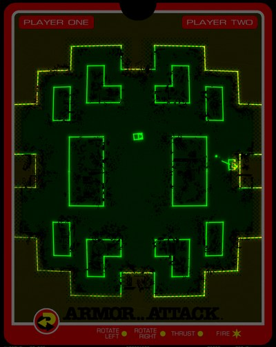</a> 
<em>With their overlays: Mine Storm, Bedlam and Armor Attack, the sheets worn by forty years of handling
(click a picture for the full resolution).</em>

<a href="docs/images/gallery/armor_attack.png">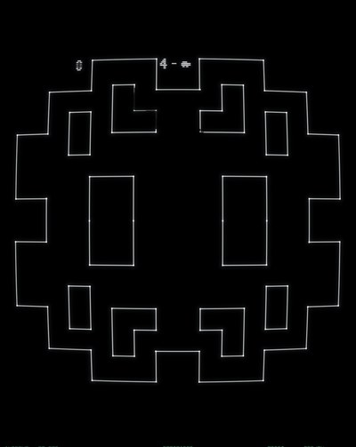</a>
<a href="docs/images/gallery/berzerk.png">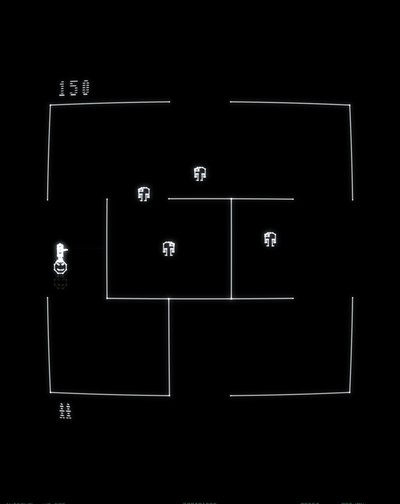</a>
<a href="docs/images/gallery/pole_position.png">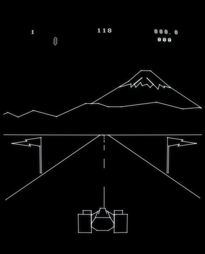</a>
<a href="docs/images/gallery/scramble.png">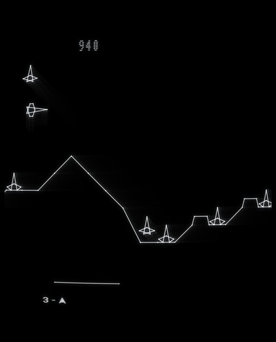</a> 
<a href="docs/images/gallery/spike.png">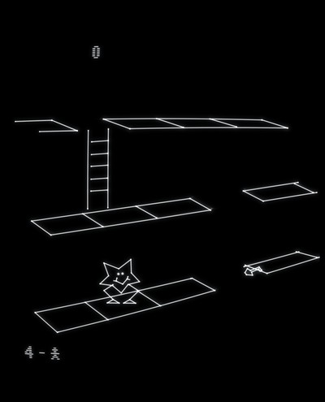</a>
<a href="docs/images/gallery/starhawk.png">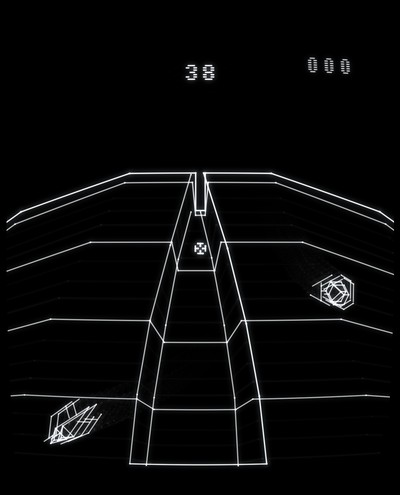</a>
<a href="docs/images/gallery/vectorblade.png">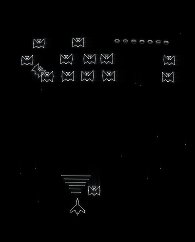</a>
<a href="docs/images/gallery/web_wars.png">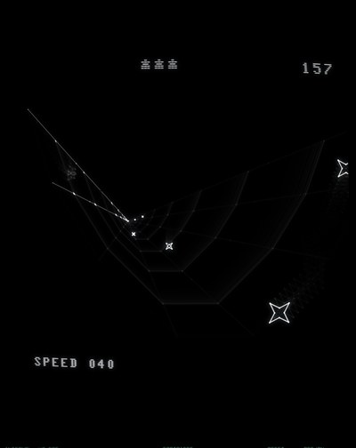</a> 
<em>And without: Armor Attack, Berzerk, Pole Position, Scramble, Spike, StarHawk, Vectorblade and Web Wars
(click a picture for the full resolution).</em>

Below the picture sits the Vectrex's own control panel, drawn in green outlines: the **on-screen display**
(the game's frame rate, the monitor's, the emulation speed, the volume), a **cartridge** you click to
open the **ROM browser**, the **RESET** button and the **volume knob**, which - as on the Vectrex - is
also the power switch.

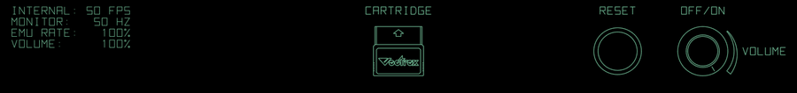 
<em>The panel below the picture: on-screen display, cartridge, RESET and the volume knob.</em>

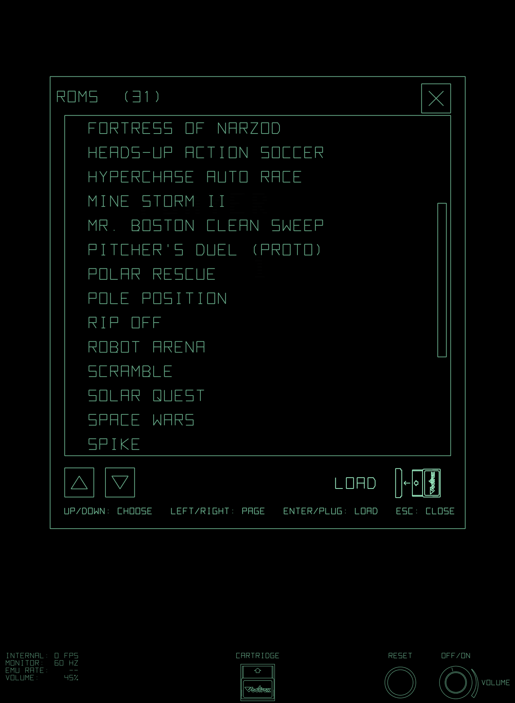 
<em>Click the cartridge: the ROM browser, drawn into the picture (it works in full screen too).</em>

## Features

* Cycle-exact 6809 bus timing, the 6522 as measured, Malban's analog delays (as measured for VIDE)
* Real-time phosphor with the measured afterglow, bloom, glow, curved glass, mains wobble, drift, bending
* The buzz, the built-in speaker, the power switch and a worn volume knob
* Fixed 60 Hz (tear-free on any monitor), the monitor's full rate (120 / 144 / 240 Hz), or G-Sync /
  FreeSync; always at the monitor's full resolution (4K, Retina)
* Two players, keyboard and any controllers at once (Xbox / PlayStation / Switch pads, the Vectrex USB
  controller, flight sticks), mapped per controller with dead zones and endpoints
* Bank-switched cartridges: 64K (PB6), Malban's Vectorblade cartridge with its flash save (as on MiSTer),
  a 512K flash cartridge with a bank latch, 1 MB multi-carts (as Sean Kelly's Multi-Cart)
* Sampled sound and speech through the Vectrex's DAC, and the VecVoice / VecVox speech accessories
* Overlays (MiSTer `.art` and PNG), flat over the curved tube, lit by the room, with forty years of
  scratches made on the graphics card
* Real size (as big as a Vectrex on any monitor), a start size that fits the desktop, the whole screen
  turned in 90 degree steps for a monitor on its side
* Every look and sound setting adjustable and explained in the built-in Help

---

## The story: measuring a Vectrex

**First, a word about the photos.** Glowing phosphor is very hard to photograph faithfully. The eye
sees a CRT differently from a camera: the exposure decides how much of the glow a photo catches, so its
bloom, its brightness and its fading afterglow are never quite what you see in the room. Keep that in
mind with every comparison below. The photos are still valuable - they showed us *where* things happen
and how long they last - but getting the bloom and the decay to *look* right took more than photos. In
the end the most important tool was A/B testing by eye: many rounds with the real Vectrex and the
emulator on an IPS monitor side by side, until the two looked very much alike in real life.

The project started from **vecx**, a long-standing open-source Vectrex emulator, and from one rule:
*nothing gets changed because it "looks nicer" - only because a real Vectrex does it.* So every step was
the same loop: look at the real machine, measure it, change the emulator, compare again.

### 1. Photographing the beam

The first surprise was how different a real Vectrex looks up close. We took long series of close-up
photos of the real tube, game by game, and laid them next to the emulator. The real lines have **gaps**:
the lines of Mine Storm's ship stop short of their corners, and the mines open up at their inner points.

An ideal emulator - one that runs the 6809 exactly but treats the rest as perfect - draws none of that:
every line meets its neighbour, every shape closes.

So where do the gaps come from? They turned out to be timing. The 6809 CPU, the 6522 VIA and its timer,
and the analog integrators that move the beam do not switch together: they start and stop a few cycles
apart. A new value from the DAC reaches the X integrator about 15 cycles late and the Y sample about 14;
the integrators start and stop some 12 cycles after their RAMP signal switches; the timer runs a little
longer than its count (as Malban measured these delays for his VIDE emulator, checked here against our
photos). A line therefore starts a moment late and stops a moment late, and a short line at a corner
can end before the beam got there. We made the emulator run every instruction's bus access in the exact
cycle the real chips do and added those analog delays - and the gaps appeared, in the same places as on
the tube:

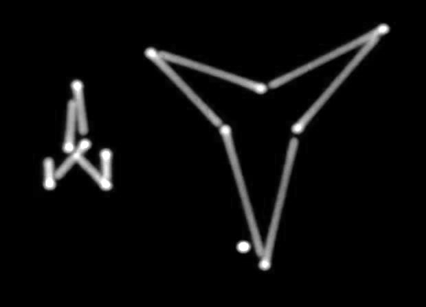
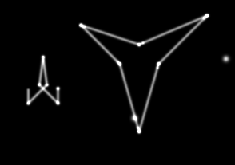
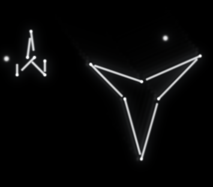 
<em>Left: a real Vectrex (one with unusually wide gaps). Middle: the CPU exact, but the analog side
without its delays - every corner closes. Right: Vectrex_EMU with the delays, set to this machine's wide
gaps: the same short lines and open corners.</em>

The photos showed more than gaps. Where the beam rests for a moment - at a corner, at the end of a
line - the phosphor gets more light and shines as a bright dot, with a soft glow around it; and fast
lines come out thinner and dimmer than slow ones, because the beam spends less time on each spot. The
emulator draws every line with the beam's real speed and every pause with its real length, so these
follow by themselves.

That is the difference between a *perfect* vector display and a Vectrex. An emulator can easily draw
the perfect one - every line equally thin and bright, no dots, no glow, every shape closed - and many
do. It looks clean, and it is exactly what Vectrex_EMU avoids: the character is in the imperfections.

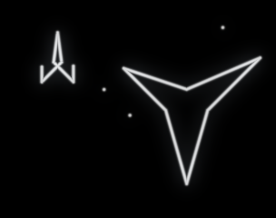
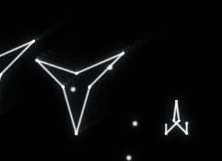 
<em>Left: a perfect vector display - what we avoid. Right: the Vectrex's character, as Vectrex_EMU draws
it. (Anyone who prefers the perfect look can have it: <b>Tube > Even beam</b>.)</em>

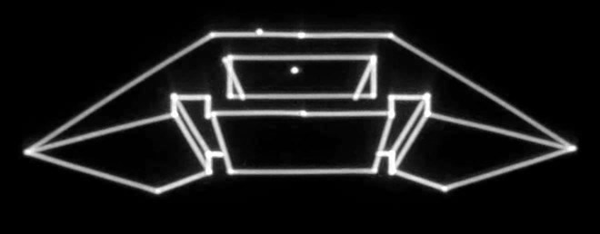
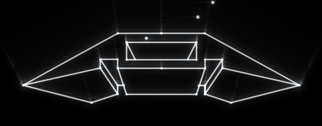 
<em>Mine Storm's mothership: real (left) and emulated (right).</em>

### 2. Filming the glow

A vector screen has no frames; it has *phosphor*. We filmed the Vectrex title fading to black and measured
the light frame by frame: the glow drops to ~15 % at once, then fades over about two seconds along two
curves. The emulator lights the phosphor at the exact moment the beam passes each spot and lets it fade
along that measured curve, sixty times a second, whatever frame rate the game runs at. A moving object
leaves a real trail, not a stack of copies - checked against Mine Storm's big mothership, which on the
real tube leaves one smooth trail.

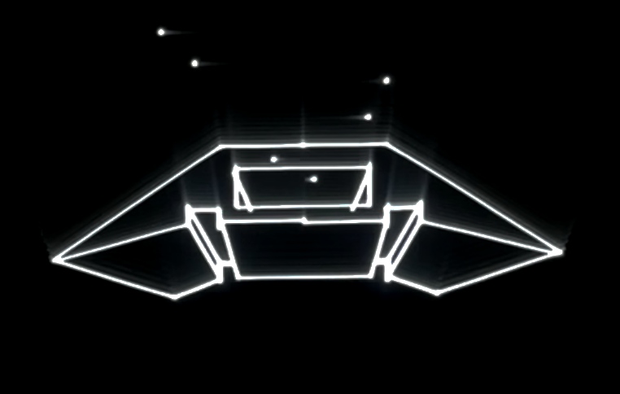
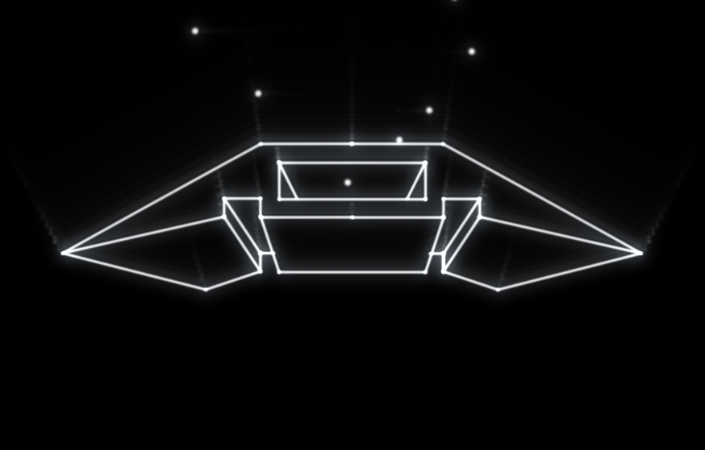 
<em>Mine Storm's mothership on the move: the trail of fading phosphor it leaves on a real Vectrex (left) and in Vectrex_EMU (right).</em>

### 3. Listening

The Vectrex is not quiet. The beam's currents leak into the audio amplifier, so the speaker **buzzes**
along with what is drawn - louder with more lines, at the game's frame rate, never quite silent. We
recorded it, together with the small built-in speaker's sound, the click of the power switch and the
crackle of a worn volume knob. All of it is in: the buzz is generated from the actual vectors each frame,
the sound plays through a model of that speaker, and turning the knob (which is also the power switch)
scratches, crackles and sometimes cuts out, as an old potentiometer does.

### 4. Asking the chips directly

Some things can't be seen in a game, so we wrote **test cartridges**: small 6809 programs that ask the
hardware a question and print the answer on screen. They were flashed to a real cartridge, run on the
real Vectrex, photographed - and then the emulator was changed until it printed the same numbers.

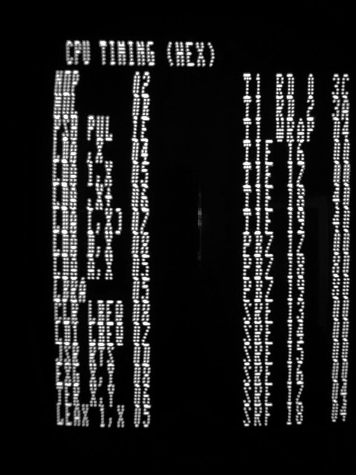
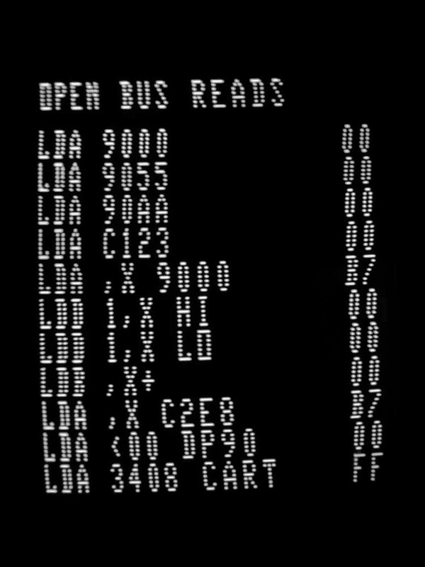
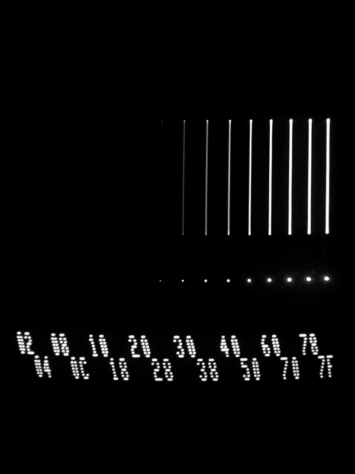 
<em>Test cartridges on the real Vectrex: CPU and timer cycles, open bus reads, beam brightness.</em>

* **CPU timing**: 32 measurements of instruction cycles and the 6522's timers and shift register. vecx
  was off in several places (a timer running one cycle long, a flag set too early, a timer that stopped
  when read). All 32 now match.
* **Open bus**: what the CPU reads where no chip answers. The real Vectrex returns the last byte on the
  data bus; vecx returned garbage. That tiny detail decides a famous glitch (below).
* **Sample and hold**: how fast the Y axis follows a jump - measured, modelled.
* **Brightness**: a page of bars and dots at 16 intensities shows exactly where a dim beam disappears on
  the real tube (10 lines and 10 dots still visible) - the emulator cuts off at the same step.

### 5. The Mine Storm bug

Mine Storm, the game built into every Vectrex, has a rare bug: when a mine splits at the wrong moment,
the game reads a stray list of vectors. On the emulator this froze the game for seconds and drew a long
diagonal streak. We logged sessions until it happened, traced it to the exact instruction - and then
tested the real hardware: on the real Vectrex, the built-in Mine Storm shrugs it off, while the same
game on a cartridge glitches for a second or two. The difference is the open bus. With the measured
open-bus behaviour, Vectrex_EMU now does exactly what the real machine does - in both cases.

### 6. The analog side

Things no digital emulator has, because they are analog:

* **Drift**: the integrators' zero point wanders, so a shape drawn as one loop doesn't quite close -
  calibrated against photos of test patterns on the real tube.
* **Mains hum**: the power supply's 50 Hz hum pushes the beam a little. A game that finishes each frame
  within the Vectrex's budget of 30,000 CPU cycles runs at 50 frames a second, in step with the hum:
  every frame is pushed the same way and the picture stands still. But a busy scene - lots of vectors on
  screen - can need more cycles than that. The frame takes longer, the game slows to, say, 48 fps, and
  its frames slip against the hum: the picture starts to sway (a scene far over budget wobbles faster).
  At 25 fps, exactly two hum waves per frame, it is in step again and stands still. Vectrex_EMU works out
  the hum at the exact moment each line is drawn, so its games wobble exactly when a real Vectrex's do.

  
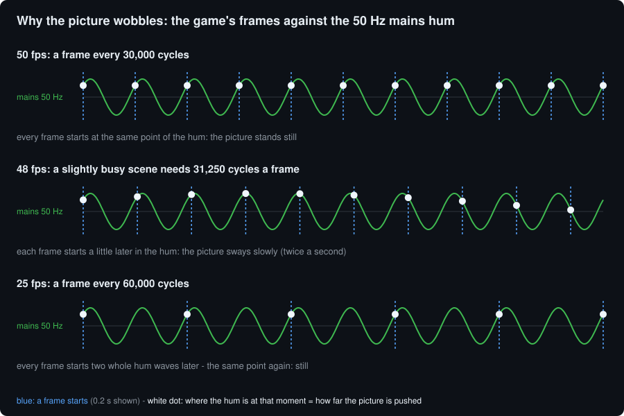

  
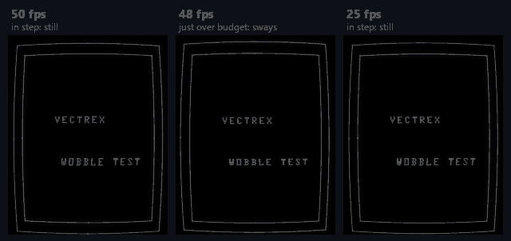 
  <em>A still test picture (testcart/wobble_test.asm) at 50, 48 and 25 fps. For demonstration only: the
  wobble is exaggerated about ten times and the animation runs at half speed, not in real time.</em>

* **Brightness bending**: the high voltage sags with a busy screen; the picture breathes.
* **The tube**: curved glass, glow around resting spots, a soft round spot - and switching off makes the
  picture shrink away with a last flash of the beam, as the real one does.

The result is not a "filter" laid over a clean picture: the imperfections come out of the emulation.

### 7. One choice: how wide the gaps are

Everything above copies the real machine. One thing is a choice. How *wide* the gaps in the lines are
(chapter 1) varies from one Vectrex to the next: component tolerances and age shift the analog timing,
so some machines show wide gaps and others barely any. The Vectrex in our photos has exceptionally wide
ones. Rather than copy this one machine, Vectrex_EMU keeps the gaps where they belong but, by default,
at the size of a better tuned - or less worn - Vectrex: a tighter tube. **Tube > Line gaps** sets them
to taste: the integrators' stop delay, 9.3 cycles (corners nearly closed) to 15.3 (wide, like the
machine in the photos), 12.3 by default.

 
<em>The default (12.3 cycles): the same gaps in the same places as on the real machine in chapter 1, but tighter.</em>

### 8. Speech: two rare modules

A handful of Vectrex games and demos talk - or sing - through a speech module plugged into the second
controller port. There are two: the **VecVoice** (Richard Hutchinson), built around General Instrument's
SP0256-AL2 speech chip, and the **VecVox** (Alex Herbert), built around Magnevation's SpeakJet. Both were
hobbyist boards made in small numbers, long out of production; today they are very hard to find.

**How they work on a real Vectrex.** The game sends bytes over a serial line it bit-bangs on the sound
chip's I/O port (bit 4 of port A, 9615 baud); the module answers "ready for the next one" on port 2's
button lines. The VecVoice takes SP0256 *allophones* - 64 small speech sounds from the chip's 2 KB ROM,
put together by a 12-pole digital filter. The VecVox takes SpeakJet codes: 72 phonemes plus codes for
pitch (in Hz), speed, stress and volume, which is how VecVox X-Mas sings its tunes. The speech comes out
of the module's own amplifier, not the Vectrex's speaker.

**How we built them.** Without the modules on the desk, we worked from what is documented and from
recordings of the real ones, comparing A/B by ear:

* **VecVoice**: the SP0256 is fully documented, and MAME has a faithful emulation of it (Joe Zbiciak
  and Tim Lindner); Vectrex_EMU runs a C port of it, with the serial link as the MiSTer core models it.
* **VecVox**: how the SpeakJet makes its sounds was never published - it is a programmed chip that has
  never been read out. So the VecVox speaks with the SP0256's voice: every SpeakJet phoneme becomes the
  nearest SP0256 sound(s), stretched to the SpeakJet's length and sung at the SpeakJet's pitch. Its
  speed law was fitted to a recording of VecVox X-Mas: 25.9 s against the recording's 25.2 s, most
  notes landing on the beat. A formant synthesizer built from the same recording was tried as well; side
  by side, the SP0256-based voice sounded more like the real thing, so that is the one that stayed.
* **The level** follows the MiSTer core's speech mix (Sorgelig's compressor), 50 % louder, with an
  arcade-style bass for big speakers - most owners plug better speakers into the module than the
  Vectrex's own.

How to plug one in, the speech ROM you need (a free download) and the games that talk:
[Speech modules](#speech-modules).

### 9. Overlays - and forty years of scratches

Every Vectrex game came with a printed plastic **overlay** for the screen: see-through colour tints the
vectors behind it, solid print adds the borders, the artwork and the game's name. The emulator reads the
MiSTer core's overlay files (`.art`) and plain PNG images, and lays the sheet over the finished picture:
the coloured plastic multiplies the light that comes through it, the print shines in the room's light,
and the sheet stays **flat** - the curved tube bends the vectors behind it, not the overlay. It sits
just in front of the glass, so seen from the usual height the picture sits a little higher on it
(**parallax**, as on MiSTer). With **Display > Real size** the sheet is exactly as big as a real one,
162 x 207 mm.

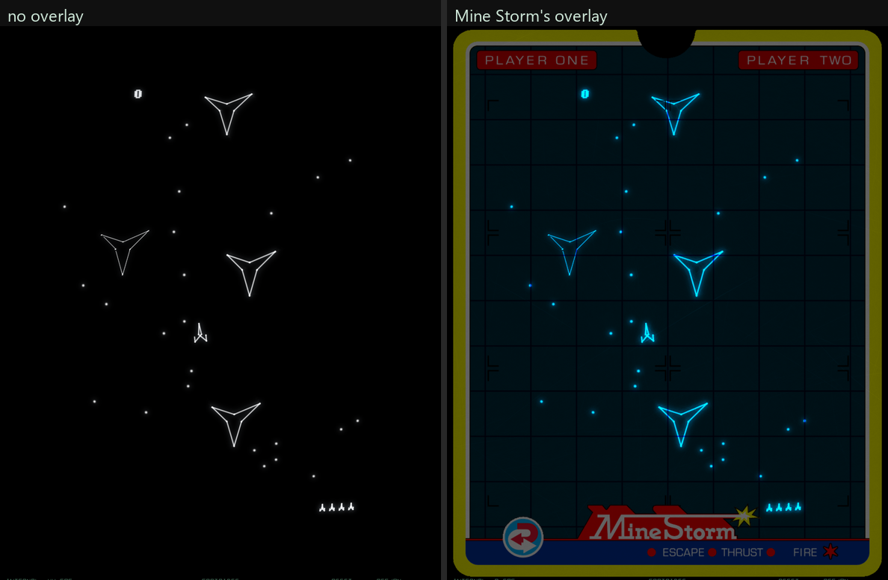 
<em>Mine Storm without and with its overlay (the one overlay that comes with the emulator).</em>

**Room light** lights the sheet itself: in an evening room the plastic is nearly black and only the
vectors show; in daylight the colours and the print come up. The plastic's light follows the setting
steeply, the print more gently, and **Printed art brightness** sets one against the other.

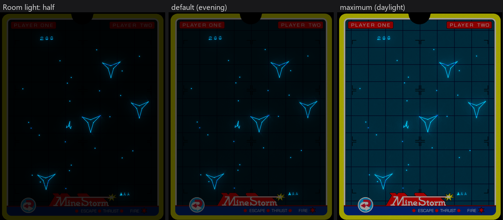 
<em>Room light at half, at the default (an evening room) and at the maximum (daylight).</em>

**The scratches.** A real overlay is forty years old. Decades of being handled, wiped and stored have
left it slightly **matte**, criss-crossed by countless fine scratches - and, here and there, a longer,
deeper one. In the dark you hardly see them, until a vector lights them from behind: then the fine ones
make a soft matte halo around the line, and the scratches that happen to run *across* the light catch it
and glint, so around a bright spot they form a little ring of dashes, like a sun drawn by a child.

Getting that right took about thirty rounds of pictures, each compared with real sheets. The first
scratches were far too big - they looked like damage. Real wear is finer: a matte buff, millions of
scratches too small to see one by one, 5 to 35 mm long, in every direction, crossing every spot many
times over; it makes the plastic duller in its own colour, never whiter. On top of that sit fewer,
longer, deeper scratches - and those follow a rule: each step has about 4.6 times fewer, a little longer
and deeper, down to one single deep scratch. The recipe that matched best:

* 1 million fine scratches (5 - 35 mm; counted over MiSTer's whole frame, about 620,000 on the sheet itself), then nine steps of 215,000, 46,000, 10,000, 2,150, 465, 100, 22, 5
  and 1 scratch, each step's lengths spread from 0.4 to 2.5 times its typical length (up to 100 mm);
* their depth stays low for a long time and then rises fast, so only the last few really stand out;
* every one slightly bent - drawn by a grain of sand under the sheet, not by a machine - at a random
  angle, and more of them where hands hold a sheet (the middle, the lower half, the edges) than in the
  corners.

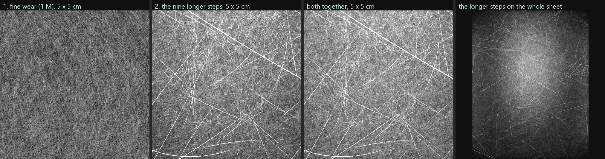 
<em>The scratch layers as the graphics card holds them, white = deeper: the fine wear, the nine longer
steps, both together (each a 5 x 5 cm patch), and the longer steps on the whole sheet - denser where the
sheet is held.</em>

The graphics card draws all of them - almost 900,000 lines - into two textures in about 50 ms, once,
when an overlay is loaded; per scratch it keeps its depth and its direction, so the shader can work out
the glint for any direction of light. After that they cost about a millisecond per frame. Each overlay
has its own pattern, as every real sheet is worn its own way, and **New random scratches** deals a new set.

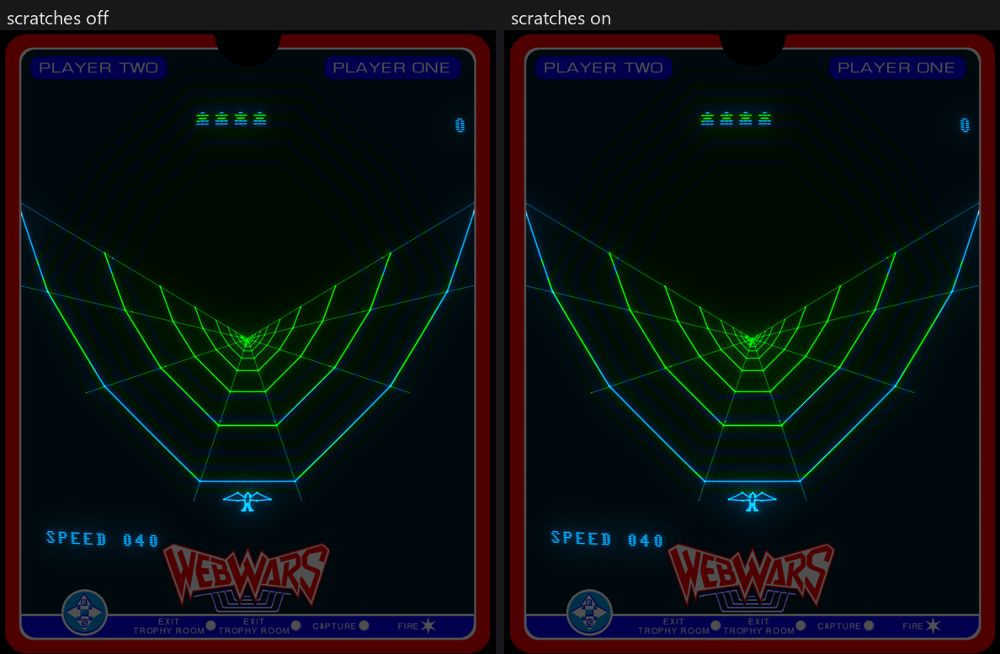 
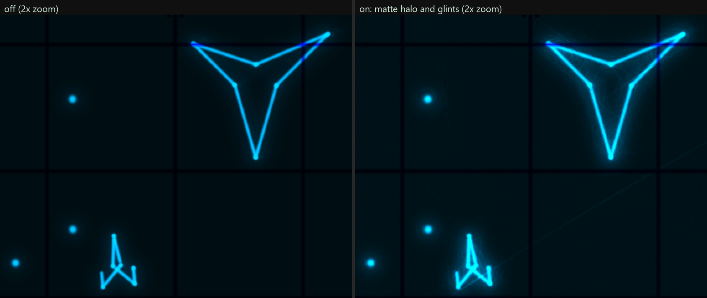 
<em>The same moment without and with the scratches (on by default): the matte halo around the lines,
the glints around the bright spots.</em>

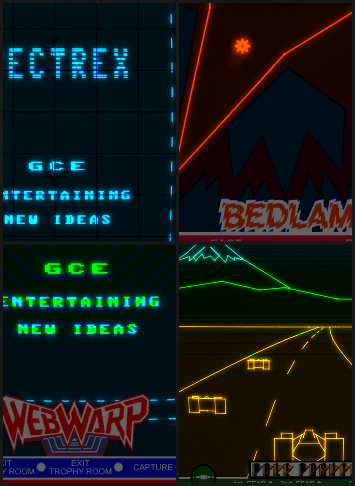 
<em>Worn sheets in play: the start screen, Bedlam, Web Warp and Pole Position - the scratches light up
only around what is drawn.</em>

**Overlay > Scratches** switches them; **Wear** sets the number and depth of the fine ones, **Damage**
the larger ones, **Glint strength** how strongly they catch the light:

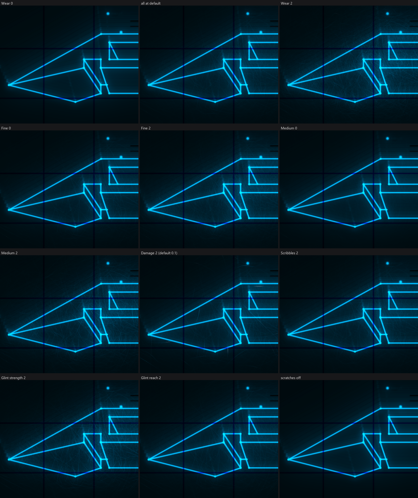 
<em>Mine Storm's ship and a mine (2x zoom) with Wear, Damage and Glint strength at 0, 1 (default) and 2.</em>

---

## Using it

### Switching on

The volume knob is the power switch (Page Up, the mouse wheel over the knob, or a click on its right
half): it clicks on, the tube warms up and the BIOS start screen plays. **Vectrex > Start switched on** skips the knob; **Vectrex > Skip the Vectrex
intro** runs the BIOS start screen (the VECTREX logo, its tune and the game's title, ~13 s) unseen in a
fraction of a second at every power on, so the cartridge starts at once - in the same state as after the
real intro. Both are saved.

### Help

**Help** in the menu bar opens a help window: every menu option explained, with **More** buttons that
unfold the history and the mechanics behind it (the phosphor, the mains wobble, the buzz, bending, the
analog drift), plus the Vectrex itself (CPU and cycles, RAM, the 6522, the sound chip and its limits),
cartridges, bank switching and saving. The text lives in `src/frontend/help_text.py`.

### Menus and sliders

Every option is in the menu bar (Vectrex, Display, Tube, Overlay, Sound, Help); options that are on have a tick,
the few that also have a key show it. Values (volume, bloom, afterglow length, wobble, bending, buzz)
open a small slider window: drag or click on the bar to set it, **right click for the default**, Esc
closes it. The defaults are the faithful values - measured on a real Vectrex or chosen side by side with
one - so each slider has its default **in the middle**: from 0 on the left to twice the default on the
right, for personal adjustments; it shows how far you are from the default. (The volume knob goes
0-100 %: 0 % is the power switch.) Each menu ends with its own **Reset ... settings to default**
(Vectrex, display, tube, overlay, sound): it resets only that menu's settings. In full screen there is
no menu (with G-Sync, Windows hides menus there): the [keys](#keys), the knob and the cartridge work there.

**Volume knob on screen** (Display menu, default on): the Vectrex's own panel as simple green
outlines in the strip right below the picture, lined up with its right edge - in the window and in
full screen alike: the volume knob with its position marker, OFF/ON and VOLUME, and the RESET button.
Mouse wheel over the knob or a click on its right / left half turns it up / down (down to 0 % switches
the Vectrex off); a click on RESET presses it.

**Cartridge on screen** (Display menu, default on): a Vectrex cartridge below the middle of the
picture. Click it (or L): the ROM browser opens over the picture with all ROMs in the folder
**`roms` next to the program** (subfolders too; `.bin`, `.vec`, `.gam`, `.rom`; no folder or no
ROMs: the list is empty). The game runs on behind it but gets no input. Up / Down choose, Left / Right
a page, the mouse wheel or the arrow buttons scroll; Enter, a double click or the plug loads the chosen
ROM (a power cycle with it); Esc, the X or a click outside closes it. Drawn in the picture, so it works
in full screen with G-Sync too.

**Display > Real size (9):** as big as on a real Vectrex: the overlay sheet 162 x 207 mm, as the real ones (the picture as tall as the sheet), worked out from your
monitor's size and resolution. Windows usually knows the monitor's size (the monitor reports it); if
it does not, or a TV or projector reports it wrong, set **Display > Monitor size** (the diagonal in
inches; right click: as the monitor reports it). Check it with a ruler: an overlay should be 162 mm wide
and 207 mm high. On macOS and Linux set the monitor size first.

**Display > Screen:** fixed 60 Hz (default: smooth and tear-free on any monitor), the monitor's full
rate (vsync on every refresh - 120, 144, 165, 240 Hz...: the afterglow fades in finer steps and moving
things update more often; on a 60 Hz monitor the same as 60 Hz), or G-Sync / FreeSync (one screen
frame per game frame: no tearing, the wobble stands still at 50 fps; needs such a monitor). Always at
the monitor's own resolution (e.g. 4K).

**On-screen display** (Display menu, default on): INTERNAL (the game's frames per second), MONITOR
(the screen's refresh), EMU RATE (green 100 %, orange / red when the PC cannot keep up), VOLUME, and
SPEECH VOL when a speech module is plugged in - below the picture on the left.

### Keys

Only what full screen needs has a key, so the rest of the keyboard is free for the players:

| Key | |
|---|---|
| F11 | full screen on/off |
| Esc | closes the ROM browser; in full screen: back to the window; in the window: quit |
| L | the ROM browser (the Windows file dialog: Vectrex > Open ROM file) |
| O | the overlay on / off |
| Ctrl+E | eject the cartridge (Mine Storm) |
| Ctrl+R | the RESET button (RAM kept: the BIOS warm-starts the cartridge, no intro) |
| P | pause |
| Page Up / Page Down | the volume knob in 5 % steps - and, as on the Vectrex, the power switch: turned down to 0 % it clicks off (the tube fades to black), turned up from 0 % it switches on (a cold start, also for carts that ignore RESET), with the real power-off / power-on sounds. While turning it scratches like a worn potentiometer; now and then it stops on a dead spot: the game goes silent, the buzz goes on - turn it again. |
| Ctrl+Page Up / Ctrl+Page Down | the speech module's own volume (VecVoice / VecVox) in 5 % steps, 0 - 200 % (100 % = the MiSTer core's Normal level) |
| + / - / 0 | window size / start size (as big as fits the desktop, above the task bar); in full screen: the picture size |
| 9 | real size: the picture as big as on a real Vectrex, in the window and in full screen (until + / - / 0) |

These keys (and everything with Ctrl) cannot be given to a player: F11, Esc, Page Up / Down, + - 0 9, P L O.
Only Ctrl+E and Ctrl+R need Ctrl - they end the game.

(The mouse pointer hides in full screen 2 s after it last moved.)

### Controls

**Vectrex > Controls** (in the window): both players - the 1st and the 2nd controller port. Each
player picks a **controller** from the ones connected, listed by their own names (e.g. "Vectrex USB
Controller", "Logitech Extreme 3D"; Xbox-type XInput pads and other USB gamepads / joysticks), or
**Keyboard only**. A controller belongs to one player: the other player's list does not offer it.
A controller first chosen is mapped at once: its X / Y axes = the Vectrex stick, its buttons 1-4 = the
Vectrex buttons 1-4 (an Xbox pad: the left stick and X Y A B); a hat / d-pad is the stick too.

**The keyboard always works as well**, next to the controller: the buttons add up, and a direction
key overrides the stick on its own axis (holding the stick up while pressing Right = up-right; pressing
A while the stick is held = button 1 with the stick still held). No switching needed to try a game on the keyboard.

Click a box, then press a key / a controller button, or push the stick the way the row says (Up: push
up...: that picks the axis and its direction); Shift+click adds a second; right click clears (a stick
box: back to the default axis). The emulator's own keys (see [Keys](#keys)) cannot be
taken. Each controller keeps its own mapping: switching controllers needs no new mapping.

**Stick:** per controller **analog stick** or **buttons**. Analog: a bar per axis (X, Y) shows the real
stick (ring) and what the Vectrex gets (fill); drag the inner handles for the **dead zone** and the outer
ones for the **endpoint** - the stick position that already gives full deflection, so a joystick with a
long travel does not need to be pushed all the way (right click: back to 20 % dead zone, full travel).
**Link X and Y** (on by default) moves both axes' handles together; untick it to set them apart.
Buttons: the Up / Down / Left / Right (and Half stick) rows take controller buttons instead of axes -
full deflection, half with the half button. A hat / d-pad works as the stick in both modes. The **test
field** per player shows the stick (ring), the dead zone (dark square), the endpoints (dashed), what the
Vectrex gets (dot, with the x / y values) and buttons 1-4 lighting up. Reset to defaults.

Defaults: player 1 - arrows, A W S D = buttons 1-4, Shift = half stick, and the first controller found.
Player 2 - keyboard only, no keys: pick a second controller, or keys of your own. A chosen controller
that is unplugged is shown as "not connected" (the keyboard still works) and is used again when it is
plugged back in. The keys only count while the emulator's window is in front.

**Settings** (window size, look, sound, volume, controls, overlays, the last ROM) are saved in
`Vectrex_EMU.conf` next to the program, so the folder is portable: copy it and the settings come along.
If that folder cannot be written (e.g. under Program Files) they go to `%APPDATA%\Vectrex_EMU` (Windows),
`~/Library/Application Support/Vectrex_EMU` (Mac) or `~/.config/Vectrex_EMU` (Linux). Nothing else is
written: no logs, no recordings.

### Overlays

Put overlay files in **`roms/overlays`** (or `overlays` next to the program), named like the ROM -
`Armor Attack.bin` finds `Armor Attack.art`. Two formats:

* **MiSTer `.art`**: get them from the MiSTer Vectrex core ([Vectrex_MiSTer](https://github.com/Videodr0me/Vectrex_MiSTer),
  its `overlays.zip`; see its `CREDITS.md` for each design's author). Copy them in as they are: MiSTer's
  names are found too - underscores count as spaces, and `(...)` parts, versions and a trailing "Proto"
  are ignored (`ArmorAttack.art`, `Armor_Attack.art`, `Dark_Tower_Proto.art` and `VectorbladeV1.13.art`
  all find their game; hacks such as `Berzerk (Hack - Speed, 2016).bin` find `Berzerk.art`). Only the
  normal files are needed, not the `_90CW` / `_90CCW` ones in its `Tate` folder: the emulator turns the
  whole screen itself (**Display > Rotate screen**).
* **PNG**: an image with transparency (8-bit RGBA), the sheet 846 x 1080 (or the same proportions) or the
  whole 1360 x 1080 MiSTer frame with the sheet in the middle. Alpha 255 is solid print, 1 - 254 coloured
  see-through plastic (MiSTer's tools use 51), 0 clear; without transparency it is all see-through, black clear.

Several overlays for one game (`Spike.art`, `Spike (red).art`): the plain one is chosen; pick another with
**Overlay > Choose overlay...** (remembered per game). The ROM browser does not list the overlays folder.

The **Overlay** menu has the rest - on / off (**O**), choose / none per game, tint, room light, printed
art, parallax, the scratches, a fine position / size per overlay - each explained in
[chapter 9](#9-overlays---and-forty-years-of-scratches) and in the built-in Help.

**Mine Storm's overlay comes with the emulator** (`bios/bios.art`, inside the Windows exe), for the game
built into the console; an overlay of your own named `bios`, `Mine Storm (built-in game)` or
`Mine Storm` takes its place. It is the [Libretro overlay-borders](https://github.com/libretro/overlay-borders)
Mine Storm artwork as converted to `.art` by the [Vectrex_MiSTer](https://github.com/Videodr0me/Vectrex_MiSTer)
project (`Mine_Storm.art` in its `overlays.zip`).

*Disclaimer: the overlay artwork is not part of this project and not covered by its licence; it belongs
to its creators and is included unchanged as a courtesy, for non-commercial use. Vectrex is a trademark
of its owners; this project is not affiliated with them, Libretro or MiSTer. On request it will be
removed. Other overlays do not come with the emulator: the artwork has several authors and terms.*

### Speech modules

**Vectrex > Controller port 2** plugs a speech module into the second controller port instead of a
joystick: the **VecVoice** (SP0256) or the **VecVox** (SpeakJet). How they work and how they were
built: [chapter 8](#8-speech-two-rare-modules).

**They need the speech ROM**, which cannot be included: the SP0256-AL2's built-in ROM is (c) Microchip
Technology Inc. Joe Zbiciak distributes it with Microchip's permission:

1. Download `al2.bin` (2 KB) from [spatula-city.org/~im14u2c/sp0256-al2](http://spatula-city.org/~im14u2c/sp0256-al2/).
2. Put it in the **`bios` folder next to the emulator** (as `al2.bin` or `sp0256-al2.bin`; MAME's
   `sp0256-al2.bin`, the same data with each byte's bits reversed, works too).
3. Choose **Vectrex > Controller port 2 > VecVoice** or **VecVox**. The Vectrex is switched off and on.

Both modules need it (the VecVox speaks with the SP0256's voice). Without it the setting stays on Joystick.

**Sound > Speech module**: its own **Volume** (also Ctrl+Page Up / Down; SPEECH VOL on the on-screen
display, 100 % = the MiSTer core's Normal level), and **Full-range speakers** (an arcade cabinet's warm
bass) or a **Small speaker**.

**Port 2's buttons:** a module answers "ready" on port 2's button 2, so to the Vectrex it looks like
player 2 holding button 2, as with a real module plugged in. **GCE's original Berzerk** waits for every
button to be released and will not start - choose Joystick for it; **Berzerk Ultimate** (Malban) starts
and talks. Two-player games lose their second player while a module is plugged in.

#### Games that talk

Pick the device the game was written for: **VecVox** for SpeakJet games, **VecVoice** for SP0256 games
(a real VecVox or AtariVox+ has a VecVoice mode for those, chosen with a button held at power-up or a
DIP switch). With the wrong one the speech comes out garbled, as with the wrong real module.

| Game | Device | Tested here |
|---|---|---|
| Berzerk Ultimate (Malban) | VecVox | talks |
| Brecher (2015) | VecVox | |
| Color Clash | VecVox | |
| Debris (Revisited) | VecVox | |
| RushHour | VecVox | |
| Shifted | VecVox | |
| Space Frenzy (John Dondzila, 2006) | VecVox | talks |
| Spike's Circus | VecVox | |
| VecFahren (Der Luchs, 2013) | VecVox | talks |
| Vectoblox | VecVox | |
| Vectorblade (Malban) | VecVox | talks ("level one") |
| V:Hockey | VecVox | |
| VecVox X-Mas (2005) | VecVox | sings |
| VecTalk (Binary Star, 2018), VecVox Demo, VecVox Driver Demo | VecVox | talk |
| B.E.T.H. (Manu) | VecVoice | talks |
| Deathchase | VecVoice | |
| NOX | VecVoice | |
| Pythagorean Theorem (Rob Mitchell, 2002) | VecVoice | |
| Verzerk (Alex Herbert, 2002) - a talking Berzerk | VecVoice | talks |
| Y.A.S.I. (John Dondzila; on "Protector & YASI") | VecVoice | |
| VecVoice Demo (Richard Hutchinson, 2002) | VecVoice | talks |

From the AtariVox+ list ([AtariAge](https://atariage.com/store/index.php?l=product_detail&p=1045),
[review](https://www.atari7800forever.com/autovox.html)), [vectrex.co.uk](http://www.vectrex.co.uk/news-2009.htm)
and [Revival Studios](https://www.revival-studios.com/vectrex.php); the lists date from 2009-2015 and
partly disagree (Space Frenzy is filed under VecVoice in places - its speech is SpeakJet codes). Malban's
two games are on none of them; newer games may be missing too.

### Cartridge hardware

**Vectrex > Cartridge hardware** (saved): **Auto** (the default) models the bank-switching cartridge
boards, chosen by the ROM's size; or pick one board for any ROM:

* **up to 64K** - PB6 drives the EPROM's A15 (3.3K pull-up: an input PB6 reads high, bank 1 at power-on).
* **over 64K, up to 256K** - Malban's Vectorblade cartridge (SST39SF020A flash): two bank lines, PB6 and
  the cartridge port's /IRQ (low while an enabled VIA interrupt flag is set), bank = PB6 + 2 x (/IRQ
  high), 64K per bank of which the cartridge shows $0000-$BFFF; power-on bank 3. The flash is modelled
  (program, sector / chip erase, ID): the game's high scores and settings are saved to `<rom>.sav` next
  to the ROM, the dump itself is never changed.
* **exactly 512K** - a 512K flash cartridge with a bank latch (Hugo Bokhorst's v2 board, SST39SF040):
  A15 = PB6, A16-A18 = a 74HC377 that a write to $0000-$3FFF loads with the data's bits 0-2 (clock =
  /CART OR A14), 16 banks of 32K. The latch has no reset: it powers up in any bank, the RESET button
  keeps it. Flash saves as above (`<rom>.sav`); the flash's commands load the latch with $55 on their
  $2AAA write, so a game saves in $4000-$7FFF of a bank with A16-A18 = 101.
* **other images over 256K** - a 1 MB multi-cart (as Sean Kelly's Multi-Cart): a latch written at $7FFF picks
  the 4K page the cartridge window starts at; power-on page 0 (the menu); the RESET button keeps the page.

**Off**: a bone-stock Vectrex - every ROM is a plain 32K cartridge (the first 32K of the file, no bank
switching), so bank-switched games do not start. Changing it puts the cartridge in again (power cycle).

### Mac and Linux notes

The same emulator, everything in this README applies. The BIOS and Mine Storm's overlay sit in the
**`bios` folder next to the program**. If macOS ever says the BIOS is missing, it is running the app from
a hidden copy: drag `Vectrex_EMU.app` out of its folder in Finder and back in (or once in Terminal:
`xattr -dr com.apple.quarantine Vectrex_EMU.app`).

On a Mac the Ctrl shortcuts work with Command as well: ⌘E eject, ⌘R RESET, ⌃⌘F full screen (also fn+F11),
⌘Q quits; Page Up / Down are fn+↑ / fn+↓ on a MacBook; the right mouse button is Ctrl+click. On a Retina
screen the picture is drawn at its full resolution, and at the full rate a ProMotion screen runs at 120 Hz.

Controllers work through SDL2: an Xbox, PlayStation or Switch pad shows up like the Xbox pad on Windows,
any other joystick by its own name. Settings files move between all three systems as they are.

---

## Building from source

For tinkerers - the [releases](../../releases) are built from the same sources by the GitHub workflow
(`.github/workflows/build.yml`), which also checks that each one starts.

* **Windows**: `build_exe.bat` builds the core (`build_core.bat`, needs Visual Studio Build Tools with
  C++), installs PyInstaller if needed and makes `Vectrex_EMU.exe` with the BIOS and Mine Storm's overlay
  inside (needs Python 3.12 from python.org). `run_from_source.bat` runs straight from the sources (after
  `build_core.bat`).
* **macOS / Linux**: `build_mac.sh` (the python.org Python 3.12) and `build_linux.sh`. The platform side
  (OpenGL context, keys, controllers, sound) is `src/frontend/osdep.py`; on Windows the program uses the
  Windows APIs directly. `tools/snapshot_test.py` checks the OpenGL picture.

| Path | |
|---|---|
| `src/core/` | the core (C): `vecx.c` CPU bus and analog model, `e6809.c` CPU, `e8910.c` / `psg.c` sound chip, `live.c` the frame pipe to the front end, `vtest.c` main (also a scripted test harness), `sp0256.c` / `speakjet.c` the speech modules, `ds2431.c` a 1-Wire save chip, `bot.c` a test player |
| `src/frontend/` | `vectrex_emu.py` window, input, sound, settings, menus; `vecrender.py` the OpenGL renderer (beam, phosphor, overlays, scratches); `vart.py` overlay files; `help_text.py` the built-in Help |
| `bios/` | the Vectrex BIOS (`bios.bin`, with Mine Storm) and Mine Storm's overlay (`bios.art`) |
| `sounds/` | the power-on / power-off sounds, recorded on a real Vectrex |
| `package/` | the folders and notes that go into each release zip |
| `testcart/` | the test cartridges (6809 assembly) used to measure the real Vectrex |
| `docs/` | the pictures, and [TECHNICAL.md](docs/TECHNICAL.md) |

Build outputs (`core/`, `build/`, `Vectrex_EMU.exe`, `dist-*`) are not in the repository.

## Credits and license

Vectrex_EMU is free software under the **GNU General Public License v3** ([LICENSE.md](LICENSE.md)), the
license of the vecx emulator it is built on.

* **vecx** - the original emulator core.
* **MAME** - the SP0256 synthesizer in `src/core/sp0256.c` is ported from MAME's sp0256.cpp
  (BSD-3-Clause, Joseph Zbiciak and Tim Lindner).
* **The MiSTer Vectrex core** (Dar, Sorgelig, alanswx, Videodr0me) - the DAC sound mix, the power-on seed,
  the VecVoice link and the speech level (Sorgelig's audio compressor table) follow it; its `.art`
  overlay format and overlays; Mine Storm's overlay (Libretro artwork, see [Overlays](#overlays)).
* **Malban** - the analog delays measured for VIDE, and Vectorblade's cartridge.
* **The SP0256-AL2 ROM** is (c) Microchip Technology Inc., distributed by Joe Zbiciak with Microchip's
  permission; it is not part of this project.
* **The Vectrex BIOS**: Smith Engineering allows it to be copied freely for non-commercial use.

Vectrex_EMU by Hugo Bokhorst, developed with Claude (Anthropic) as development assistant and programmer.
