# Vectrex_EMU

**A Vectrex emulator that doesn't try to be perfect. It tries to be a Vectrex.**

<p align="center"></p>

The Vectrex (GCE / Milton Bradley, 1982) is the only home console that ever drew its games with a real
vector beam: one electron beam, steered by analog circuits, tracing every line straight onto the
phosphor of its own built-in 9-inch screen. Most emulators show what the games *meant* to draw: clean,
sharp lines on black. A real Vectrex never looks like that. Its lines are made of moving light; corners
glow where the beam rests; shapes don't quite close because the analog circuits drift; text has gaps;
the picture wobbles with the mains hum; everything leaves a fading trail; and the speaker buzzes along
with whatever is on screen.

**Vectrex_EMU is built to show all of that** - measured on a real Vectrex, not guessed. Ready to run on
**Windows, macOS and Linux**: [download it from Releases](../../releases).

**Author:** Hugo Bokhorst ([@hugonl31](https://github.com/hugonl31)) - the idea, the real Vectrex, every
photo, recording and measurement, and every call on how it should look, sound and feel.<br>
**Development assistant and programmer:** Claude (Anthropic).

## New in v1.2.0 - everything since v1.0.5

<p align="center">
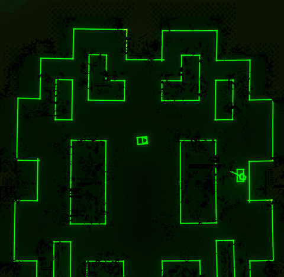<br>
<em>v1.1.9: Armor Attack's helicopter - every rotor position flashes once, razor sharp, and fades as on the tube.</em>
</p>

<p align="center">
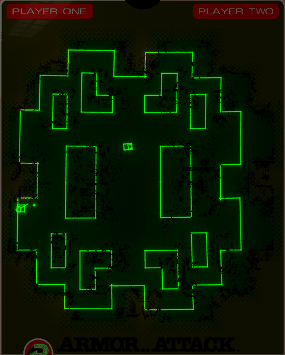<br>
<em>Head tracking: the playfield shifts behind the Armor Attack overlay as the head moves (largest shift 4 mm here).</em>
</p>

**New in v1.2.0: updates in one click**
* **Updates in one click** - installs a new version, keeps your games: when a new version is out, the message
  that says so has an *Update now* button. The emulator downloads the new version for your system, closes, installs
  it over the old one and starts again. Your ROMs,
  overlays, SD cards and BIOS stay as they are (the new version only adds files that are missing), and so do where
  your overlays sit and how large, your player name and your recent games; the other settings start fresh (the old
  ones are kept as `system/settings_before_<version>.json`). Not when it runs from the sources or from a folder it
  cannot write to (Program Files): then the message links to the download. From v1.2.0 on - versions before it still
  need the download once.
* **What's new, in the message** - the main points of a new version: the message that tells you lists them, all
  the versions since yours, so you see what you get before you update.
* **Glass curvature** (Config > Tube) - now 1 is your Vectrex, 0 even squares: the slider counts the other way: 1, the default, is the curve as on a Vectrex, 0 takes
  it away (even squares). Saved settings are turned round once, so nothing changes on screen.

**New in v1.1.9: fast objects, the Head tab, Basic**
* **A new phosphor engine** - every flash of the beam is razor sharp and then fades on the measured afterglow on its
  own: a fast-turning rotor (Armor Attack's helicopter) lights up position after position as on a real tube, and
  overlapping trails add up instead of cutting each other. No more dotted trails, doubled copies held at full
  brightness, or a line's glow cut off where it crosses a trail. Best with G-Sync. Afterglow joining and smoothing
  are switches in Config > Tube now, off by default ([how it was done](docs/images/phosphor_model/README.md)).
* **Smooth, rock-solid glow on moving lines** - a line sliding slowly across the screen keeps an even glow all along
  it: the bloom no longer pulses as the line crosses the pixels, several game frames in one picture no longer double
  the glow, and the plastic glow behind an overlay no longer flickers with the mains wobble or head tracking.
* **Head tracking has its own tab** (Config > Head): the room light's reflections on the glass and on the overlay
  move with your head too, leaning in and out follows the real-world rule, smoothing per direction, a setting for
  the phone's tilt. USB comes before Wi-Fi, and SmoothTrack's Calibrate keeps the USB connection.
* **Basic quality** - Low with the lines drawn at half size too, for a Raspberry Pi 5 with busy games (Vectrexians
  on a Pi 5: 17 pictures a second at Low, 21-25 at Basic). Ultra alone keeps the full-colour afterglow and averages
  several game frames per pixel; the other profiles use cheaper versions of both.
* **Settings survive a restart** - each game's settings are kept by themselves, the overlay's place and size too,
  with *Make global default* and *Reset*.
* **The Config window keeps out of the game's way** - the game keeps its controller and keys while it is open, and
  the emulator's shortcuts work inside it.
* **The window** resizes around its middle and stays on the screen; + stops at the largest size that fits, 0 in
  full screen fills it. In a small window the on-screen display stays under the frame (the CPU and GPU meters become
  thin lines when it runs out of room).
* **Fixes**: the room light no longer throws a shaft of light up the glass; Reset all resets the Head tab too; right-click on a
  slider goes back to the chosen profile's value.

**New in v1.1.7 and v1.1.8: head tracking**
* **Head tracking** (Config > Head) - a phone on your desk follows your head with the app SmoothTrack, and the
  game's picture slides against the overlay and the glass as you move, the way the glowing phosphor behind a real
  overlay does. Over Wi-Fi, or plugged in over USB - iPhone or Android, found by the emulator itself, no extra
  tools to start (v1.1.8); no OpenTrack needed. Only the picture moves, never the game, so it works online too
  ([Head tracking](#head-tracking)).

**Online play, grown up**
* **Every game online** - UVMC2 games (VecDoom, Veccy Road, Tempest, Vectorblade...) and PiTrex programs play
  online too: the two PCs compare their SD cards file by file and play from the files they have the same. PiTrex
  programs run at full speed between two PCs of the same type. Windows, Linux, macOS and a Raspberry Pi all play
  with each other, and a **sync check** compares both machines twice a second
  ([Online play](#online-play-two-vectrex_emus-one-game)).
* **The game room** - Online > **Host public game** puts your game in the meeting point's game room under your
  player name; Online > **Find players** lists the games waiting for a player 2 (who, what, how long, whether you
  have it), keeps itself up to date and joins with a click. The private five-letter code stays for friends.
* **Your player name** - asked once, reserved for you at the meeting point, at most 10 characters.
* **The ports below the picture** - online, **P1 PORT** appears right of the cartridge (as on a Vectrex: port 1
  right, port 2 left). Each port shows the player who holds it; **click a port to take it**. For games where two
  take turns on one controller there are **Take port 1 / Take port 2** in the chat too, and a note says how each
  original game is played by two.
* **The chat** - opens when you connect, in three colours (the emulator green, you white, the other player orange),
  scrolls, chimes on a new line (Ctrl+T).
* **Drops and pauses** - a connection drop pauses both games with a 30-second countdown and goes on where it was
  when the connection is back; P pauses both, for as long as you like. While you wait for a player 2 you can play
  alone, and change the cartridge.
* **A new version is told at start** - online, both players need the same one.

**The emulator**
* **The Vectrex's trim pots** - every adjustment of a real Vectrex in Config: the brightness knob, X and Y size, the
  high voltage, the yoke's centering magnets and rotation (Unit tab), the DAC offset, the integrator rate offsets
  and the high voltage's ringing (Circuit tab). **Random unit** and **Cranky** roll a believable other unit.
* **Smooth by default** - the monitor's full rate with Smooth motion: unchanged on 60 Hz, smoother on 120-240 Hz.
* **Config shows what changed** - a changed setting in orange, a slider with an orange stripe at its default.
* **Glass curvature** (Config > Tube) - the tube's face curves away towards its edges, so seen straight on the
  squares of a grid look narrower at the sides and lower at the top and bottom, as in the photo the tube was measured
  from. The slider sets how much of it shows, separate from the analog circuits' geometry: 1 = as seen on a Vectrex
  (the default, the overlays' fit), 0 = even squares.
* **Messages in the middle of the picture**, and none stays over a game you can play.
* **The strip below the picture** - centred, the on-screen display always the same width, PAUSED left of P2 PORT.

**Fixes** (many found by a night of stress tests: a million broken packets at the meeting point, random online
sessions of 20 minutes, every ROM with random input, cross-machine games between Windows and Linux)
* The meeting point can no longer be stopped by a malformed packet.
* Online, a setting that restarts the game is refused while connected (it restarted on one PC only).
* UVMC2 games draw the same random numbers on every system; the power-on seed is the same on 64-bit Linux and macOS.
* A pause longer than 30 seconds no longer ends the online game; a joiner whose host vanished gives up after 20 s.
* Windows that open by themselves no longer take the keyboard from other programs.
* The brightness knob turned down no longer slows the emulator to a crawl.

<p align="center">
<a href="docs/images/v1.1.0/pitrex_online.jpg">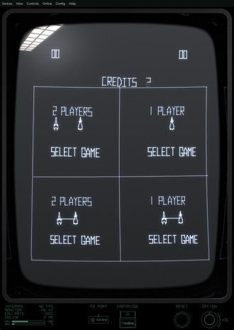</a>
<a href="docs/images/v1.1.0/chat.png">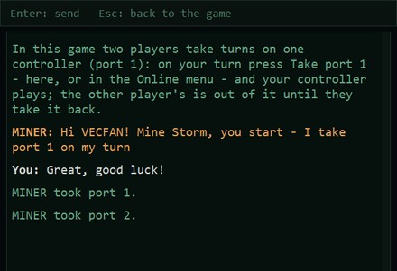</a><br>
<em>PiTrex Space Duel online at 100 %; the chat in three colours.</em>
</p>

<p align="center">
<a href="docs/images/v1.0.9/online_game.jpg">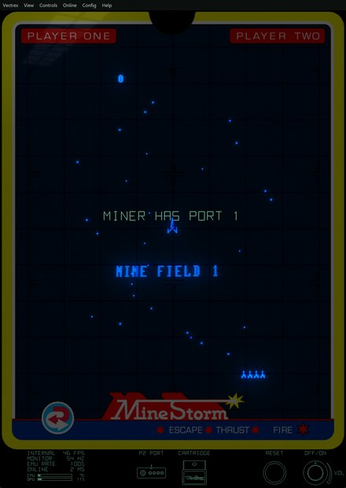</a>
<a href="docs/images/v1.0.9/chat.png">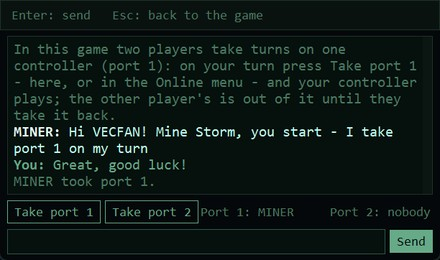</a><br>
<em>Mine Storm online: player 2 took port 1 for their turn - on the screen and in the chat.</em>
</p>
<p align="center">
<a href="docs/images/v1.0.9/find_players.png">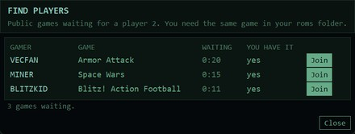</a>
<a href="docs/images/v1.0.9/config_orange.png">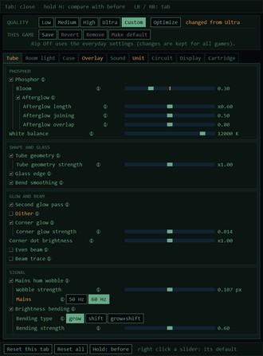</a><br>
<em>Find players, live; the Config window marks what differs from the default in orange.</em>
</p>

## New in v1.0.5

* **The 3D Imager** - GCE's spinning-disc goggles on controller port 2: 3D Mine Storm, 3D Narrow Escape and
  3D Crazy Coaster in colour. The game drives the disc's motor and times its pictures from the disc's index hole,
  as on the real goggles - so the game waits in the dark while the disc spins up, then plays in colour. You hear
  the goggles' little electric motor whir up (its own volume in Config > Sound), and a note on the picture shows
  the disc's speed meanwhile. Click the P2 PORT pictogram until it shows the goggles.
* **The light pen** - the mouse is GCE's light pen (the pointer turns into a small green pen): Art Master,
  AnimAction and Melody Master. The pen sees the real beam as it passes - Art Master's cursor follows it by its
  tracking circle, as on a real Vectrex. Left button = draw, right = straight line, middle = menu.
* **AnimAction's cartridge RAM** - its 8 KB of RAM at $2000, found by itself.
* **Paused below the picture** - PAUSED shows in the strip below the picture, not on it: a paused game makes a
  clean screenshot.
* **Faster, and a quality for every PC** - the 6809 emulation in two rounds: about 25 %, then another 27 % less
  processor time per frame, bit-identical on 68 games; the PiTrex's JIT runs its floating point
  itself (10-20 % faster, VecDoom's load 17.1 -> 15.5 s) and now boots on Linux and macOS too; the display thread
  no longer burns a processor core waiting for the screen (the program's processor time 0.37 -> 0.22 s per second).
  Four quality profiles, **Low, Medium, High, Ultra**, each for a kind of PC - measured on a Raspberry Pi 5 at
  1080p: Low (the phosphor at half size, 30 pictures a second) runs at full speed, Medium (three-quarter phosphor)
  went from 62 to 37 ms a picture. **Optimize** measures this PC and turns off only what it must. The on-screen
  display shows **CPU and GPU meters**: how much of each frame the processor and the graphics card need
  ([Quality](#quality-for-any-pc)).
* **The real size of everything** - the case, the glass and the picture rebuilt from an exact trace of a real
  Vectrex at three times real size: the matte frame is the overlay's own 162 x 207 mm with 3.5 mm of matte band
  and round corners, the glossy walls slope down to the glass at their old angle, and the Test Cartridge grid lands
  on the real tube's grid line by line (within 0.05 mm). Overlays lie exactly on the frame, as on the real console
  ([how it was measured](#10-the-tubes-geometry-measured-not-invented)).
* **A new Config window** - compact enough for a 1080p laptop at 100, 125 and 150 %: short labels with an *i* for
  the details, two columns only when a tab is too tall. Changed tabs show in orange, the Quality row says what
  changed (from Low, Medium, High, Ultra or Optimal), *Hold H* compares with before, Reset this tab / Reset all
  really reset. Tabs switch at once - no white flashes, no half-drawn controls - and every window opens where you
  left it.
* **Online play** - two PCs, one Vectrex: the host shows a five-letter code, player 2 types it in (the **Online**
  menu), and **chat** with each other while you play (Ctrl+T). Direct through most home routers, relayed through a
  meeting-point server when not; only the controllers travel, the emulation is identical on both sides ([Online play](#online-play-two-vectrex_emus-one-game)).
* **Menus in full screen** - move the mouse to the top edge of the screen (or press Alt) and the menu bar appears
  over the picture; Tab opens the Config window over the full-screen picture, and the other windows stay in front
  too.
* **Fixes** - Vectorblade no longer slows to a crawl after a game change; no false 999 % CPU or speed dips when
  switching games; the white balance's default is the real Vectrex's cold 12000 K.

<a href="docs/images/v1.0.5/config.png">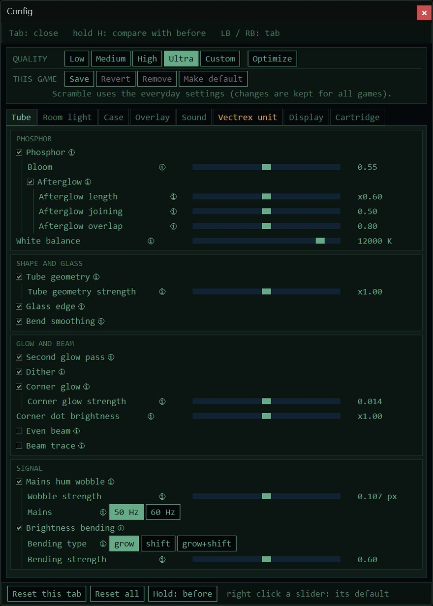</a>
<a href="docs/images/v1.0.5/online.png">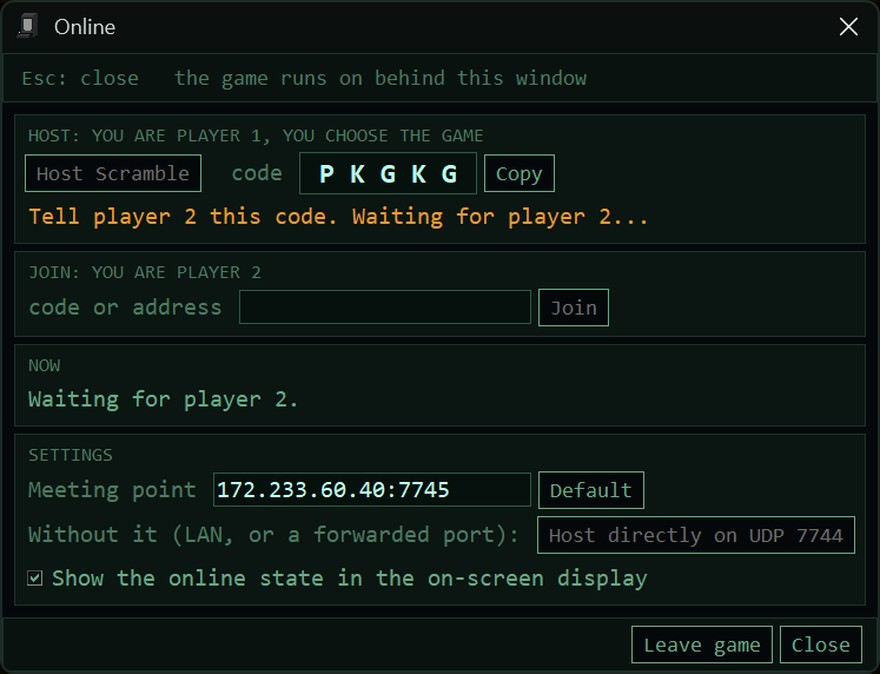</a><br>
<sub>The new Config window (Tube tab; the orange tab has changed settings) and the Online window, hosting a game.</sub>

<a href="docs/images/v1.0.5/lightpen.jpg">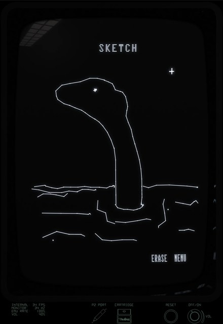</a>
<a href="docs/images/v1.0.5/imager.jpg">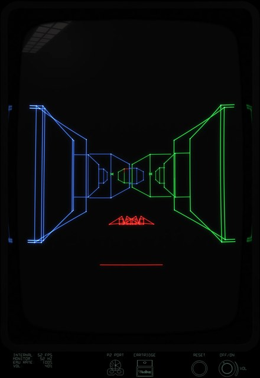</a><br>
<sub>Art Master drawn with the light pen (the mouse), and 3D Narrow Escape through the 3D Imager.</sub>

## New in v1.0.4

* **The beam, simulated** - the spot itself now follows the analog circuits: it lags behind the integrators, slows
  into corners and lights them, bends round curves instead of breaking them into facets, and goes dark where the
  real one does. Fitted to new test cartridges photographed on a real Vectrex (the DAC, the corners, the gaps, the
  lag); the DAC and the analog side measured and modelled, the brightness knob at the back too.
  [The story](#12-the-beam-itself-four-test-cartridges-and-a-maze), with side-by-side comparisons.
* **The PiTrex** - the Raspberry Pi cartridge emulated: its ARM processor (with a JIT compiler, fast enough
  for the arcade emulators it runs), the Pi's hardware and its SD card - and its USB port: the PC's keyboard
  and mouse, so Elite and GS BASIC find their keyboard (Ctrl+K types). Its menu, Tempest, Battlezone, Elite,
  Vectorblade... [PiTrex](#the-pitrex-a-raspberry-pi-in-the-cartridge-slot).
* **Quality profiles and Optimize** - Low, Medium, High or Custom, as in games; **Optimize** measures this PC once
  and turns off only what it has to, then says what it changed (Undo is one click). [Quality](#quality-for-any-pc).
* **Everything in one click** - the setup shows what is missing in red and fetches it: the original GCE games,
  free homebrew games with overlays, the speech ROM, the PiTrex's SD card. **65 overlays now come with the
  emulator.** [What you add](#what-you-add).
* **Config** - Reset all, the window's close button back, the changed settings marked with a dot, the white
  balance with a neutral middle (the lines stay full-bright white, the glow takes the tint).
* **The strip below the picture** - every part clickable shows a hand; a click on the on-screen display opens
  Config; the volume knob turns the moment you move; Recent games; a right click on the cartridge pulls it out.
* **Logs to send along** - `cache/core_log.txt` (the emulator core's messages: for the PiTrex whether its JIT runs)
  and `cache/render_log.txt` (the graphics card, the picture's size, the quality, and the time each picture takes);
  a PC too slow for the effects is pointed out once. Smaller screens (1080p at 125 / 150 %): every window fits.

## Contents

* [Download and play](#download-and-play) - [what you add](#what-you-add) - [requirements](#requirements)
* [What it looks like](#what-it-looks-like) - [Features](#features)
* [The story: measuring a Vectrex](#the-story-measuring-a-vectrex) -
  [1. photographing the beam](#1-photographing-the-beam), [2. filming the glow](#2-filming-the-glow),
  [3. listening](#3-listening), [4. asking the chips](#4-asking-the-chips-directly),
  [5. the Mine Storm bug](#5-the-mine-storm-bug), [6. the analog side](#6-the-analog-side),
  [7. how wide the gaps are](#7-one-choice-how-wide-the-gaps-are), [8. speech](#8-speech-two-rare-modules),
  [9. overlays and scratches](#9-overlays---and-forty-years-of-scratches),
  [10. the tube's geometry](#10-the-tubes-geometry-measured-not-invented),
  [11. the room's light](#11-the-rooms-light-the-glass-the-phosphor-and-the-reflections),
  [12. the beam itself](#12-the-beam-itself-four-test-cartridges-and-a-maze)
* [Using it](#using-it) - [the first start](#the-first-start-the-setup), [switching on](#switching-on),
  [menus and the Config window](#menus-and-the-config-window), [quality](#quality-for-any-pc),
  [the screen](#the-screen-60-hz-high-refresh-g-sync), [keys](#keys), [TV mode shortcuts](#tv-mode-shortcuts),
  [controls](#controls), [overlays](#overlays), [head tracking](#head-tracking), [speech modules](#speech-modules),
  [the 3D Imager and the light pen](#the-3d-imager-and-the-light-pen),
  [cartridge hardware](#cartridge-hardware), [UVMC2 games](#uvmc2-games-the-ultimate-vectrex-multicart-2),
  [the PiTrex](#the-pitrex-a-raspberry-pi-in-the-cartridge-slot), [Mac and Linux notes](#mac-and-linux-notes)
* [Building from source](#building-from-source) - for tinkerers
* [Technical details](docs/TECHNICAL.md) - what it models, number by number
* [Credits and license](#credits-and-license)

---

## Download and play

Get the zip for your computer from [Releases](../../releases), unzip it anywhere and start the program:

| | Download | Start |
|---|---|---|
| **Windows** (10 / 11, 64-bit) | `Vectrex_EMU-windows.zip` | `Vectrex_EMU.exe` |
| **macOS** (10.13 or later, Intel and Apple Silicon) | `Vectrex_EMU-mac-app.zip` | `Vectrex_EMU.app` |
| **Linux** (x86-64: Ubuntu 22.04, Debian 12, Fedora 36 or later) | `Vectrex_EMU-linux-bin.zip` | `./Vectrex_EMU` |

The programs are not signed, so the first start needs one extra step:

* **Windows**: if SmartScreen says "Windows protected your PC": **More info > Run anyway**.
* **Mac**: right-click (or Ctrl+click) the app > **Open** > **Open**; on macOS 15 or later double-click it
  once, then **System Settings > Privacy & Security > Open Anyway**. Keep the app, `system` and `roms`
  together in one folder.
* **Linux**: if unzipping dropped the run permission: `chmod +x Vectrex_EMU`.

The first start opens a short **setup** ([below](#the-first-start-the-setup)): it checks the folders, picks
the best picture for your monitor and PC, and asks whether the Vectrex should start switched on. Switched
off, it is like a real Vectrex: **turn the volume knob up** (Page Up, the mouse wheel over the knob below
the picture, or any key). Without a cartridge it plays its built-in game, **Mine Storm**.

**In the zip**, the same on Windows, Mac and Linux: the emulator, and next to it three folders, each
with a short note on what goes there:

| Folder | |
|---|---|
| `system` | the Vectrex BIOS, `bios.bin` (with Mine Storm; Smith Engineering allows it to be copied freely for non-commercial use) |
| `roms` | your cartridge ROMs go here; it comes with two small UVMC2 programs written for this emulator: **UVMC2 Demo** and **UVMC2 Movie Player** ([UVMC2 games](#uvmc2-games-the-ultimate-vectrex-multicart-2)) |
| `overlays` | the overlays: the MiSTer Vectrex core's set, named like the games (`CREDITS.md`: each design's author); yours go here too |

More folders appear when they are needed: `uvmc2`, the UVMC2 cartridge's SD card (with a note in it), `pitrex`,
the PiTrex's SD card, and `cache`, working files: the SD card images the UVMC2 and the PiTrex run from, and two logs
to send along when something is wrong - `core_log.txt` (the emulator core's messages of the last start) and
`render_log.txt` (the graphics card and the time each picture takes, every 10 seconds).

### What you add

| What | Where | Where to get it |
|---|---|---|
| **Cartridge ROMs** (`.bin`, `.vec`, `.gam`, `.rom`, VecFever `.v4e`) | `roms` (subfolders too) | your own cartridges |
| **Overlays** (more of them, optional) | `overlays` | they come with the emulator; your own `.art` / PNGs - see [Overlays](#overlays) |
| **Speech ROM** (optional, for the VecVoice / VecVox speech modules) | `system` | `al2.bin`, a free download - see [Speech modules](#speech-modules) |
| **UVMC2 games** (`.um2`, optional) | `roms` | made for the Ultimate Vectrex Multicart 2 - see [UVMC2 games](#uvmc2-games-the-ultimate-vectrex-multicart-2) |
| **Game data** for UVMC2 games that need it (Doom's WAD, Quake's `pak0.pak`, vector movies) | `uvmc2` (`uvmc2/doom`, `uvmc2/quake`, `uvmc2/movies`) | your own copy (the shareware Doom and Quake files work) |

**Vectrex > Get games & extras...** (also in the first-start setup, which shows in red what is missing) fetches
them in one click: the original GCE games, free homebrew games that have an overlay (public domain releases,
Malban's Telengard, and Vectorblade and the Neon Hawk demo as the MiSTer project shares them with their authors'
permission), the speech ROM and the PiTrex's SD card files - unpacked into `roms`, `system` and the PiTrex folder
and named as the ROM browser lists them; files you already have are kept. Each has a chain of sources tried in
turn: the games and the speech ROM, which never change, from the project's own copy first, then archive.org,
GitHub, Joe Zbiciak's page and the Wayback Machine; the PiTrex from the newest download on Malban's page first
(the project's copy of the last version only when you ask for it). Should all of them fail, the window says
where to get it, and **Add file...** takes your own download and names it the same way. None of it comes with
the emulator. *The maintainer of Vectrex_EMU does not take responsibility for the sharing of these files: you
download them yourself and take that responsibility.* The disclaimer is shown once, with every file and its
sources; accepted, the downloads go without asking.

Then click the cartridge below the picture (or press **L**) and pick a game.

### Requirements

A graphics card with OpenGL (any from the last 15 years; the phosphor, bloom and overlay scratches run on
it), sound, and for Linux an X11 or Wayland desktop (through XWayland) with PulseAudio or PipeWire. On a
computer without a real graphics card (a virtual machine, Apple's software renderer) it still runs, with
a shorter afterglow and without the scratches.

---

## What it looks like

<p align="center">
<a href="docs/images/gallery/overlay_mine_storm.png"></a>
<a href="docs/images/gallery/overlay_bedlam.png"></a>
<a href="docs/images/gallery/overlay_armor_attack.png"></a><br>
<em>With their overlays: Mine Storm, Bedlam and Armor Attack, the sheets worn by forty years of handling
(click a picture for the full resolution).</em>
</p>

<p align="center">
<a href="docs/images/gallery/armor_attack.png"></a>
<a href="docs/images/gallery/berzerk.png"></a>
<a href="docs/images/gallery/pole_position.png"></a>
<a href="docs/images/gallery/scramble.png"></a><br>
<a href="docs/images/gallery/spike.png"></a>
<a href="docs/images/gallery/starhawk.png"></a>
<a href="docs/images/gallery/vectorblade.png"></a>
<a href="docs/images/gallery/web_wars.png"></a><br>
<em>And without: Armor Attack, Berzerk, Pole Position, Scramble, Spike, StarHawk, Vectorblade and Web Wars
(click a picture for the full resolution).</em>
</p>

Without an overlay, the Vectrex's black plastic **case** frames the tube: its glossy walls mirror the
picture, softly and a little warped as moulded plastic does, with fine scratches and the matte front round
them.

<p align="center">
<a href="docs/images/v1.0.3/main.png">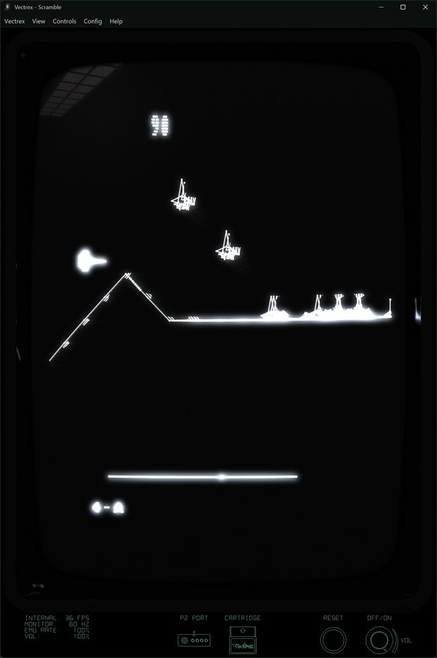</a><br>
<em>Armor Attack in the window: the dark menu bar, the tube in its case, and the control deck below.</em>
</p>

<p align="center">
<a href="docs/images/v1.0.3/case_grid.png">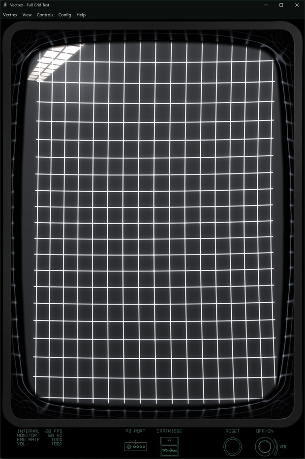</a><br>
<em>The case in a bright room (View > Room light > Daylight): the grid mirrored in its glossy walls, the ceiling
light on the glass.</em>
</p>

Below the picture sits the **control deck**, the Vectrex's own controls drawn in green outlines: the
**on-screen display** (the game's frame rate, the monitor's, the emulation speed; online: the connection), **P2 PORT**
(click it: joystick, VecVox or VecVoice), a **cartridge** you click to open the **ROM browser** (a right click
pulls it out of the slot, another puts it back - as Ctrl+E), the
**RESET** button and the **volume knob**, which - as on the Vectrex - is also the power switch. View >
Control deck switches it all off for a smaller window.

<p align="center">
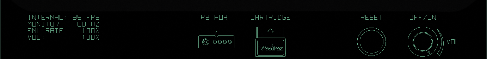<br>
<em>The control deck: on-screen display, P2 PORT, cartridge, RESET and the volume knob.</em>
</p>

<p align="center">
<a href="docs/images/v1.0.4/browser.png">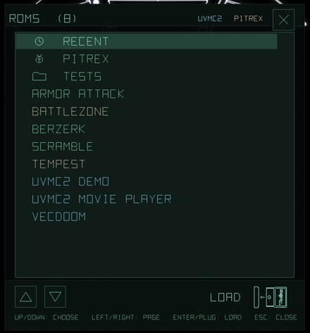</a><br>
<em>Click the cartridge: the ROM browser, drawn into the picture (it works in full screen too) - it opens
in the folder you left it in. Recent games and the PiTrex at the top, then folders; Vectrex games green,
PiTrex programs red, UVMC2 games blue.</em>
</p>

Every look and sound setting is in one place, the **Config window** (Tab), over the running game: change a
slider and see it at once, hold H to compare with how it was.

<p align="center">
<a href="docs/images/v1.0.3/deck.png">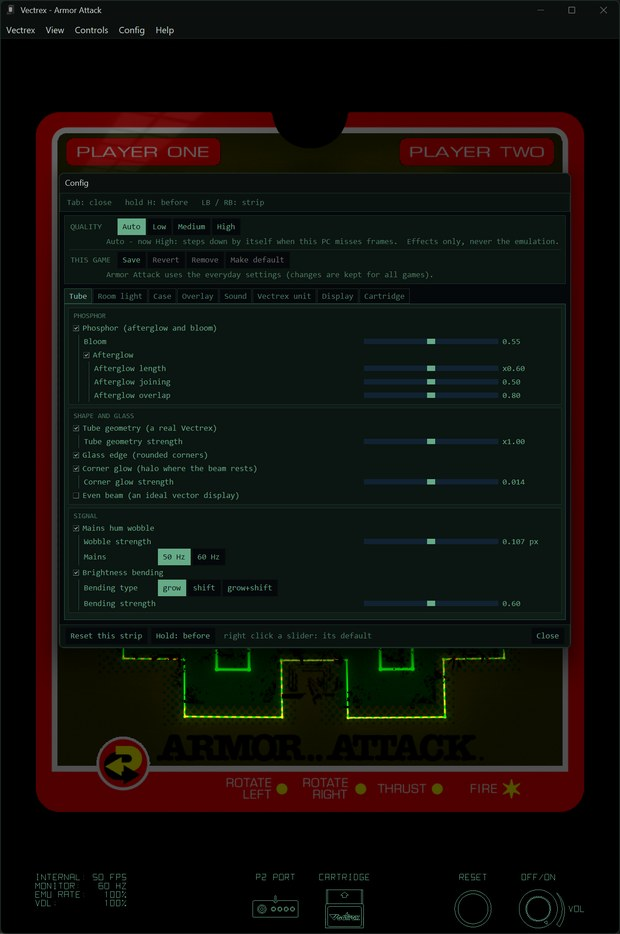</a><br>
<em>The Config window (Tab) over Armor Attack: quality, this game's own settings, and eight strips.</em>
</p>

## Features

* Cycle-exact 6809 bus timing, the 6522 as measured, Malban's analog delays (as measured for VIDE)
* Real-time phosphor with the measured afterglow, bloom, glow, mains wobble, drift, bending
* The tube's geometry measured from photos of a real Vectrex: its uneven, asymmetric imperfections, not a
  generic barrel curve
* A room with a ceiling light: its reflection in the glass, a soft glow on the phosphor behind the thick
  glass, a sheen on overlays and their scratches glinting around it - all following the room light
* The buzz, the built-in speaker, the power switch and a worn volume knob
* Fixed 60 Hz (tear-free on any monitor), the monitor's full rate (120 / 144 / 240 Hz), or G-Sync /
  FreeSync; always at the monitor's full resolution (4K, Retina)
* Two players, keyboard and any controllers at once (Xbox / PlayStation / Switch pads, the Vectrex USB
  controller, flight sticks), mapped per controller with dead zones and endpoints
* Bank-switched cartridges: 64K (PB6), Malban's Vectorblade cartridge with its flash save (as on MiSTer),
  a 512K flash cartridge with a bank latch, 1 MB multi-carts (as Sean Kelly's Multi-Cart)
* VecFever `.v4e` files load like any ROM: plain ROMs, the DS2431 save chip, 2 x 48K and 4 x 48K banks
* **The 3D Imager** (its spinning colour disc, spin-up and all: 3D Mine Storm, 3D Narrow Escape, 3D Crazy Coaster in
  colour) and **the light pen** (the mouse: Art Master, AnimAction, Melody Master) on controller port 2
* Sampled sound and speech through the Vectrex's DAC, and the VecVoice / VecVox speech accessories
* Overlays (MiSTer `.art` and PNG), flat over the tube, lit by the room, with forty years of
  scratches made on the graphics card
* Authentic size (as big as a Vectrex on any monitor), Fit screen (as big as fits the desktop), the whole screen
  turned in 90 degree steps for a monitor on its side
* The **Config window** (Tab): every look and sound setting in eight strips over the running game, with a
  before / after compare, settings saved per game when you ask, and a gamepad to drive it
* **The beam simulated**: the spot's lag behind the integrators, its rests in corners and slow bends, curves
  drawn smooth, fitted to test cartridges photographed on a real Vectrex
* **Quality** Low / Medium / High (or Custom, changed by hand) - effects only, the emulation is always exact;
  **Optimize** measures this PC once and turns off only what it must (the first-start **setup** runs it)
* **Smooth motion** for 60 Hz screens (frames drawn between the game's 50), G-Sync / FreeSync detected
  from the monitor itself (a G-Sync module too)
* **The Vectrex unit**: the analog parts that differ from one Vectrex to the next as sliders, with presets
  (the measured one, an ideal one, a cranky one, a random one) to export and share
* **UVMC2 games** (`.um2`): the Ultimate Vectrex Multicart 2 emulated - its RP2350 (two ARM cores, PIO,
  DMA, PSRAM), the SD card (a folder), the headphone jack, a USB mouse and keyboard - plug and play, with a
  demo and a vector movie player included
* **The PiTrex**: the Raspberry Pi cartridge - its ARM11 (with a JIT for x86-64 and ARM64), the Pi's hardware
  and the SD card (a folder): its menu, the arcade emulators, Vectorblade, Elite and more
* **One-click downloads** of the original games, free homebrew, the speech ROM and the PiTrex's SD card;
  65 overlays included
* Every look and sound setting adjustable and explained in the built-in Help

---

## The story: measuring a Vectrex

**First, a word about the photos.** Glowing phosphor is very hard to photograph faithfully. The eye
sees a CRT differently from a camera: the exposure decides how much of the glow a photo catches, so its
bloom, its brightness and its fading afterglow are never quite what you see in the room. Keep that in
mind with every comparison below. The photos are still valuable - they showed us *where* things happen
and how long they last - but getting the bloom and the decay to *look* right took more than photos. In
the end the most important tool was A/B testing by eye: many rounds with the real Vectrex and the
emulator on an IPS monitor side by side, until the two looked very much alike in real life.

The project started from **vecx**, a long-standing open-source Vectrex emulator, and from one rule:
*nothing gets changed because it "looks nicer" - only because a real Vectrex does it.* So every step was
the same loop: look at the real machine, measure it, change the emulator, compare again.

### 1. Photographing the beam

The first surprise was how different a real Vectrex looks up close. We took long series of close-up
photos of the real tube, game by game, and laid them next to the emulator. The real lines have **gaps**:
the lines of Mine Storm's ship stop short of their corners, and the mines open up at their inner points.

An ideal emulator - one that runs the 6809 exactly but treats the rest as perfect - draws none of that:
every line meets its neighbour, every shape closes.

So where do the gaps come from? They turned out to be timing. The 6809 CPU, the 6522 VIA and its timer,
and the analog integrators that move the beam do not switch together: they start and stop a few cycles
apart. A new value from the DAC reaches the X integrator about 15 cycles late and the Y sample about 14;
the integrators start and stop some 12 cycles after their RAMP signal switches; the timer runs a little
longer than its count (as Malban measured these delays for his VIDE emulator, checked here against our
photos). A line therefore starts a moment late and stops a moment late, and a short line at a corner
can end before the beam got there. We made the emulator run every instruction's bus access in the exact
cycle the real chips do and added those analog delays - and the gaps appeared, in the same places as on
the tube:

<p align="center">


<br>
<em>Left: a real Vectrex (one with unusually wide gaps). Middle: the CPU exact, but the analog side
without its delays - every corner closes. Right: Vectrex_EMU with the delays, set to this machine's wide
gaps: the same short lines and open corners.</em>
</p>

The photos showed more than gaps. Where the beam rests for a moment - at a corner, at the end of a
line - the phosphor gets more light and shines as a bright dot, with a soft glow around it; and fast
lines come out thinner and dimmer than slow ones, because the beam spends less time on each spot. The
emulator draws every line with the beam's real speed and every pause with its real length, so these
follow by themselves.

That is the difference between a *perfect* vector display and a Vectrex. An emulator can easily draw
the perfect one - every line equally thin and bright, no dots, no glow, every shape closed - and many
do. It looks clean, and it is exactly what Vectrex_EMU avoids: the character is in the imperfections.

<p align="center">

<br>
<em>Left: a perfect vector display - what we avoid. Right: the Vectrex's character, as Vectrex_EMU draws
it. (Anyone who prefers the perfect look can have it: <b>Tube > Even beam</b>.)</em>
</p>

<p align="center">

<br>
<em>Mine Storm's mothership: real (left) and emulated (right).</em>
</p>

### 2. Filming the glow

A vector screen has no frames; it has *phosphor*. We filmed the Vectrex title fading to black and measured
the light frame by frame: the glow drops to ~15 % at once, then fades over about two seconds along two
curves. The emulator lights the phosphor at the exact moment the beam passes each spot and lets it fade
along that measured curve, sixty times a second, whatever frame rate the game runs at. A moving object
leaves a real trail, not a stack of copies - checked against Mine Storm's big mothership, which on the
real tube leaves one smooth trail.

<p align="center">

<br>
<em>Mine Storm's mothership on the move: the trail of fading phosphor it leaves on a real Vectrex (left) and in Vectrex_EMU (right).</em>
</p>

### 3. Listening

The Vectrex is not quiet. The beam's currents leak into the audio amplifier, so the speaker **buzzes**
along with what is drawn - louder with more lines, at the game's frame rate, never quite silent. We
recorded it, together with the small built-in speaker's sound, the click of the power switch and the
crackle of a worn volume knob. All of it is in: the buzz is generated from the actual vectors each frame,
the sound plays through a model of that speaker, and turning the knob (which is also the power switch)
scratches, crackles and sometimes cuts out, as an old potentiometer does.

### 4. Asking the chips directly

Some things can't be seen in a game, so we wrote **test cartridges**: small 6809 programs that ask the
hardware a question and print the answer on screen. They were flashed to a real cartridge, run on the
real Vectrex, photographed - and then the emulator was changed until it printed the same numbers.

<p align="center">


<br>
<em>Test cartridges on the real Vectrex: CPU and timer cycles, open bus reads, beam brightness.</em>
</p>

* **CPU timing**: 32 measurements of instruction cycles and the 6522's timers and shift register. vecx
  was off in several places (a timer running one cycle long, a flag set too early, a timer that stopped
  when read). All 32 now match.
* **Open bus**: what the CPU reads where no chip answers. The real Vectrex returns the last byte on the
  data bus; vecx returned garbage. That tiny detail decides a famous glitch (below).
* **Sample and hold**: how fast the Y axis follows a jump - measured, modelled.
* **Brightness**: a page of bars and dots at 16 intensities shows exactly where a dim beam disappears on
  the real tube (10 lines and 10 dots still visible) - the emulator cuts off at the same step.

### 5. The Mine Storm bug

Mine Storm, the game built into every Vectrex, has a rare bug: when a mine splits at the wrong moment,
the game reads a stray list of vectors. On the emulator this froze the game for seconds and drew a long
diagonal streak. We logged sessions until it happened, traced it to the exact instruction - and then
tested the real hardware: on the real Vectrex, the built-in Mine Storm shrugs it off, while the same
game on a cartridge glitches for a second or two. The difference is the open bus. With the measured
open-bus behaviour, Vectrex_EMU now does exactly what the real machine does - in both cases.

### 6. The analog side

Things no digital emulator has, because they are analog:

* **Drift**: the integrators' zero point wanders, so a shape drawn as one loop doesn't quite close -
  calibrated against photos of test patterns on the real tube.
* **Mains hum**: the power supply's 50 Hz hum pushes the beam a little. A game that finishes each frame
  within the Vectrex's budget of 30,000 CPU cycles runs at 50 frames a second, in step with the hum:
  every frame is pushed the same way and the picture stands still. But a busy scene - lots of vectors on
  screen - can need more cycles than that. The frame takes longer, the game slows to, say, 48 fps, and
  its frames slip against the hum: the picture starts to sway (a scene far over budget wobbles faster).
  At 25 fps, exactly two hum waves per frame, it is in step again and stands still. Vectrex_EMU works out
  the hum at the exact moment each line is drawn, so its games wobble exactly when a real Vectrex's do.

  <p align="center"></p>
  <p align="center"><br>
  <em>A still test picture (testcart/wobble_test.asm) at 50, 48 and 25 fps. For demonstration only: the
  wobble is exaggerated about ten times and the animation runs at half speed, not in real time.</em></p>
* **Brightness bending**: the high voltage sags with a busy screen; the picture breathes.
* **The tube**: its measured geometry ([chapter 10](#10-the-tubes-geometry-measured-not-invented)), the glass, glow around resting spots, a soft round spot - and switching off makes the
  picture shrink away with a last flash of the beam, as the real one does.

The result is not a "filter" laid over a clean picture: the imperfections come out of the emulation.

### 7. One choice: how wide the gaps are

Everything above copies the real machine. One thing is a choice. How *wide* the gaps in the lines are
(chapter 1) varies from one Vectrex to the next: component tolerances and age shift the analog timing,
so some machines show wide gaps and others barely any. The Vectrex in our photos has exceptionally wide
ones. Rather than copy this one machine, Vectrex_EMU keeps the gaps where they belong but, by default,
at the size of a better tuned - or less worn - Vectrex: a tighter tube. **Vectrex unit > Line gaps** (in the [Config window](#menus-and-the-config-window)) sets them
to taste: the integrators' stop delay, 9.3 cycles (corners nearly closed) to 15.3 (wide, like the
machine in the photos), 12.3 by default.

<p align="center">
<br>
<em>The default (12.3 cycles): the same gaps in the same places as on the real machine in chapter 1, but tighter.</em>
</p>

### 8. Speech: two rare modules

A handful of Vectrex games and demos talk - or sing - through a speech module plugged into the second
controller port. There are two: the **VecVoice** (Richard Hutchinson), built around General Instrument's
SP0256-AL2 speech chip, and the **VecVox** (Alex Herbert), built around Magnevation's SpeakJet. Both were
hobbyist boards made in small numbers, long out of production; today they are very hard to find.

**How they work on a real Vectrex.** The game sends bytes over a serial line it bit-bangs on the sound
chip's I/O port (bit 4 of port A, 9615 baud); the module answers "ready for the next one" on port 2's
button lines. The VecVoice takes SP0256 *allophones* - 64 small speech sounds from the chip's 2 KB ROM,
put together by a 12-pole digital filter. The VecVox takes SpeakJet codes: 72 phonemes plus codes for
pitch (in Hz), speed, stress and volume, which is how VecVox X-Mas sings its tunes. The speech comes out
of the module's own amplifier, not the Vectrex's speaker.

**How we built them.** Without the modules on the desk, we worked from what is documented and from
recordings of the real ones, comparing A/B by ear:

* **VecVoice**: the SP0256 is fully documented, and MAME has a faithful emulation of it (Joe Zbiciak
  and Tim Lindner); Vectrex_EMU runs a C port of it, with the serial link as the MiSTer core models it.
* **VecVox**: how the SpeakJet makes its sounds was never published - it is a programmed chip that has
  never been read out. So the VecVox speaks with the SP0256's voice: every SpeakJet phoneme becomes the
  nearest SP0256 sound(s), stretched to the SpeakJet's length and sung at the SpeakJet's pitch. Its
  speed law was fitted to a recording of VecVox X-Mas: 25.9 s against the recording's 25.2 s, most
  notes landing on the beat. A formant synthesizer built from the same recording was tried as well; side
  by side, the SP0256-based voice sounded more like the real thing, so that is the one that stayed.
* **The level** follows the MiSTer core's speech mix (Sorgelig's compressor), 50 % louder, with an
  arcade-style bass for big speakers - most owners plug better speakers into the module than the
  Vectrex's own.

How to plug one in, the speech ROM you need (a free download) and the games that talk:
[Speech modules](#speech-modules).

### 9. Overlays - and forty years of scratches

Every Vectrex game came with a printed plastic **overlay** for the screen: see-through colour tints the
vectors behind it, solid print adds the borders, the artwork and the game's name. The emulator reads the
MiSTer core's overlay files (`.art`) and plain PNG images, and lays the sheet over the finished picture:
the coloured plastic multiplies the light that comes through it, the print shines in the room's light,
and the sheet stays **flat** - the tube's geometry bends the vectors behind it, not the overlay. It sits
just in front of the glass, so seen from the usual height the picture sits a little higher on it
(**parallax**, as on MiSTer). With **View > Authentic** the sheet is exactly as big as a real one,
162 x 207 mm.

<p align="center">
<br>
<em>Mine Storm without and with its overlay (one of the overlays that come with the emulator).</em>
</p>

**Room light** lights the sheet itself: in an evening room the plastic is nearly black and only the
vectors show; in daylight the colours and the print come up. The plastic's light follows the setting
steeply, the print more gently, and **Printed art brightness** sets one against the other.

<p align="center">
<br>
<em>Room light at half, at the default (an evening room) and at the maximum (daylight).</em>
</p>

**The scratches.** A real overlay is forty years old. Decades of being handled, wiped and stored have
left it slightly **matte**, criss-crossed by fine scratches - and, here and there, a deeper one. In the
dark you hardly see them, until a vector lights them from behind: the fine ones make a soft matte halo
around the line, and single hairlines light up around it.

Getting that right took many rounds of pictures, compared with real sheets - in the end with photos of
the author's own Vectrex and Mine Storm overlay, in the dark, with and without the sheet, and with a
flashlight behind it. What they show:

* **Which scratches light up.** A scratch catches light that comes from square across it. So every point
  of light lights the scratches that face it, and all of it adds up: around a bright dot that makes
  **rings** of glinting scratches, as around the flashlight; along a long line every part of it lights
  other scratches, so there you see **random hairlines in every direction**. (A first try lit the
  scratches that run along the nearest line: they looked painted on, "Van Gogh" as the author put it.)
* **The plastic glows.** Around bright lines and text the sheet itself spreads a soft, wide glow in its
  own colour (**Plastic glow**, with its strength).
* **The wear is mostly short and shallow.** Far fewer fine scratches than first thought, most of the
  visible ones of medium depth, and only a few deep ones. 95.5 % are 5 - 15 mm long, 4 % 15 - 35 mm and
  0.5 % up to 80 mm, at random angles; a few (4 %) are **scribbles** - a short smooth sweep ending in a
  little curl, as from a grain of sand dragged under the sheet.
* **Deep damage cuts through the colour.** Where a deep scratch is widest, the colour layer is gone and a
  little untinted, white light comes through.

The recipe: ten steps from the finest to the deepest, their number following a curve with its peak in
the middle - about 77,000 fine scratches (the matte buff), 15,000 medium ones and, by default, hardly
any damage (about 15 on the whole sheet: most people want a sheet without; **Damage** adds them). Their
depth rises step by step, and there are more of them where hands hold a sheet (the middle, the lower
half, the edges) than in the corners.

<p align="center">
<br>
<em>One square of the sheet around the player's ship and a mine: the game, then the scratches as the
graphics card holds them (white = deeper) - the fine ones, the medium ones, the damage (shown at x1; at
its default there is none in this square) and all of them together at the defaults.</em>
</p>

The graphics card draws them - about 90,000 scratches - into three textures in a fraction of a second,
once, when an overlay is loaded; per scratch it keeps its depth and its direction, so the shader can work
out the glint for light from any direction. After that they cost about a millisecond per frame. Each
overlay has its own pattern, as every real sheet is worn its own way, and **New random scratches** deals
a new set.

<p align="center">
<br>
<br>
<em>Web Wars without and with the scratches (on by default): the matte halo and the hairlines around
the lines.</em>
</p>

<p align="center">
<br>
<em>Worn sheets in play: the start screen through Mine Storm's overlay, Bedlam, the start screen through
Web Wars' overlay, and Pole Position - the scratches light up only around what is drawn.</em>
</p>

**Overlay > Scratches** switches them. **Wear** sets how much the sheet was handled (all scratches
together); three sliders - **fine**, **medium** and **damage** - set the kind of wear; **Scribbles**
the share of curly ones; **Glint strength** how strongly they catch the light and **Glint reach** how far
from the lines they still do. **Plastic glow** and its strength are on the same strip of the Config window.

<p align="center">
<br>
<em>Clean Sweep's player by the yellow box (2x zoom) with the defaults, and with each scratch setting turned
down or up.</em>
</p>

### 10. The tube's geometry: measured, not invented

Most emulators bend the picture with a neat, symmetrical "barrel" curve - the CRT look. A Vectrex does not
look like that. Its picture is drawn by a magnetic yoke on a flat-faced tube, and what you see is the sum
of small, *uneven* imperfections: the grid is a little narrower at the top than at the bottom, the bottom
edge sags in a gentle bow, the sides lean, and on our machine the top right corner is pulled up. None of it
is symmetrical, and none of it is a curve anyone would design.

So instead of a formula we took photos. The **Test Cartridge** draws a precise grid of straight lines; we
photographed it on a real Vectrex with a long lens (to keep the camera's own distortion out), together with
the start screen and the test's **Distortion 1** pattern, and fitted where every crossing of the grid
actually lands on the glass. A second Vectrex showed much the same shape - this is how the tube and yoke
were made, not one tired machine.

<p align="center">
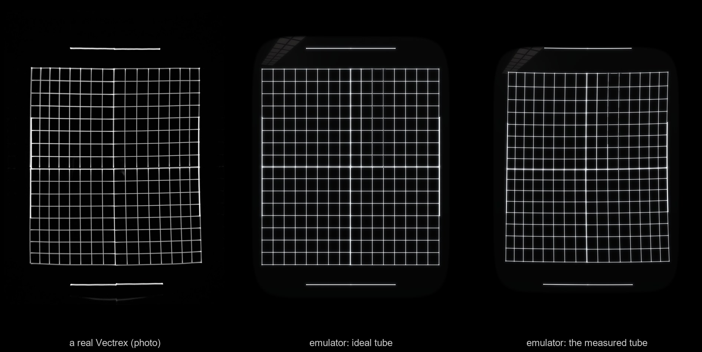<br>
<em>The first measurement (v1.0.x): the Test Cartridge grid on a real Vectrex (photo, colour neutralised), the
emulator with an ideal tube, and with the measured one.</em>
</p>

**Then, the real sizes.** Photos fit the picture to the glass, but not the glass to the case or the case to the
overlay. So the whole front was traced from a real Vectrex at three times real size, every part on its own layer:
the matte frame, the edge of the glass, and the Test Cartridge's grid line by line. The anchor is the overlay: a
real sheet is 162 x 207 mm and lies exactly on the case's matte frame, which is 3.5 mm wide. Everything else is
measured from there:

* **The frame**: 162 x 207 mm outside, round corners (8.6 mm radius), 3.5 mm of matte, grained plastic; inside it
  the opening of 155 x 200 mm where the glossy walls start.
* **The glass**: 145.7 x 188.5 mm, a rounded rectangle with gently bulging sides, centred in the frame. The glossy
  walls slope from the frame down to it at the same angle as before (68.5 degrees at the sides, 63.5 in the
  corners), so they mirror the picture as they did.
* **The picture**: the emulator's own grid - its vectors, as the core draws them - warped onto the traced one.
  A smooth fit plus a mesh pinned to all 17 x 17 crossings of the grid and to the points between them; measured on
  the emulator's finished picture (brightness bending included, as the real tube's was in the trace), every line
  lies within 0.05 mm of the real one. The picture's centre sits a little left of and below the glass's centre,
  as on the real tube.
* **All of the grid on screen**: the drawing area is a little wider than before, so the grid's two outer columns -
  just outside the old one - show, as on a real Vectrex.

<p align="center">
<a href="docs/images/v1.0.5/tube_match.jpg">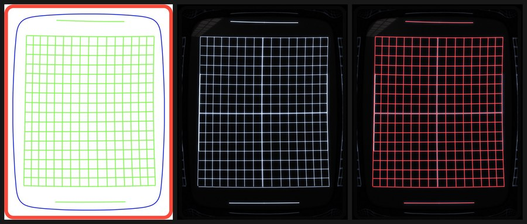</a><br>
<em>Left: the trace of a real Vectrex - the matte frame (red), the edge of the glass (blue), the Test Cartridge's
grid (green). Middle: the emulator's own picture of that grid. Right: the traced grid (red) laid over the
emulator's picture - the emulator's lines are underneath it.</em>
</p>

<p align="center">
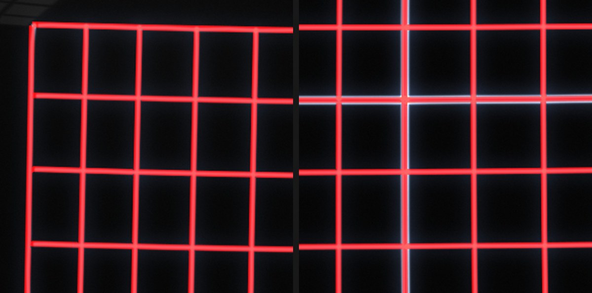<br>
<em>Close-ups: the top left corner and the middle. Where the emulator's white lines show beside the red, the
cartridge draws its middle lines twice, 0.7 mm apart - the trace runs between them.</em>
</p>

How it works:

* **The straight part** - how big the picture is on the tube - is always on, so the picture and an overlay keep
  their size and place when the imperfections are switched off.
* **The imperfections** are the rest of the measured map, kept as a small table (a few hundred numbers,
  interpolated between them - as cheap as the formula it replaced). They are zero in the middle of the screen, so
  turning them up or down never moves the centre. **Tube > Tube geometry strength** scales them: x1 is the measured
  tube, 0 an ideal one, x2 a more worn-looking one.
* **The vectors are bent, not the picture.** Every line goes through the map before it is drawn; long
  lines are cut into short pieces so they curve, each piece keeping its share of the beam's energy and its
  moment in the frame (so the phosphor's glow and afterglow stay exact). Nothing is stretched as a texture:
  the lines stay as sharp as the tube draws them.
* **Overlays are not bent, and not moved.** A real overlay is a flat sheet of plastic lying on the case's frame,
  so it is drawn exactly there: 162 x 207 mm. Its fine adjustment (Overlay left / right, up / down, size) moves and
  sizes the game's picture behind it instead, the other way - the sheet never leaves the frame. With the overlay
  off, the picture is as measured. **Parallax** shows the picture behind the glass a little higher than the sheet,
  as seen from the usual viewing height.
* **The glass** has the traced outline with a slightly soft edge, the case round it as described above, and
  black around the case - the same on every side, and below it the on-screen display and the knob.

### 11. The room's light: the glass, the phosphor and the reflections

A Vectrex is never seen in the dark. Its screen is a thick sheet of glass over a phosphor layer, and both
catch the room: a ceiling lamp shows up as a sharp mirror image in the glass, as a large soft glow on the
phosphor behind it, and on an overlay as a sheen with every scratch lighting up around it. The **Light**
menu adds this room, with one lamp: an office ceiling light - a long fluorescent fixture with a grid of
white louvre cells (5600 K daylight white), lying flat on the ceiling above and in front of you, turned
20 degrees.

<p align="center">
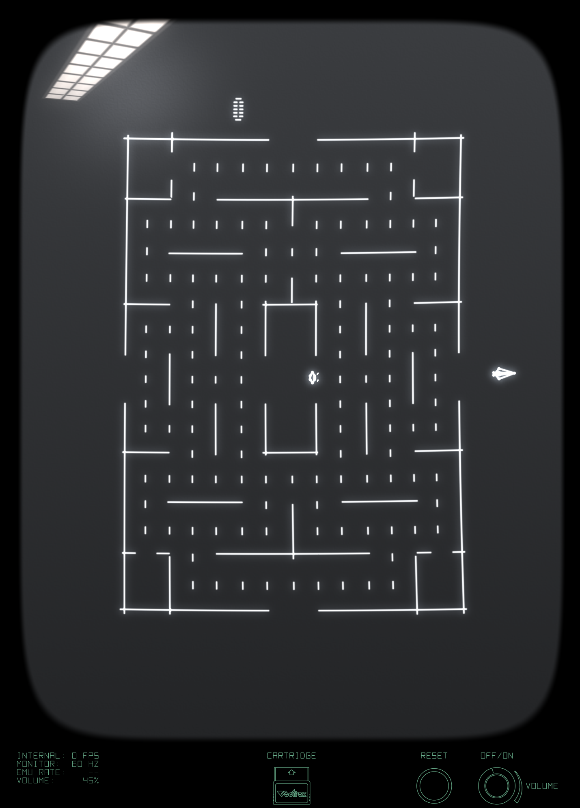
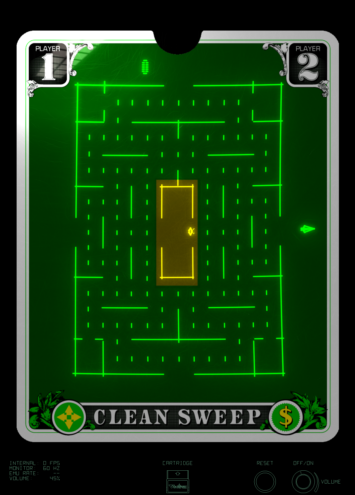<br>
<em>Clean Sweep at maximum room light (daylight): the lamp in the glass without an overlay, and on the overlay with
its scratches.</em>
</p>

The logic behind each part:

* **One room light for everything.** **Room light > Room light** (the same slider as the overlay's) sets how
  bright the room is. The reflections follow it steeply (its cube): in the default evening room they are
  barely there, in daylight they are clear - as with a real screen, which you hardly notice reflecting
  anything until the lights are on.
* **The glass reflection.** For every point on the screen the shader works out, as a mirror would, which
  point of the ceiling you see there: the viewing angle across the glass plus the tilt of its surface (the
  glass is a gentle dome, so the reflection is a little curved and smaller than the lamp). The lamp is drawn
  in perspective on the ceiling plane - its far end smaller and, by the inverse-square law (gentled), a
  little dimmer. The grid of cells is anti-aliased per pixel and blurred by about 1 %, as real glass is
  never perfectly clean. Without an overlay the glass itself turns slightly grey in a bright room (**Glass
  catches room light**); with an overlay it stays black for contrast.
* **The phosphor glow.** The phosphor layer sits behind several millimetres of glass and is much more
  curved, so it shows the lamp very differently: much larger, squarer (its stronger curvature pinches the
  long fixture), very blurry, and *shifted inwards* - the glass is thin in the middle and thick at the edges,
  so the offset grows with the distance from the centre. The emulator builds this from the glass
  reflection's own centre of light, enlarges and squares it, moves every point inwards by the glass's
  thickness there, and blurs it in three widths. A faint, random (non-repeating) texture gives the
  phosphor's grain. It is computed once at low resolution whenever the lamp moves.
* **The overlay.** An overlay is a flat sheet, so it mirrors the lamp without curvature, a little blurred
  by the plastic, and its plastic brightens around it. Its scratches (chapter 9) catch the light: close to
  the reflection *every* fine scratch glints; further away only the bigger, deeper ones do, the ones lying
  across the direction to the lamp. The lamp is an area, not a point, so the glints follow its whole shape.
* **Moving the lamp.** **Room light > Light position...** opens a small pad: drag the dot to move the lamp left
  and right, and up and down between just visible at the top edge and its middle a quarter down the screen
  (right click: the default, top left). The strengths of the glass and overlay reflections each have their
  own slider, and each can be switched off.

---

### 12. The beam itself: four test cartridges and a maze

Until now the emulator drew what the integrators said, line by line, and then made each line look like the
Vectrex's. For v1.0.4 we went one step further and simulated **the spot itself**: where the electron beam
really is, cycle by cycle, and how much light it leaves. To measure it we wrote new test cartridges (they are
in [`testcart`](testcart), for anyone with a Vectrex and a flash cartridge) and photographed them on the real
tube:

* **The lag test** and **the gap test**: the deflection amplifiers do not follow the integrators at once - the
  spot runs about 6 cycles behind them. That one lag explains the gaps where lines join (they grow with the
  scale exactly as on the tube) and why a fast corner is rounded.
* **The corner test**: where the beam stops - a corner, the end of a line - it rests, and a resting spot pours
  light into one point. A rest of 12 cycles is only a slight thickening, from 16 cycles on it is a dot, and a
  long rest is a bright, blooming star. The emulator now finds those rests from the spot's own speed, inside a
  stroke too.
* **Curves**: the spot moves smoothly, so a curve made of short lines is drawn as a curve, not as facets.
* **The DAC test**: lines drawn at every speed from the same point, with a reference placed by a move. On the
  real Vectrex the DAC turned out linear and the lines meet the reference; the emulator matches within the
  photos' own scatter. The Vectrex unit's DAC bit errors, the ZERO circuit's timing and the offset are modelled
  too (Config > Vectrex unit), and the **brightness knob** at the back - the tube's bias, measured from black to
  a real Vectrex's brightest.
* **Clean Sweep's maze**: its walls are drawn by switching the beam on and off during long sweeps. With the
  photo's camera angle and the tube's curve fitted out, every wall end in the emulator lands within about one
  pixel of the real one.

For an even more literal picture, **Tube > Beam trace** draws the phosphor from the spot's path itself, the
energy it leaves where it moves and where it rests. The **white balance** follows the real tube: the bright
cores of the lines stay the screen's full-bright white, and the cool tint lives in the glow around them.

<p align="center">
<a href="docs/images/v1.0.4/cmp_vectorblade.jpg">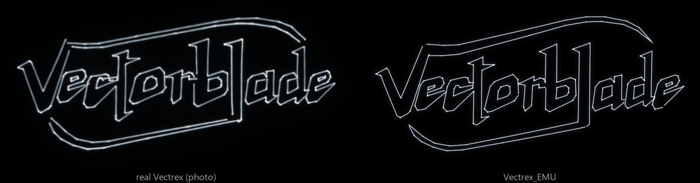</a><br>
<a href="docs/images/v1.0.4/cmp_corner.jpg">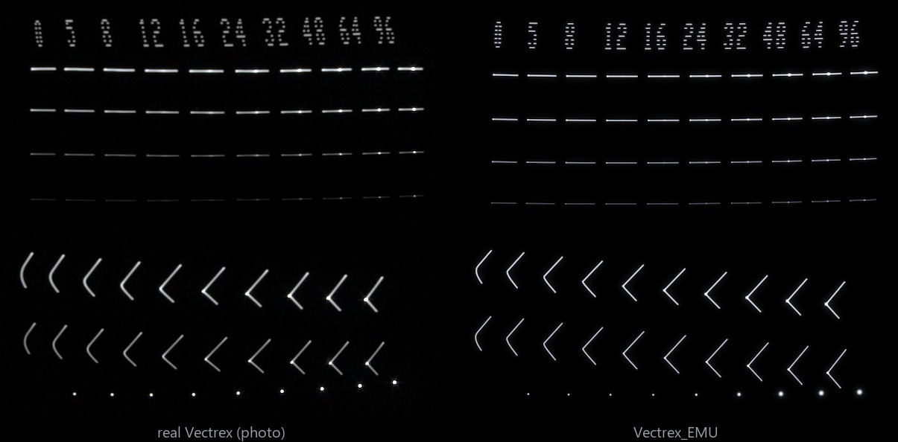</a><br>
<a href="docs/images/v1.0.4/cmp_gaps.jpg">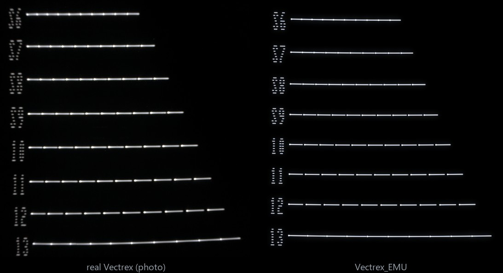</a><br>
<a href="docs/images/v1.0.4/cmp_cleansweep.jpg">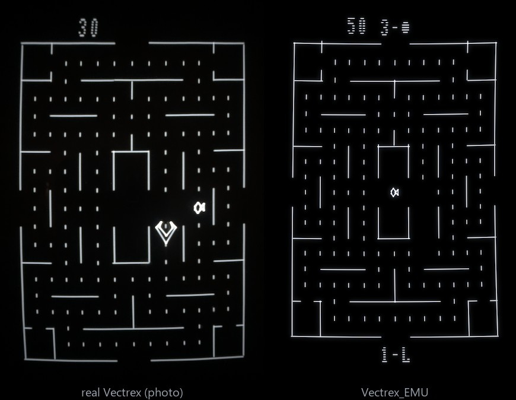</a><br>
<em>Left the real Vectrex, right the emulator: Vectorblade's logo, the corner test (rests of 0 to 96 cycles at
four intensities, then corners and dots), the gap test (joins at scales 6 to 13) and Clean Sweep's maze (the game
in a different moment). The photos' white balance is matched to the emulator's, as the eye sees the tube; the
camera always shows the glow bigger than the eye does.</em>
</p>

---

## Using it

Settings written as **Tube > Afterglow** are in the [Config window](#menus-and-the-config-window) (Tab): the
strip, then the setting.

### The first start: the setup

<p align="center">
<a href="docs/images/v1.0.4/ui_setup.png">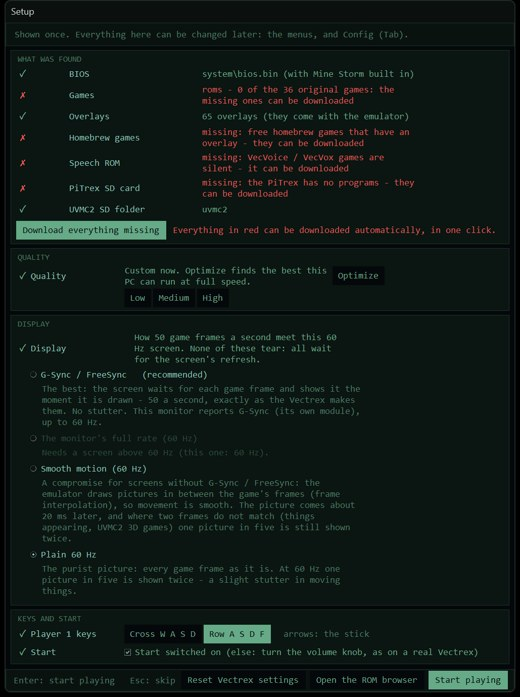</a><br>
<em>The setup, shown once (Vectrex > Setup wizard... runs it again): what is missing in red, one click gets it.</em>
</p>

The first start shows one page: whether the BIOS, the games, the overlays, homebrew, the speech ROM, the PiTrex's
SD card and the UVMC2 SD card folder were found - what is missing in red, and **Download everything missing**
gets it all; the **quality** (a new install runs **Optimize** at once); the
**display** mode, with each one explained and the best for your monitor chosen ([the screen](#the-screen-60-hz-high-refresh-g-sync));
the **player 1 keys**; and **Start switched on**. Enter starts playing; Esc skips it. Everything
on it can be changed later, and **Vectrex > Setup wizard...** (also in View) runs it again.

### Switching on

The volume knob is the power switch (Page Up, the mouse wheel over the knob, a click on its right
half, or while it is off any key, a controller button or a click on the picture): it clicks on, the tube warms up and the BIOS start screen plays. **Start switched on** (the deck's Vectrex unit strip) skips the knob; **Skip the Vectrex
intro** (same place) runs the BIOS start screen (the VECTREX logo, its tune and the game's title, ~13 s) unseen in a
fraction of a second at every power on, so the cartridge starts at once - in the same state as after the
real intro. Both are saved.

### Help

**Help** in the menu bar opens a help window: every menu option explained, with **More** buttons that
unfold the history and the mechanics behind it (the phosphor, the mains wobble, the buzz, bending, the
analog drift), plus the Vectrex itself (CPU and cycles, RAM, the 6522, the sound chip and its limits),
cartridges, bank switching and saving. The text lives in `src/frontend/help_text.py`.

### Menus and the Config window

The menu bar is short and dark - **Vectrex** (cartridges and recent games, RESET, pause, volume, the controls
and port 2, the setup), **View** (full screen, sizes, the overlay, the case, the control deck below the picture,
quality, room light), **Config** (opens the Config window) and **Help**; options that are on have a tick, the
few that also have a key show it. Alt (or F10) opens the menus from the keyboard, Alt + the underlined
letter one of them. **View > Control deck** switches the whole strip below the picture - the OSD, P2 PORT,
the cartridge, RESET and the volume knob - on or off at once: the window gets smaller by it.

<p align="center">
<a href="docs/images/v1.0.3/menus.png">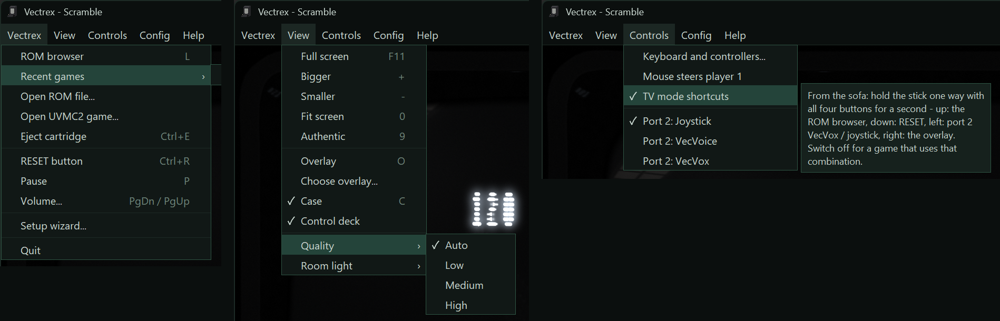</a><br>
<em>Vectrex (with Recent games), View (with the Quality choices) and Controls (an item's explanation on hover).</em>
</p>

Everything that sets the look and the sound is in the **Config window**: **Tab** (or **Config** on the menu bar)
opens it over the picture while the game runs on; Tab or Esc closes it. On top, the **quality** and this
**game**'s own settings; below, eight **strips**:

| Strip | |
|---|---|
| **Tube** | phosphor, bloom, afterglow, the tube's geometry, the glass edge, corner glow, an even (ideal) beam, the mains wobble, brightness bending |
| **Room light** | the room's light, the ceiling light's reflections on the glass and the overlay, the lamp's position |
| **Case** | the plastic case round the tube (without an overlay): on / off, its reflections, its wear |
| **Overlay** | on / off, choosing one per game, tint, printed art, parallax, the plastic glow, the scratches, position and size |
| **Sound** | the volume, the buzz, the speaker, the speech module's volume and speaker |
| **Vectrex unit** | the trim pots and analog parts that differ per Vectrex, in two tabs: **Unit** (the brightness knob R509, X / Y size R401 / R408, high voltage R525, the yoke's centering magnets and rotation) and **Circuit** (DAC offset R302, integrator rate offsets R335 / R333, the high voltage's ringing R526, zero hold, calibration, Y settling, beam delay, line gaps) - presets *Owner's Vectrex* (the measured one), *Ideal*, *Cranky* and *Random unit* (a new unit on every press); Export / Import a unit as a file |
| **Display** | the screen mode, smooth motion, rotation, the on-screen display, knob and cartridge, the monitor size, Authentic size |
| **Cartridge** | cartridge hardware, controller port 2 (speech modules), UVMC2 games, their USB port, headphone jack and SD card folder |

<p align="center">
<a href="docs/images/v1.0.3/strip_tube.png">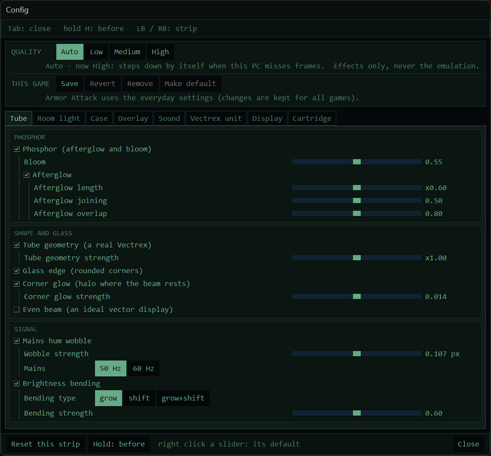</a>
<a href="docs/images/v1.0.3/strip_unit.png">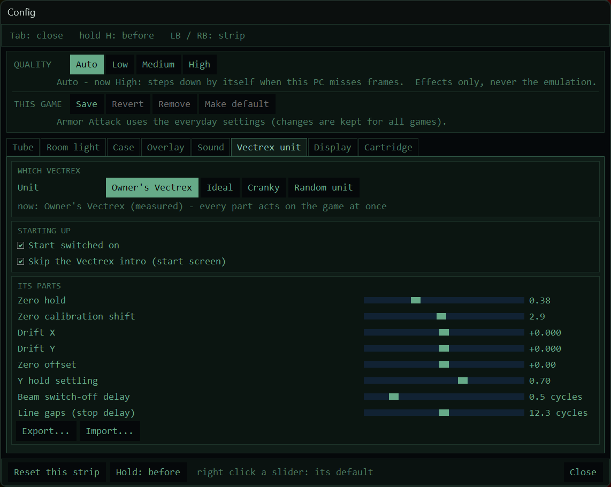</a><br>
<a href="docs/images/v1.0.3/strip_display.png">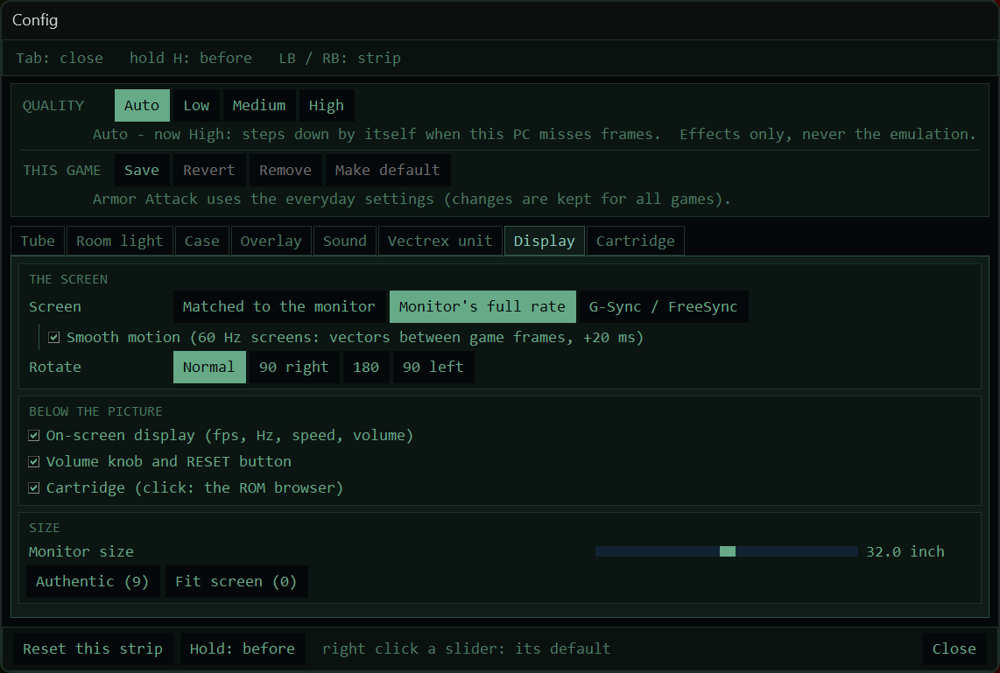</a>
<a href="docs/images/v1.0.3/strip_cartridge.png">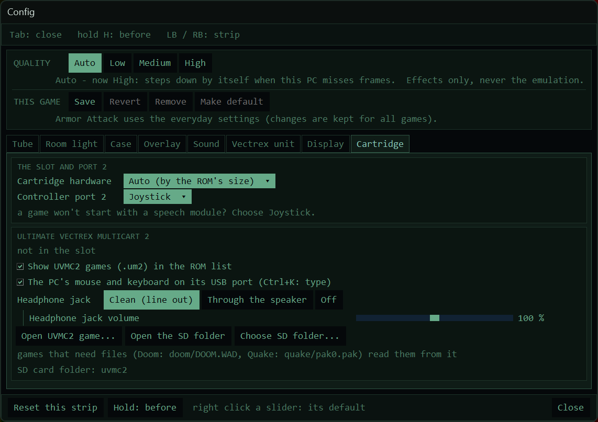</a><br>
<em>Four of the strips: Tube, Vectrex unit, Display and Cartridge (click for the full size; also
<a href="docs/images/v1.0.3/strip_light.png">Room light</a>, <a href="docs/images/v1.0.3/strip_case.png">Case</a>,
<a href="docs/images/v1.0.3/strip_overlay.png">Overlay</a> and <a href="docs/images/v1.0.3/strip_sound.png">Sound</a>).</em>
</p>

* **Sliders**: drag or click; **right click: the default**. The defaults are the faithful values - measured
  on a real Vectrex or chosen side by side with one - so most sliders have the default **in the middle**,
  from 0 on the left to twice the default on the right.
* **Hold H** (or the button on the deck): the picture as it was when the deck opened - let go to see your
  change. **Reset this strip** puts one strip back to its defaults; **Reset all** puts back every strip -
  to the chosen Quality profile's defaults (from Custom: High's).
* **This game's own settings** (THIS GAME row): changes are kept for all games, until you press **Save** -
  then that game starts with its own look and controls, and the everyday settings stay as
  they were. **Revert** goes back to what was saved, **Remove** forgets them, **Make default**
  makes the game's settings the everyday ones. Nothing is ever saved to a game unless you ask.
* **A gamepad drives it too**: LB / RB switch strips, the d-pad moves and changes.

In full screen there is no menu bar (with G-Sync, Windows hides menus there): the [keys](#keys), the deck,
the knob and the cartridge all work there.

**Volume knob on screen** (Display strip, default on): the Vectrex's own panel as simple green
outlines in the strip right below the picture, lined up with its right edge - in the window and in
full screen alike: the volume knob with its position pointer, OFF/ON and VOL, and the RESET button.
Grab the knob and turn it round (drag clockwise: louder - the pointer shows the volume and how to turn it),
or use the mouse wheel over it, a click on its right / left half (5 % up / down) or Page Up / Page Down; down
to 0 % switches the Vectrex off, as on the real one. A click on RESET presses it.

**Cartridge on screen** (Display strip, default on): a Vectrex cartridge below the middle of the
picture. Click it (or L): the ROM browser opens over the picture with the ROMs in the folder
**`roms` next to the program** (`.bin`, `.vec`, `.gam`, `.rom`, `.v4e`; no folder or no ROMs: the list is
empty). Subfolders are shown as folders above the games: open one and **BACK** at the top (or
Backspace) goes back up; the browser opens in the folder of the game in the slot. **Links work as
folders:** a Finder alias (Mac), a shortcut (Windows) or a symbolic link of a folder shows as a subfolder,
of a ROM as that ROM - keep an alias of the folder you build your own games in, and there is nothing to
copy (the browser opens there again after you load from it). The game runs on
behind it but gets no input. Up / Down choose, Left / Right a page, the mouse wheel or the arrow buttons
scroll; Enter, a double click or the plug loads the chosen ROM (a power cycle with it) or opens the
folder; Esc, the X or a click outside closes it. **With a controller** (player 1's): the stick up /
down chooses, left / right turns a page, **button 4** loads the ROM or opens the folder, **button 1** goes
back to the roms folder (there: closes the browser). **Open it with the controller:** hold the stick up
and all four buttons for a second (see [TV mode shortcuts](#tv-mode-shortcuts)). Drawn in the picture, so it works
in full screen with G-Sync too.

**View > Authentic (9):** as big as on a real Vectrex: the overlay sheet 162 x 207 mm, as the real ones (the picture as tall as the sheet), worked out from your
monitor's size and resolution. Windows usually knows the monitor's size (the monitor reports it); if
it does not, or a TV or projector reports it wrong, set **Display > Monitor size** (the diagonal in
inches; right click: as the monitor reports it). Check it with a ruler: an overlay should be 162 mm wide
and 207 mm high. On macOS and Linux set the monitor size first.

**On-screen display** (Display strip, default on): INTERNAL (the game's frames per second), MONITOR
(the screen's refresh), EMU RATE (green 100 %, orange / red when the PC cannot keep up), VOL, and
SPEECH VOL when a speech module is plugged in - below the picture on the left.

### Quality: for any PC

The quality is a profile of the costly picture effects - never the emulation, which is always exact. It sets
their switches in Config; change any picture setting (Tube, Room light, Case, Overlay) and the profile reads
**Custom**:

| Quality | | For |
|---|---|---|
| **Basic** | Low, and the lines themselves drawn at half size too: softer lines, a quarter of the drawing work | a Raspberry Pi 5 with busy games (Vectrexians) |
| **Low** | Medium's cuts, and the phosphor (the afterglow, the display pass, the bloom's source) drawn at half the window's size while the vectors themselves stay at full size, 30 pictures a second instead of 60 | a Raspberry Pi 5, old laptops with integrated graphics |
| **Medium** | the Vectrex look: the afterglow, the glow, the corner dots and the overlay's colours kept; the tube's curve and glass edge, the overlay's scratches and plastic glow, the room light and reflections, the case's reflections and the dither off; the phosphor at three quarters of the window's size | laptops of the last years |
| **High** | all but the room light and its reflections; a lighter glow | a MacBook Air, any discrete graphics card |
| **Ultra** | every effect on, the afterglow in full colour and several game frames in one picture averaged per pixel | a gaming PC |

Measured on a Raspberry Pi 5 at 1920 x 1080 (2026-10-27): Ultra and High about 300 ms per picture (3 a second - the
emulation itself at full speed throughout), Medium 37 ms with its three-quarter phosphor (62 ms at full size), Low
full speed. With v1.1.9 (2026-10-29): Web Wars at Low 16 ms of the graphics chip per picture, Vectrexians (8000+
vectors a frame) 24 ms at Low and 16 ms at Basic; Ultra on a mini PC's Radeon 780M 8 ms, a steady 60 a second. The two Low switches are
also in Display > Weak graphics, for any profile.

**Optimize** (View > Quality, the Config window, and the first-start setup) says what it will do, then draws a
heavy scene for a few seconds and measures each effect on this PC - the processor and the graphics card. It turns
off only what it has to for the full emulation speed, the costliest first, and keeps everything that saves less
than 2 %. Then it says what it turned off; **Undo** puts it back. The result is the **Custom** profile, and the
Config window marks every setting that differs from its default in orange: a checkbox's text turns orange, a slider
shows an orange stripe where its default is, a choice's label turns orange; the tab's name is orange then too.
Normal use is never marked: the screen rate, G-Sync, Smooth motion, the volume, controller port 2, the monitor's
size and the SD folders. Nothing changes by itself while you
play. Choosing Basic, Low, Medium, High or Ultra sets all picture settings to that profile; **Reset all** in the Config window
puts every strip back to the chosen profile (from Custom: Ultra).

<p align="center">
<a href="docs/images/v1.0.4/ui_config.png">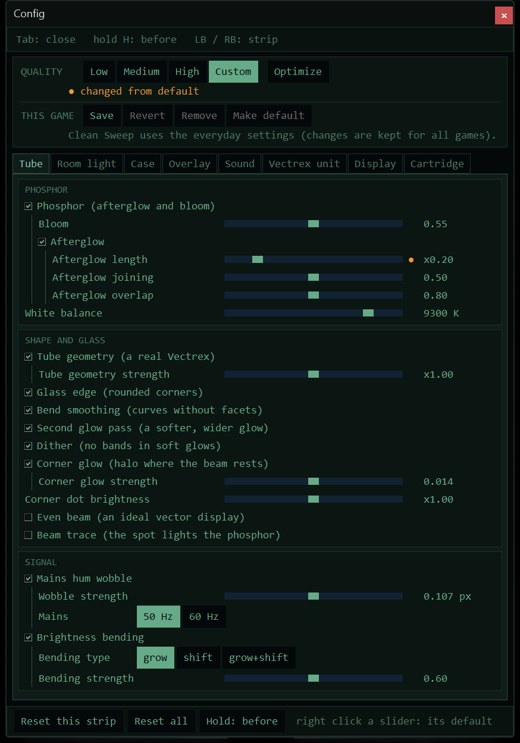</a><br>
<em>The Config window: Quality with Optimize, this game's settings, the Tube strip (a changed setting marked
in orange) and Reset all.</em>
</p>

### The screen: 60 Hz, high refresh, G-Sync

A Vectrex draws 50 pictures a second; most screens show 60. **Display > Screen** (and the setup, which
picks the best for your monitor) offers:

* **G-Sync / FreeSync** (the best, where the monitor has it): the screen waits for each game frame and
  shows it the moment it is drawn - 50 a second, as the Vectrex makes them, the wobble standing still.
  Detected from the monitor itself (its EDID): a G-Sync module, G-Sync Compatible / FreeSync, or
  DisplayID adaptive sync, with its range.
* **The monitor's full rate** (screens above 60 Hz: 120, 144, 165, 240 Hz...): vsync on every refresh; the
  afterglow fades in finer steps and moving things update more often.
* **Smooth motion** (60 Hz screens without G-Sync / FreeSync): pictures drawn between the game's frames, so
  movement is smooth; the picture comes about 20 ms later.
* **Plain 60 Hz**: every game frame as it is - one picture in five shown twice, a slight stutter in moving
  things.

None of them tear, and the picture is always drawn at the monitor's own resolution (e.g. 4K). A game that
runs slower than 50 frames a second (busy scenes, menus that draw half their lines each frame) keeps its
lines glowing between its frames, as the tube does - no flicker.

### Keys

Only what full screen needs has a key, so the rest of the keyboard is free for the players:

| Key | |
|---|---|
| F11 | full screen on/off |
| Esc | closes the ROM browser; in full screen: back to the window; in the window: pause (it never quits: close the window for that) |
| Tab | the Config window (Tab or Esc closes it); hold H in it to compare with before |
| L | the ROM browser (the Windows file dialog: Vectrex > Open ROM file) |
| O | the overlay on / off |
| Ctrl+E | eject the cartridge (Mine Storm) |
| Ctrl+R | the RESET button (RAM kept: the BIOS warm-starts the cartridge, no intro) |
| P | pause |
| Page Up / Page Down | the volume knob in 5 % steps - and, as on the Vectrex, the power switch: turned down to 0 % it clicks off (the tube fades to black), turned up from 0 % it switches on (a cold start, also for carts that ignore RESET), with the real power-off / power-on sounds. While turning it scratches like a worn potentiometer; now and then it stops on a dead spot: the game goes silent, the buzz goes on - turn it again. |
| Ctrl+Page Up / Ctrl+Page Down | the speech module's own volume (VecVoice / VecVox) in 5 % steps, 0 - 200 % (100 % = the MiSTer core's Normal level) |
| + / - / 0 | window size / start size (as big as fits the desktop, above the task bar); in full screen: the picture size |
| 9 | real size: the picture as big as on a real Vectrex, in the window and in full screen (until + / - / 0) |
| Ctrl+K | UVMC2 games: the keyboard types into the cartridge's USB port (Ctrl+K again gives it back) |

These keys (and everything with Ctrl) cannot be given to a player: F11, Esc, Page Up / Down, + - 0 9, P L O.
Only Ctrl+E and Ctrl+R need Ctrl - they end the game.

(The mouse pointer hides in full screen 2 s after it last moved.)

### TV mode shortcuts

So every game can be played with a controller only (or a Steam Deck): hold the stick in one direction and
**all four buttons for a second** (player 1's controller, or the keyboard's player keys):

| Stick + all four buttons, 1 s | |
|---|---|
| Up | the ROM browser (then: the stick chooses, button 4 loads, button 1 goes back / closes) |
| Down | the RESET button (the game's title screen, as on a Vectrex) |
| Left | controller port 2: the VecVox speech module / the joystick (a power cycle, as in the menu; announced on screen, and the port 2 pictogram below the picture changes) |
| Right | the overlay on / off |

While the Vectrex is switched off, any controller button switches it on (choose *Start switched on* in the
setup to skip that). A game that uses all four buttons with the stick for a second of its own: switch the
shortcuts off in the **Controls** menu: **TV mode shortcuts** (one switch for all).

### Controls

**Controls > Keyboard and controllers**: both players - the 1st and the 2nd controller port. Each
player picks a **controller** from the ones connected, listed by their own names (e.g. "Vectrex USB
Controller", "Logitech Extreme 3D"; Xbox-type XInput pads and other USB gamepads / joysticks), or
**Keyboard only**. A controller belongs to one player: the other player's list does not offer it.
A controller first chosen is mapped at once: its X / Y axes = the Vectrex stick, its buttons 1-4 = the
Vectrex buttons 1-4 (an Xbox pad: the left stick and X Y A B); a hat / d-pad is the stick too.

**The keyboard always works as well**, next to the controller: the buttons add up, and a direction
key overrides the stick on its own axis (holding the stick up while pressing Right = up-right; pressing
A while the stick is held = button 1 with the stick still held). No switching needed to try a game on the keyboard.

Click a box, then press a key / a controller button, or push the stick the way the row says (Up: push
up...: that picks the axis and its direction); Shift+click adds a second; right click clears (a stick
box: back to the default axis). The emulator's own keys (see [Keys](#keys)) cannot be
taken. Each controller keeps its own mapping: switching controllers needs no new mapping.

**Stick:** per controller **analog stick** or **buttons**. Analog: a bar per axis (X, Y) shows the real
stick (ring) and what the Vectrex gets (fill); drag the inner handles for the **dead zone** and the outer
ones for the **endpoint** - the stick position that already gives full deflection, so a joystick with a
long travel does not need to be pushed all the way (right click: back to 20 % dead zone, full travel).
**Link X and Y** (on by default) moves both axes' handles together; untick it to set them apart.
Buttons: the Up / Down / Left / Right (and Half stick) rows take controller buttons instead of axes -
full deflection, half with the half button. A hat / d-pad works as the stick in both modes. The **test
field** per player shows the stick (ring), the dead zone (dark square), the endpoints (dashed), what the
Vectrex gets (dot, with the x / y values) and buttons 1-4 lighting up. Reset to defaults.

Defaults: player 1 - arrows, A S D F = buttons 1-4 (a row, as on the controller; the setup offers W A S D
too), Shift = half stick, and the first controller found. **Mouse / touchpad steers player 1** (in the Controls window)
makes the pointer's place on the picture the stick (left button = button 4, right = button 1).
Player 2 - keyboard only, no keys: pick a second controller, or keys of your own. A chosen controller
that is unplugged is shown as "not connected" (the keyboard still works) and is used again when it is
plugged back in. The keys only count while the emulator's window is in front.

**Settings** (window size, look, sound, volume, controls, overlays, the last ROM) are saved in
`system/settings.json` next to the program, so the folder is portable: copy it and the settings come along.
If that folder cannot be written (e.g. under Program Files) they go to `%APPDATA%\Vectrex_EMU` (Windows),
`~/Library/Application Support/Vectrex_EMU` (Mac) or `~/.config/Vectrex_EMU` (Linux). Nothing else is
written: no logs, no recordings. **Help > Copy system info** copies the program's version, your system,
graphics card and screen to the clipboard, for a GitHub issue.

### Overlays

Put overlay files in the folder **`overlays`** next to the program, named like the ROM -
`Armor Attack.bin` finds `Armor Attack.art`. Two formats:

* **MiSTer `.art`**: the emulator comes with the MiSTer Vectrex core's set ([Vectrex_MiSTer](https://github.com/Videodr0me/Vectrex_MiSTer)'s
  `overlays.zip`), renamed like the games (`overlays/RENAMED.txt`; `overlays/CREDITS.md` names each design's
  author). New ones from there can be copied in as they are: MiSTer's
  names are found too - underscores count as spaces, and `(...)` parts, versions and a trailing "Proto"
  are ignored (`ArmorAttack.art`, `Armor_Attack.art`, `Dark_Tower_Proto.art` and `VectorbladeV1.13.art`
  all find their game; hacks such as `Berzerk (Hack - Speed, 2016).bin` find `Berzerk.art`). Only the
  normal files are needed, not the `_90CW` / `_90CCW` ones in its `Tate` folder: the emulator turns the
  whole screen itself (**Display > Rotate**).
* **PNG**: an image with transparency (8-bit RGBA), the sheet 846 x 1080 (or the same proportions) or the
  whole 1360 x 1080 MiSTer frame with the sheet in the middle. Alpha 255 is solid print, 1 - 254 coloured
  see-through plastic (MiSTer's tools use 51), 0 clear; without transparency it is all see-through, black clear.

Several overlays for one game (`Spike.art`, `Spike (red).art`): the plain one is chosen; pick another with
**Overlay > Choose overlay...** (remembered per game). (Overlays in `roms/overlays`, where they went
before, are still found.)

The Config window's **Overlay** strip has the rest - on / off (**O**), choose / none per game, tint, printed
art, parallax, the plastic glow, the scratches, a fine position / size per overlay - each explained in
[chapter 9](#9-overlays---and-forty-years-of-scratches) and in the built-in Help. The room light and the
ceiling light's reflections are on the **Room light** strip ([chapter 11](#11-the-rooms-light-the-glass-the-phosphor-and-the-reflections)).

**Mine Storm's overlay** is `overlays/Mine Storm (built in).art`, for the game built into the console. To use another one, put your own `Mine Storm.art` next to it (the
plain name is chosen first), or replace or delete that file (without it Mine Storm runs without an
overlay). It is the [Libretro overlay-borders](https://github.com/libretro/overlay-borders)
Mine Storm artwork as converted to `.art` by the [Vectrex_MiSTer](https://github.com/Videodr0me/Vectrex_MiSTer)
project (`Mine_Storm.art` in its `overlays.zip`).

*Disclaimer: the overlay artwork is not part of this project and not covered by its licence; it belongs
to its creators and is included unchanged as a courtesy, for non-commercial use. Vectrex is a trademark
of its owners; this project is not affiliated with them, Libretro or MiSTer. On request it will be
removed. The other overlays are the MiSTer project's set as it shares them, each credited in `overlays/CREDITS.md`.*

### Head tracking

A phone on your desk can follow your head: with **head tracking** on, the game's picture slides a little against
the overlay and the glass as you move, the way the phosphor behind a real overlay does - the overlay looks like the
sheet of plastic in front of the tube it is. It uses **[SmoothTrack](https://smoothtrack.app/)**, a phone app for
iPhone and Android made for head tracking in simulators: it follows your head with the phone's front camera and sends
its position in OpenTrack's format, which Vectrex_EMU reads itself (no OpenTrack needed).

* **Over Wi-Fi:** in SmoothTrack's settings enter this PC's address - Config > Head shows it under Head
  tracking - and port **4242**, start tracking, and turn Head tracking on. Let Vectrex_EMU through the firewall when
  Windows asks.
* **Over USB (iPhone):** install **Apple Devices** (or iTunes) from the Microsoft Store, plug the iPhone in and trust
  the PC, then tap *Activate USB Connection* in the app. Vectrex_EMU finds the phone on the cable by itself and reads
  SmoothTrack straight from it (about 120 positions a second, steadier than Wi-Fi) - SmoothTrack's USB tunnel tool
  is not needed.
* **Over USB (Android):** turn on USB debugging on the phone and unpack
  [Gnirehtet](https://github.com/Genymobile/gnirehtet/releases) (it brings adb) into the Vectrex_EMU folder. The
  emulator runs it itself - installs its app on the phone the first time, routes only this PC's address through it
  (the phone's internet stays as it is) and reads SmoothTrack's positions; enter this PC's address and port 4242 in
  the app and allow Gnirehtet's VPN once.
* **Config > Head**: **Centre** makes where your head is now the middle. The picture's shift (x1 = 2 mm at the
  edge of the app's view), the room light's reflections on the glass and on the overlay (each with its own
  strength), smoothing for left / right, up / down and near / far, and the phone's tilt if it looks up at you.
  Leaning in makes the shift larger, as on a real tube. Only with an overlay: without one there is nothing in front
  of the picture for it to slide against.

Help > Head tracking (SmoothTrack), also a button in the Config window, walks through it with every link.

### Speech modules

**Controls > Port 2** (or **Cartridge > Controller port 2** in Config) plugs a speech module into the second controller port instead of a
joystick: the **VecVoice** (SP0256) or the **VecVox** (SpeakJet). How they work and how they were
built: [chapter 8](#8-speech-two-rare-modules).

**They need the speech ROM**, which cannot be included: the SP0256-AL2's built-in ROM is (c) Microchip
Technology Inc. Joe Zbiciak distributes it with Microchip's permission:

1. Download `al2.bin` (2 KB) from [spatula-city.org/~im14u2c/sp0256-al2](http://spatula-city.org/~im14u2c/sp0256-al2/).
2. Put it in the **`system` folder next to the emulator** (as `al2.bin` or `sp0256-al2.bin`; MAME's
   `sp0256-al2.bin`, the same data with each byte's bits reversed, works too).
3. Choose **Controls > Port 2: VecVoice** or **VecVox**. The Vectrex is switched off and on.

What is in port 2 shows as a pictogram labelled P2 PORT in the strip below the picture, next to the cartridge -
a Vectrex controller seen from above, the VecVox (a box with a speaker) or the VecVoice (a speaking head): **click it** to plug in the next one
(joystick, VecVox, VecVoice, joystick...). Every switch is announced in the middle of the picture for two
seconds. The [controller shortcut](#controller-shortcuts) stick left + all four buttons switches between the
VecVox and the joystick.

Both modules need it (the VecVox speaks with the SP0256's voice). Without it the setting stays on Joystick.

**Sound > Speech module volume**: its own **Volume** (also Ctrl+Page Up / Down; SPEECH VOL on the on-screen
display, 100 % = the MiSTer core's Normal level), and **Full-range speakers** (an arcade cabinet's warm
bass) or a **Small speaker**.

**Port 2's buttons:** a module answers "ready" on port 2's button 2, so to the Vectrex it looks like
player 2 holding button 2, as with a real module plugged in. **GCE's original Berzerk** waits for every
button to be released and will not start - choose Joystick for it; **Berzerk Ultimate** (Malban) starts
and talks. Two-player games lose their second player while a module is plugged in.

#### Games that talk

Pick the device the game was written for: **VecVox** for SpeakJet games, **VecVoice** for SP0256 games
(a real VecVox or AtariVox+ has a VecVoice mode for those, chosen with a button held at power-up or a
DIP switch). With the wrong one the speech comes out garbled, as with the wrong real module.

| Game | Device | Tested here |
|---|---|---|
| Berzerk Ultimate (Malban) | VecVox | talks |
| Brecher (2015) | VecVox | |
| Color Clash | VecVox | |
| Debris (Revisited) | VecVox | |
| RushHour | VecVox | |
| Shifted | VecVox | |
| Space Frenzy (John Dondzila, 2006) | VecVox | talks |
| Spike's Circus | VecVox | |
| VecFahren (Der Luchs, 2013) | VecVox | talks |
| Vectoblox | VecVox | |
| Vectorblade (Malban) | VecVox | talks ("level one") |
| V:Hockey | VecVox | |
| VecVox X-Mas (2005) | VecVox | sings |
| VecTalk (Binary Star, 2018), VecVox Demo, VecVox Driver Demo | VecVox | talk |
| B.E.T.H. (Manu) | VecVoice | talks |
| Deathchase | VecVoice | |
| NOX | VecVoice | |
| Pythagorean Theorem (Rob Mitchell, 2002) | VecVoice | |
| Verzerk (Alex Herbert, 2002) - a talking Berzerk | VecVoice | talks |
| Y.A.S.I. (John Dondzila; on "Protector & YASI") | VecVoice | |
| VecVoice Demo (Richard Hutchinson, 2002) | VecVoice | talks |

From the AtariVox+ list ([AtariAge](https://atariage.com/store/index.php?l=product_detail&p=1045),
[review](https://www.atari7800forever.com/autovox.html)), [vectrex.co.uk](http://www.vectrex.co.uk/news-2009.htm)
and [Revival Studios](https://www.revival-studios.com/vectrex.php); the lists date from 2009-2015 and
partly disagree (Space Frenzy is filed under VecVoice in places - its speech is SpeakJet codes). Malban's
two games are on none of them; newer games may be missing too.

### The 3D Imager and the light pen

GCE's two accessories for controller port 2 - click the P2 PORT pictogram below the picture (or Controls > Port 2)
until it shows the one you want:

* **The 3D Imager** (1983): goggles with a disc spinning in front of the eyes, half black, half red, green and blue
  filters. The game drives the disc's motor itself and times its pictures from a hole in the disc, so each line is
  seen through the filter passing at that moment: 3D Mine Storm, 3D Narrow Escape and 3D Crazy Coaster in colour. As
  on the real goggles the game first spins the disc up and waits, the screen dark, until it is at speed (about 13
  seconds), then plays. Meanwhile a note on the picture shows the disc's speed, and you hear its motor: a small
  disc's soft rush, swelling once every turn - made from recordings of real goggles (on its own channel, not through the
  Vectrex's knob: Config > Sound or Cartridge - the sound, its volume, the note). Shown in colour, both eyes'
  pictures together (no 3D yet).
* **The light pen** (1983): a light sensor in a pen; when the beam passes under its tip the game knows where it
  points. Here the mouse is the pen (the pointer turns into a small green pen): over the picture it is held to the
  screen, and the mouse buttons are player 1's buttons 1, 2 and 3 (Art Master: draw, straight line, menu). For Art
  Master, AnimAction and Melody Master. The pen sees only what the game draws: to drag the cursor, put the pointer
  on it, hold the left button and move at a steady pace (too fast and the cursor lets go: go back to it).
  AnimAction's cartridge has RAM of its own (8 KB at $2000), found by itself (Cartridge hardware: Auto).

<a href="docs/images/v1.0.5/lightpen.jpg"></a>
<a href="docs/images/v1.0.5/imager.jpg"></a><br>

### Cartridge hardware

**Cartridge > Cartridge hardware** (saved): **Auto** (the default) models the bank-switching cartridge
boards, chosen by the ROM's size; or pick one board for any ROM:

* **up to 64K** - PB6 drives the EPROM's A15 (3.3K pull-up: an input PB6 reads high, bank 1 at power-on).
* **over 64K, up to 256K** - Malban's Vectorblade cartridge (SST39SF020A flash): two bank lines, PB6 and
  the cartridge port's /IRQ (low while an enabled VIA interrupt flag is set), bank = PB6 + 2 x (/IRQ
  high), 64K per bank of which the cartridge shows $0000-$BFFF; power-on bank 3. The flash is modelled
  (program, sector / chip erase, ID): the game's high scores and settings are saved to `<rom>.sav` next
  to the ROM, the dump itself is never changed.
* **exactly 512K** - a 512K flash cartridge with a bank latch (Hugo Bokhorst's v2 board, SST39SF040):
  A15 = PB6, A16-A18 = a 74HC377 that a write to $0000-$3FFF loads with the data's bits 0-2 (clock =
  /CART OR A14), 16 banks of 32K. The latch has no reset: it powers up in any bank, the RESET button
  keeps it. Flash saves as above (`<rom>.sav`); the flash's commands load the latch with $55 on their
  $2AAA write, so a game saves in $4000-$7FFF of a bank with A16-A18 = 101.
* **other images over 256K** - a 1 MB multi-cart (as Sean Kelly's Multi-Cart): a latch written at $7FFF picks
  the 4K page the cartridge window starts at; power-on page 0 (the menu); the RESET button keeps the page.

**Off**: a bone-stock Vectrex - every ROM is a plain 32K cartridge (the first 32K of the file, no bank
switching), so bank-switched games do not start. Changing it puts the cartridge in again (power cycle).

**VecFever `.v4e` files** load like any ROM (the ROM browser, Open ROM file). The emulator unpacks them
(VecFever's packed, checksummed banks) into the folder `v4e` next to its settings and runs the plain image,
with the board the file names: a plain ROM, a ROM with a DS2431 save chip (its memory saved there too),
2 x 48K (PB6) or 4 x 48K (PB6 and /IRQ, as Vectorblade); a flash game's `.sav` is kept in that folder.
Files for hardware the emulator does not have (the VecFever's own programs, a ROM with RAM, 50K flat,
hybrid, firmware) are refused with a message, and the game in the slot keeps running.

### UVMC2 games: the Ultimate Vectrex Multicart 2

The **Ultimate Vectrex Multicart 2** (UVMC2) is a cartridge with a computer of its own: an RP2350, two ARM
Cortex-M33 cores at 150 MHz. Its native games (`.um2` files) run on that chip: the game holds the Vectrex's
6809 stopped and drives the bus itself, writing the VIA once per bus cycle, as the 6809 would. Vectrex_EMU
runs the RP2350 - both cores, its PIO state machines, DMA, timers, PSRAM, the SD card, the USB port and the
headphone jack - and lets it drive the emulated Vectrex, so the picture, the tube and the sound behave as with
any cartridge: the mains wobble and the buzz too, as on a real Vectrex with a UVMC2.

**Plug and play:** put `.um2` files in `roms` (or anywhere: **Vectrex > Open UVMC2 game...**); the ROM browser
lists them marked UVMC2. On a PC with four or more cores the cartridge's two cores run on two of the PC's.

<p align="center">
<a href="docs/images/v1.0.3/uvmc2_demo.png">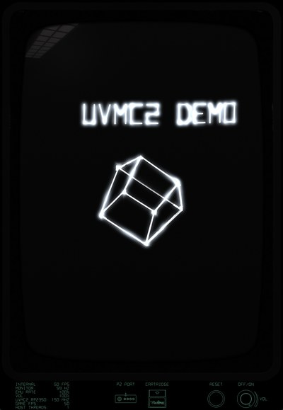</a>
<a href="docs/images/v1.0.3/uvmc2_movies.png">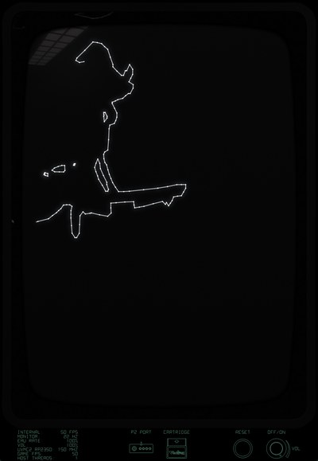</a>
<a href="docs/images/v1.0.3/uvmc2_doom.png">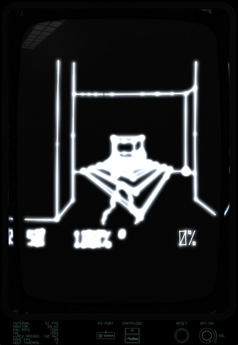</a><br>
<em>The included UVMC2 Demo and UVMC2 Movie Player (here: Bad Apple), and Doom on the UVMC2 in its
first level (the WAD read from the SD card folder).</em>
</p>

**Included**, both written for this emulator from scratch (MIT license, sources in `testcart/`):

* **UVMC2 Demo** - a rotating 3D cube computed on the cartridge's chip and drawn on the Vectrex, line by
  line, by the chip itself. Source: [`testcart/uvmc2_demo`](testcart/uvmc2_demo) - a small, readable
  starting point for writing your own UVMC2 programs in plain C.
* **UVMC2 Movie Player** - plays the Vectrex vector movies made for the PiTrex / VecFever (Bad Apple, La
  Linea, ...) from the SD card's `movies` folder, one after another; button 4 skips to the next. **Bad Apple
  is included** (`uvmc2/movies/BadApple.bin`, by Malban, bundled with his kind permission). With a `.pcm` sound file next to a movie (raw 16-bit mono,
  44100 Hz) it plays that high-quality sound through the Vectrex's own speaker (button 3: through the UVMC2's
  headphone jack instead); without one, the movie's own 8-bit sound. Source and the `ffmpeg` line to make a
  `.pcm`: [`testcart/uvmc2_movies`](testcart/uvmc2_movies).
  **Where to get movies:** Malban's free PiTrex SD card download ([vide.malban.de](http://vide.malban.de))
  has four of them: Bad Apple, Bad Apple DE, BlaBla and La Linea. Copy its `vectrex/movies` folder into
  `uvmc2/movies` for the other three. For Bad Apple's high-quality sound, make a `BadApple.pcm` from the video with that `ffmpeg` line.

**The SD card is a folder.** A real UVMC2 reads its games' extra files from a microSD card; here that card
is the folder **`uvmc2` next to the program** (made at the first start, with a note in it). Put files in it as
you would on the card:

| Game | Needs | Put it in |
|---|---|---|
| Doom | a DOOM WAD file: `DOOM.WAD`, `DOOM2.WAD`, or `DOOM1.WAD` (the free shareware episode) | `uvmc2/doom` |
| Quake | `pak0.pak` (the free shareware one will do), and `pak1.pak` for the full game | `uvmc2/quake` |
| UVMC2 Movie Player | the movies (`.bin`: Bad Apple is included, the others from Malban's PiTrex SD card download, see above), and optionally their `.pcm` sound | `uvmc2/movies` |

A game that needs such a file and does not find it **says so when it starts**: which file, and the exact
folder - and offers to open that folder. **Cartridge > Open the SD folder** opens it any time, **Choose SD
folder...** uses another folder (a copy of your real card, for example). What a game writes (saves,
settings) stays in the folder.

**The cartridge strip** has the rest: the UVMC2 games shown in the ROM list or not; **the PC's mouse and
keyboard on its USB port** (on by default: the mouse over the picture is a USB mouse - VecOS uses it -
and after **Ctrl+K** the keyboard types into the cartridge, Ctrl+K again gives it back); the **headphone
jack**: clean as a line out next to the Vectrex's sound, through the Vectrex's own speaker and volume knob,
or off, with its volume.

### The PiTrex: a Raspberry Pi in the cartridge slot

The [PiTrex](http://vide.malban.de) (Malban, Kevin Koster and others) is a cartridge with a Raspberry Pi Zero in
it: the Pi draws on the Vectrex directly, so it runs arcade emulators (Asteroids, Battlezone, Tempest, Black
Widow, Space Duel, Tailgunner, the Cinematronics games and more), Vectorblade, Elite, a BASIC, and a Vectrex
emulator of its own. Vectrex_EMU emulates the whole cartridge: the Pi's ARM11 processor - with a JIT compiler
for x86-64 and ARM64, fast enough for its arcade emulators - its timers and interrupts, the bus to the Vectrex
and the SD card.

<p align="center">
<a href="docs/images/v1.0.4/pitrex_menu.jpg">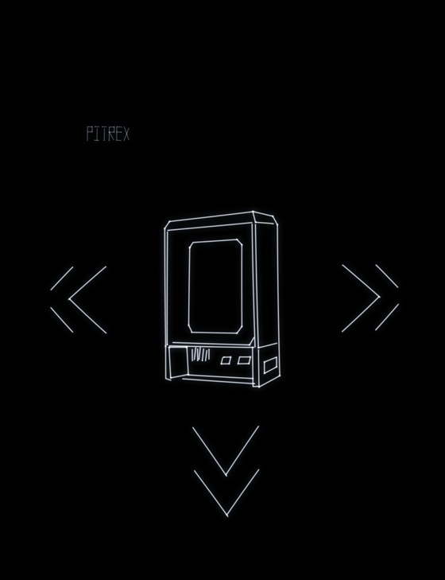</a>
<a href="docs/images/v1.0.4/pitrex_games.jpg">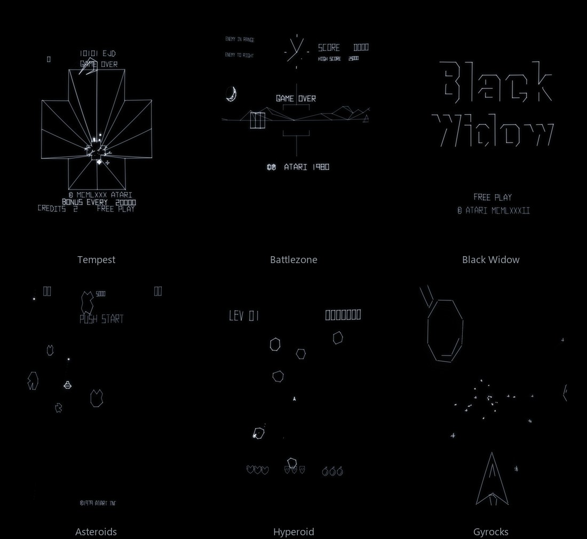</a><br>
<em>The PiTrex's menu, and some of what runs on it: Tempest, Battlezone, Black Widow, Asteroids, Hyperoid and Gyrocks.</em>
</p>

* **Vectrex > PiTrex > Start the PiTrex** boots its menu; **Open PiTrex program...** runs one program on its own;
  **SD card folder...** chooses the folder the PiTrex sees as its SD card (default `pitrex` next to the program).
  The ROM browser lists the PiTrex at the top.
* **The SD card**: Malban's PiTrex SD card download - **Get games & extras** (or the setup) fetches the newest and
  unpacks it into `pitrex`.
* **Arcade games need their ROMs**, your own: MAME sets (non-merged or split; merged ones are not supported) in
  `pitrex/roms`, the AAE ones (Star Wars, Major Havoc) in `pitrex/roms/aae`. The PiTrex's own FAQ in that folder
  lists them.
* In its menu, **button 4** starts, the stick chooses.
* **A USB keyboard and mouse**: the PC's, on the PiTrex's USB port (the Pi's own USB controller emulated, for the USPi
  library the programs use) - Elite and GS BASIC find their keyboard. **Ctrl+K** types on it (the keys then go to the
  PiTrex, not the controller; Ctrl+K again gives them back). Cartridge strip: *The PC's mouse and keyboard on its USB
  port*.

### Online play: two Vectrex_EMUs, one game

Two players, two PCs, one Vectrex: the host is player 1 and chooses the game, the other PC joins as player 2 and
both switch on together. Only the controllers travel over the network (4 bytes a frame): the emulator is
deterministic, so both machines compute the same game, to the bit. The **Online** menu does it all: *Host this
game...* shows a five-letter code for player 2, who types it in *Join a game...*; the Online window also shows the
connection (round trip, input delay, direct or relayed) and its settings. From the command line:

```
Vectrex_EMU.exe "roms\Armor Attack.bin" --net-online     the host: it shows a five-letter code
Vectrex_EMU.exe --net-join KRAVE                          player 2, with that code
```

The code goes through a small meeting-point server (`tools/vxrelay.py`), which puts the two PCs in touch directly
(through most home routers without any settings) and relays the packets when that is not possible. Without the
server: `--net-host` on the host (its router forwards UDP port 7744) and `--net-join ADDRESS` on the other side.
**The game room**: Online > *Host public game* lists your game under your player name (asked once, reserved for you
at the meeting point) for anyone to join; Online > *Find players* shows the games waiting for a player 2 and joins one with a click (the meeting point holds at most 100 waiting games). **Chat** (Online > Chat, Ctrl+T): write to the other player while you play - Enter sends, Esc gives the keyboard back
to the game, and a controller plays on while you type. The window opens by itself when the other player writes, and
their line shows briefly in the picture too. Player 2 needs the same ROM in its `roms` folder (found by checksum). **UVMC2 games and PiTrex programs** play online too: player 2 needs the same game file, and the two SD cards are compared file by file - the game runs from the files both have the same (nothing is copied between the PCs; the chat says when files differ). While online the UVMC2 runs on one PC thread and the PiTrex's JIT in its exact mode, so both PCs stay identical; the PC's keyboard and mouse do not reach the cartridge. Twice a second both sides compare a checksum of the whole emulated machine: ONLINE: OUT OF SYNC would show if they ever differed. The host measures the round trip and sets the
input delay accordingly (3 frames on a LAN, up to 12); lost packets are covered by the next. Tested on one PC and
through a simulated bad connection (40-60 ms each way, 10 % packet loss): identical pictures throughout.

### Mac and Linux notes

The same emulator, everything in this README applies. The BIOS and Mine Storm's overlay sit in the
**`system` folder next to the program**. If macOS ever says the BIOS is missing, it is running the app from
a hidden copy: drag `Vectrex_EMU.app` out of its folder in Finder and back in (or once in Terminal:
`xattr -dr com.apple.quarantine Vectrex_EMU.app`).

On a Mac the Ctrl shortcuts work with Command as well: ⌘E eject, ⌘R RESET, ⌃⌘F full screen (also fn+F11),
⌘Q quits; Page Up / Down are fn+↑ / fn+↓ on a MacBook; the right mouse button is Ctrl+click. On a Retina
screen the picture is drawn at its full resolution, and at the full rate a ProMotion screen runs at 120 Hz.

Controllers work through SDL2: an Xbox, PlayStation or Switch pad shows up like the Xbox pad on Windows,
any other joystick by its own name. Settings files move between all three systems as they are.

**Steam Deck:** the Linux build runs on it. In **Desktop Mode** start `Vectrex_EMU` from the extracted
folder (the first start shows the setup window; *Start playing* switches the Vectrex on). For **Game Mode**
add `Vectrex_EMU` to Steam as a non-Steam game: there only one window is shown, so the emulator skips the
setup window and starts switched on; the Deck's controls are player 1's controller. Any controller button
switches a Vectrex that is off back on, and the [TV mode shortcuts](#tv-mode-shortcuts) open the ROM
browser, press RESET, switch the overlay and the VecVox.

**No glow, a plain picture?** Then OpenGL did not start, and the emulator says why in a message. On Linux
the program uses the system's own OpenGL driver, C++ runtime and X libraries (it does not bring copies of
its own, which broke Mesa on new systems). A build older than v1.0.2 can be started with them:
`LD_PRELOAD="/usr/lib64/libstdc++.so.6 /usr/lib64/libgcc_s.so.1 /usr/lib64/libX11.so.6" ./Vectrex_EMU`
(on Debian / Ubuntu: `/usr/lib/x86_64-linux-gnu/...`).

---

## Building from source

For tinkerers - the [releases](../../releases) are built from the same sources by the GitHub workflow
(`.github/workflows/build.yml`), which also checks that each one starts.

* **Windows**: `build_exe.bat` builds the core (`build_core.bat`, needs Visual Studio Build Tools with
  C++), installs PyInstaller if needed and makes `Vectrex_EMU.exe` with the BIOS and Mine Storm's overlay
  inside (needs Python 3.12 from python.org). `run_from_source.bat` runs straight from the sources (after
  `build_core.bat`).
* **macOS / Linux**: `build_mac.sh` (the python.org Python 3.12) and `build_linux.sh`. The platform side
  (OpenGL context, keys, controllers, sound) is `src/frontend/osdep.py`; on Windows the program uses the
  Windows APIs directly. `tools/snapshot_test.py` checks the OpenGL picture.

| Path | |
|---|---|
| `src/core/` | the core (C): `vecx.c` CPU bus and analog model, `e6809.c` CPU, `e8910.c` / `psg.c` sound chip, `live.c` the frame pipe to the front end, `vtest.c` main (also a scripted test harness), `sp0256.c` / `speakjet.c` the speech modules, `ds2431.c` a 1-Wire save chip, `bot.c` a test player; the UVMC2: `cm33.c` the ARM Cortex-M33 cores, `rp2350.c` the RP2350 (PIO, DMA, timers, SD card, PSRAM), `uvm2_cart.c` the cartridge on the Vectrex's bus, `usbhost.c` its USB host with a keyboard and mouse, `host.c` the host threads |
| `src/frontend/` | `vectrex_emu.py` window, input, sound, settings, menus; `deck.py` the Config window and the setup; `vecrender.py` the OpenGL renderer (beam, phosphor, overlays, scratches); `vrrdetect.py` G-Sync / FreeSync from the monitor's EDID; `fatimg.py` SD card images; `links.py` Finder aliases and shortcuts in the ROM folder; `vart.py` overlay files; `help_text.py` the built-in Help |
| `system/` | the Vectrex BIOS (`bios.bin`, with Mine Storm) |
| `overlays/` | Mine Storm's overlay (`Mine Storm (built in).art`) |
| `sounds/` | the power-on / power-off sounds, recorded on a real Vectrex |
| `package/` | the folders and notes that go into each release zip |
| `testcart/` | the test cartridges (6809 assembly) used to measure the real Vectrex; `uvmc2_demo/` and `uvmc2_movies/` the included UVMC2 programs (C, MIT) |
| `docs/` | the pictures, and [TECHNICAL.md](docs/TECHNICAL.md) |

Build outputs (`core/`, `build/`, `Vectrex_EMU.exe`, `dist-*`) are not in the repository.

## Credits and license

Vectrex_EMU is free software under the **GNU General Public License v3** ([LICENSE.md](LICENSE.md)), the
license of the vecx emulator it is built on.

* **vecx** - the original emulator core.
* **MAME** - the SP0256 synthesizer in `src/core/sp0256.c` is ported from MAME's sp0256.cpp
  (BSD-3-Clause, Joseph Zbiciak and Tim Lindner).
* **The MiSTer Vectrex core** (Dar, Sorgelig, alanswx, Videodr0me) - the DAC sound mix, the power-on seed,
  the VecVoice link and the speech level (Sorgelig's audio compressor table) follow it; its `.art`
  overlay format and overlays; Mine Storm's overlay (Libretro artwork, see [Overlays](#overlays)).
* **Malban** - the analog delays measured for VIDE, Vectorblade's cartridge, and the Bad Apple vector movie
  (`uvmc2/movies/BadApple.bin`, from his PiTrex SD card), bundled with his permission.
* **The PiTrex** (Malban, Kevin Koster and the PiTrex team) - the cartridge and its programs; the emulator runs
  their SD card as it comes, downloaded from Malban's page.
* **The overlays** - the authors of each design are listed in `overlays/CREDITS.md`.
* **The SP0256-AL2 ROM** is (c) Microchip Technology Inc., distributed by Joe Zbiciak with Microchip's
  permission; it is not part of this project.
* **The Vectrex BIOS**: Smith Engineering allows it to be copied freely for non-commercial use.

Vectrex_EMU by Hugo Bokhorst, developed with Claude (Anthropic) as development assistant and programmer.
