# Vectrex_EMU

**A Vectrex emulator that doesn't try to be perfect. It tries to be a Vectrex** - measured, line by line, on a real one.

<p align="center">
<a href="docs/images/page/hero_full.jpg">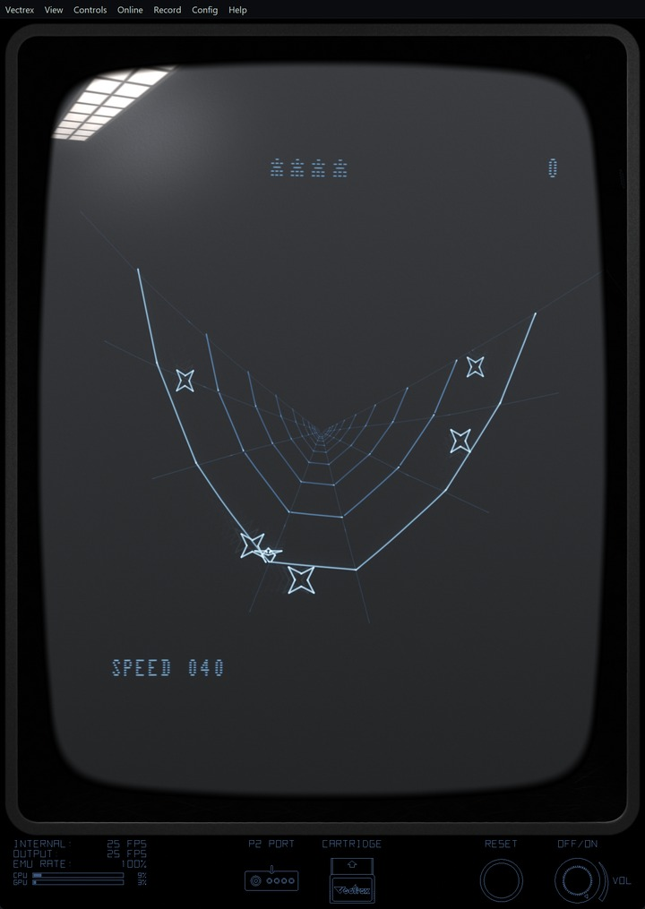</a><br>
<em>Web Wars on the bare glass, room light at Daylight: the ceiling light mirrored in the tube, the glass catching the room.</em>
</p>

## Downloads

**Latest release: [github.com/hugonl31/Vectrex_EMU/releases/latest](https://github.com/hugonl31/Vectrex_EMU/releases/latest)**

| | Download | Start |
|---|---|---|
| **Windows** 10 / 11, 64-bit | [Vectrex_EMU-windows.zip](https://github.com/hugonl31/Vectrex_EMU/releases/latest/download/Vectrex_EMU-windows.zip) | `Vectrex_EMU.exe` |
| **macOS** 10.13 or later, Intel and Apple Silicon | [Vectrex_EMU-mac-app.zip](https://github.com/hugonl31/Vectrex_EMU/releases/latest/download/Vectrex_EMU-mac-app.zip) | `Vectrex_EMU.app` |
| **Linux** x86-64 (Ubuntu 22.04, Debian 12, Fedora 36 or later) | [Vectrex_EMU-linux-bin.zip](https://github.com/hugonl31/Vectrex_EMU/releases/latest/download/Vectrex_EMU-linux-bin.zip) | `./Vectrex_EMU` |

**RetroArch cores** (each zip has RetroArch's folders and an `INSTALL.txt`):
[Windows x64](https://github.com/hugonl31/Vectrex_EMU/releases/latest/download/Vectrex_EMU_RetroArch_Windows-x64.zip) -
[macOS](https://github.com/hugonl31/Vectrex_EMU/releases/latest/download/Vectrex_EMU_RetroArch_macOS.zip) -
[Linux x64](https://github.com/hugonl31/Vectrex_EMU/releases/latest/download/Vectrex_EMU_RetroArch_Linux-x64.zip) -
[Linux arm64](https://github.com/hugonl31/Vectrex_EMU/releases/latest/download/Vectrex_EMU_RetroArch_Linux-arm64.zip) -
[Android arm64](https://github.com/hugonl31/Vectrex_EMU/releases/latest/download/Vectrex_EMU_RetroArch_Android-arm64.zip)
(with ES-DE support). See [The RetroArch core](#the-retroarch-core).

**Box art, the full set** (labels and boxes for 280 games, optional):
[release artwork-1](https://github.com/hugonl31/Vectrex_EMU/releases/tag/artwork-1) -
[Vectrex_EMU-artwork-full.zip](https://github.com/hugonl31/Vectrex_EMU/releases/download/artwork-1/Vectrex_EMU-artwork-full.zip).

**Included:** the Vectrex BIOS with Mine Storm, the game **Last Human** (and its UVMC2 edition), about 65 overlays,
box art for 112 games, the UVMC2 Movie Player with Bad Apple. **You add:** your own cartridge ROMs - or fetch the
original GCE games and free homebrew with **Vectrex > Get games & extras**, at your own responsibility
([what you add](#what-you-add)).

The Mac app is signed and notarized by Apple: it opens straight away. The Windows program is not signed yet: Windows may
say it protected your PC - *More info > Run anyway*. Linux: `chmod +x Vectrex_EMU` if the zip lost the permission.

---

## Contents

* [What it is](#what-it-is) - [Gallery](#gallery) - [Features](#features)
* [Measured on a real Vectrex](#measured-on-a-real-vectrex) - how the picture, the sound and the timing were made
  authentic, and [the test cartridges](#11-the-test-cartridges)
* [Using it](#using-it) - first start, keys, controls, Config, quality, the screen, overlays, the games list, speech,
  3D Imager and light pen, cartridge hardware, UVMC2, PiTrex, online play, VecLink, recording, head tracking,
  Mac and Linux
* [The RetroArch core](#the-retroarch-core)
* [Building from source](#building-from-source) - [Technical details](docs/TECHNICAL.md) -
  [Release notes](RELEASE_NOTES.md) - [Credits and license](#credits-and-license)

---

## What it is

The Vectrex (GCE / Milton Bradley, 1982) is the only home console that drew its games with a real vector beam: one
electron beam, steered by analog circuits, tracing every line onto the phosphor of its own 9-inch screen. Most
emulators show what the games *meant* to draw: clean, sharp lines on black. A real Vectrex never looks like that.
Its lines are moving light. Corners glow where the beam rests. Shapes don't quite close, because the analog circuits
drift. Text has gaps. The picture sways with the mains hum, everything leaves a fading trail, and the speaker buzzes
along with what is on screen.

Vectrex_EMU shows all of that, and every part of it was measured on a real Vectrex - with test cartridges written
for the purpose, photographs, films and sound recordings - not guessed.

* **The picture is the beam on the phosphor.** The emulator follows the beam's path cycle by cycle and lets the
  phosphor light up by one law measured on photos of a real tube: slow lines brighter, resting spots wider, crossings
  adding up, an afterglow filmed on the real thing.
* **The tube, measured.** Its uneven shape fitted to a photo of a full-screen grid on a real Vectrex; the glass, the
  case and the overlay at their real sizes in millimetres.
* **The analog side.** Line gaps, drift, mains-hum wobble, brightness bending, the trim pots and the brightness knob
  at the back - as sliders, with presets for other units.
* **Overlays** lying flat on the glass, lit by the room, with forty years of scratches glinting around the lines.
* **The sound** of the real console: the buzz, the small speaker, the power switch, a worn volume knob - and the two
  rare speech modules.
* **The hardware around it:** bank-switched and flash cartridges, VecFever files, the 3D Imager, the light pen,
  VecLink, and two cartridges with computers of their own: the **UVMC2** and the **PiTrex**.
* **Online play** between PCs, phones and tablets, a game room, LAN and router-free "Nearby" play.
* **Everywhere:** Windows, macOS, Linux, RetroArch (including Android handhelds with ES-DE). Apps for iPhone / iPad and
  Android exist and are in testing.

**Author:** Hugo Bokhorst ([@hugonl31](https://github.com/hugonl31)) - the idea, the real Vectrex, every photo,
recording and measurement, and every call on how it should look, sound and feel.<br>
**Development assistant and programmer:** Claude (Anthropic).

## Gallery

<p align="center">
<a href="docs/images/page/gallery/overlay_mine_storm.jpg">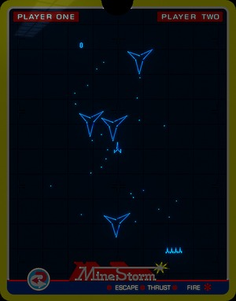</a>
<a href="docs/images/page/gallery/overlay_armor_attack.jpg">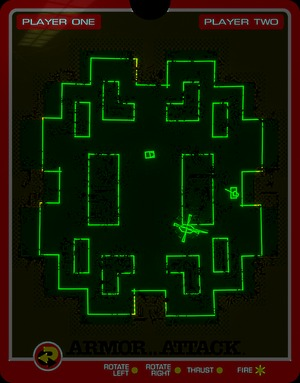</a>
<a href="docs/images/page/gallery/overlay_bedlam.jpg">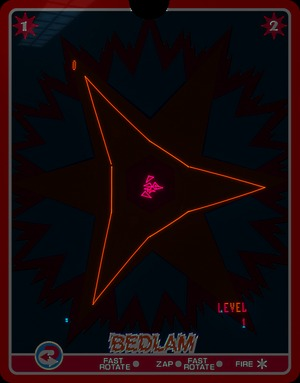</a><br>
<em>With their overlays: Mine Storm, Armor Attack, Bedlam (the lines lifted a little for this page).</em>
</p>

<p align="center">
<a href="docs/images/page/gallery/web_wars.jpg">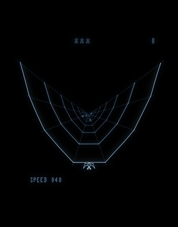</a>
<a href="docs/images/page/gallery/pole_position.jpg">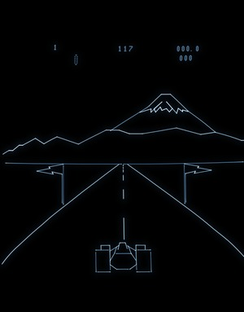</a>
<a href="docs/images/page/gallery/spike.jpg">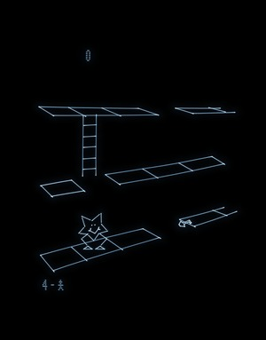</a>
<a href="docs/images/page/gallery/starhawk.jpg">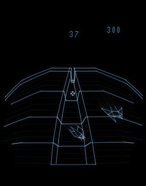</a><br>
<a href="docs/images/page/gallery/scramble.jpg">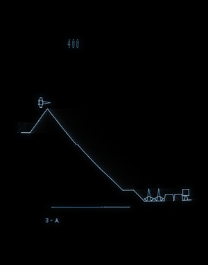</a>
<a href="docs/images/page/gallery/berzerk.jpg">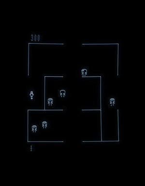</a>
<a href="docs/images/page/gallery/armor_attack.jpg">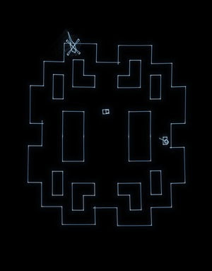</a>
<a href="docs/images/page/gallery/vectorblade.jpg">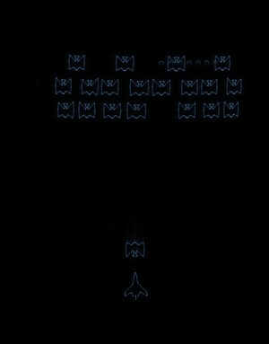</a><br>
<em>Web Wars, Pole Position, Spike, StarHawk, Scramble, Berzerk, Armor Attack, Vectorblade (click for the full size).</em>
</p>

<p align="center">
<a href="docs/images/page/gallery/imager_narrow_escape.jpg">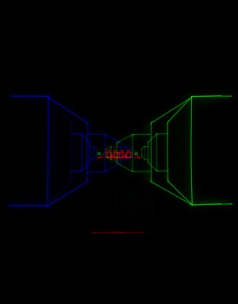</a><br>
<em>3D Narrow Escape: the 3D Imager's colour wheel seen without the goggles (or one eye's picture only).</em>
</p>

<p align="center">
<a href="docs/images/page/library_carts.jpg">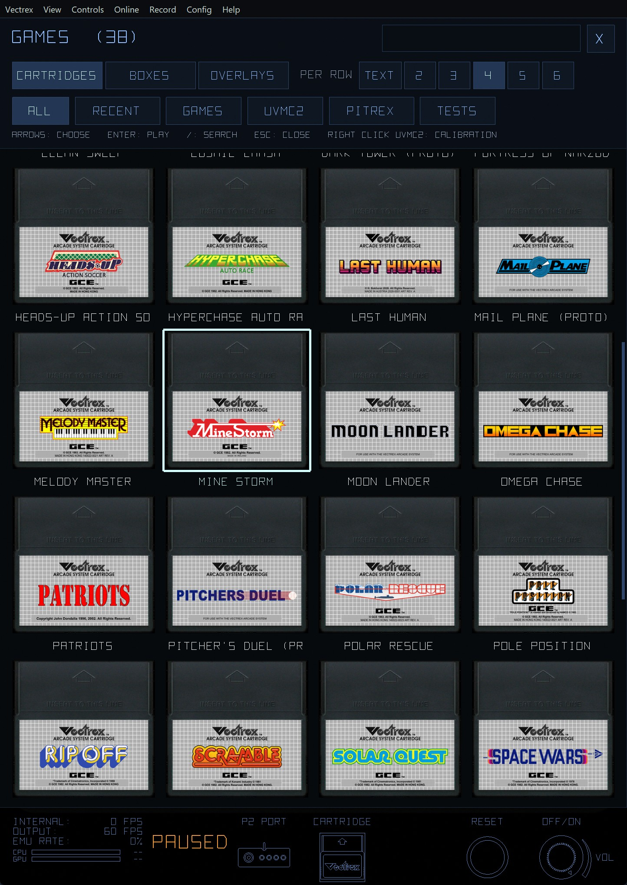</a>
<a href="docs/images/page/library_boxes.jpg">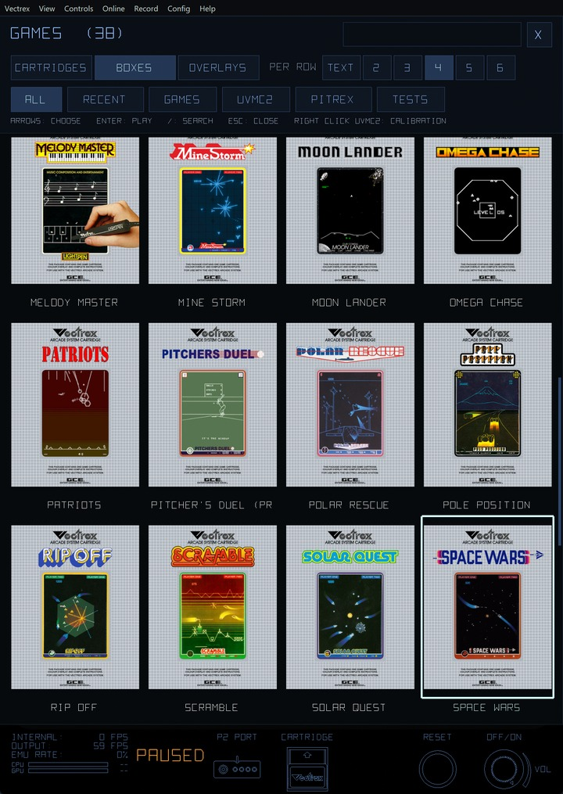</a><br>
<em>The games list with real cartridges and boxes, from a collection of the original GCE and homebrew artwork.</em>
</p>

---

## Features

### Picture and tube

* **The beam on the phosphor**: the simulated spot follows the analog circuits (it lags behind the integrators, settles
  in three stages, rounds fast corners, bends round curves) and lights a simulated phosphor by one measured law. Dots,
  corner glow, the brightness of slow and fast lines and the glow of the glass around a bright spot all follow from it.
  The same picture on the PC, RetroArch and the phone apps.
* **The afterglow** as filmed on a real Vectrex: every spot lights up when the beam passes and fades on the measured
  curve, at the screen's full refresh rate, whatever the game's frame rate. Moving things leave a real trail.
* **Look**: *Vectrex* (the measured picture, the PC's default) or *Bright* (for small screens: the tube's light lifted,
  the beam 30 % wider).
* **HDR** on HDR monitors (Windows), iPhone / iPad and Android 14: the same picture, the brightest lines and dots above
  white up to the screen's peak.
* **The tube's geometry** measured on a real Vectrex - uneven, asymmetric, not a generic barrel curve - with a strength
  slider (0 ideal, 1 measured, 2 more worn) and the glass's curvature on its own slider.
* **The glass and the case**: the traced outline of the glass with a soft edge; the black plastic case round it with
  flat, glossy walls that mirror the picture, a worn matte front, all at real size.
* **Analog effects**: line gaps, integrator drift, the 50 Hz (or 60 Hz) mains-hum wobble exactly when a real Vectrex
  wobbles, brightness bending under load, the power-off collapse with its last flash.
* **The Vectrex unit**: every trim pot of a real Vectrex - the brightness knob at the back, X / Y size, the high
  voltage, the yoke's centering magnets and rotation, the DAC offset, the integrators' rate offsets, the high
  voltage's ringing - plus the picture's shape (yoke skew, keystone, pincushion, linearity) and the beam's rate up vs
  down, right vs left. Presets: *Owner's Vectrex* (the measured one), *Ideal*, *Cranky*, *Random unit*; export and
  import a unit as a file.
* **The vectors' colour**: the real tube's cold 12000 K white, the glow a little bluer than the bright core, as on the tube.
* **Room light**: from a dark room to daylight - the ceiling light mirrored in the glass, a soft glow on the phosphor
  behind it, the overlay's print and plastic lit, all added to the picture as light.

### Overlays and the case

* MiSTer `.art` overlays and PNGs; about 65 come with the emulator, found by the game's name.
* The sheet lies flat in front of the curved tube at its real size (162 x 207 mm); the coloured plastic tints the
  light behind it, the print shines in the room's light, the picture sits a little higher behind it (parallax).
* **Scratches**: about 90,000, made on the graphics card for every sheet - fine, medium and deep, a few curly
  scribbles - that light up only where a line lights them from behind, glinting in rings around bright dots.
* **Plastic glow**: the sheet spreads a soft glow in its own colour around bright lines.
* Custom overlays cut to a shape get black outside it and a soft edge.
* Without an overlay the Vectrex's case frames the tube.

### Sound and speech

* The **buzz** the beam's currents put into the speaker, made from each frame's actual lines.
* All sound through a model of the small built-in **speaker**; sampled sound and speech through the Vectrex's DAC,
  mixed against the sound chip as measured on a real console.
* The **power switch**'s click and a **worn volume knob** that scratches and has a dead spot - the knob is also the
  power switch, as on the real one.
* The two rare speech modules on port 2: **VecVoice** (SP0256-AL2) and **VecVox** (SpeakJet), with their own volume
  and a full-range or small-speaker sound.
* The **3D Imager**'s disc motor, made from recordings of real goggles.

### Controls and add-ons

* Keyboard, mouse and any controllers at once: Xbox / PlayStation / Switch pads, the Vectrex USB controller, flight
  sticks - per controller mapping, dead zones and endpoints, two players.
* **TV mode shortcuts**: every game playable with a controller alone (Steam Deck included).
* **3D Imager**: GCE's spinning-disc goggles - 3D Mine Storm, 3D Narrow Escape, 3D Crazy Coaster in colour, the disc
  spun up by the game itself; or one eye's pictures only (no double image).
* **Light pen**: the mouse is GCE's pen and sees the real beam pass - Art Master, AnimAction, Melody Master.
* **VecVox / VecVoice** speech modules.
* **VecLink**: Alex Herbert's cable between two consoles - two windows on one PC, or over the internet.
* **Head tracking**: a phone running SmoothTrack follows your head, and the picture slides behind the overlay and the
  glass as the real phosphor does.

### Cartridges and hardware

* Cycle-exact 6809 bus timing, the 6522 as measured, Malban's analog delays.
* **Bank switching**: 64K (PB6), Malban's Vectorblade cartridge with its flash saves, a 512K flash cartridge with a
  bank latch, 1 MB multi-carts; AnimAction's cartridge RAM; Last Human's DS2431 save chip.
* **VecFever `.v4e`** files load like any ROM.
* **UVMC2** (Ultimate Vectrex Multicart 2): its RP2350 emulated - two ARM cores with a JIT, PIO, DMA, PSRAM, the SD
  card (a folder), the headphone jack, a USB mouse and keyboard. VecDoom, Veccy Road, Galaga, Quake and more; Exact,
  Fast and Dev modes for slower PCs.
* **PiTrex**: the Raspberry Pi cartridge - its ARM11 with a JIT (x86-64 and ARM64), the Pi's hardware, its USB
  keyboard and mouse, the SD card: its menu, the arcade emulators (Tempest, Battlezone, Black Widow, Space Duel...),
  Vectorblade, Elite, GS BASIC.

### Games list and box art

* A **game library** (L, or the cartridge below the picture): cartridges, boxes or overlays as tiles, 2 to 6 a row or
  titles only, a search, and the categories All, Recent, Games, UVMC2, PiTrex and Tests.
* **Box art for 112 games** comes with it: box fronts and cartridge labels remade on the emulator's own box and label
  design (the silver paper, the real labels' small print), with the title artwork and pictures from Simon Quincey's
  Vectrex 2D Front Cover Box Art pack, used with his permission. The full set of 280 games is a separate download.
* Every other game gets a drawn cartridge and box with its title. Your own pictures always come first.

### Online play

* Two players, two devices, one game: a five-letter code, a public game room, or a local network - and **Nearby**,
  where the host makes its own Wi-Fi (no router, no internet).
* **Rollback** for Vectrex games (smooth over Wi-Fi and mobile networks); UVMC2 and PiTrex games streamed from the
  host. A sync check twice a second.
* Chat, player names, taking turns on one controller, the host changing the game for both.
* PCs (Windows, macOS, Linux, Raspberry Pi), iPhones, iPads and Android play together.

### Recording and snapshots

* **F9**: an MP4 with sound, 50 pictures a second. **F12**: a PNG of the picture on screen.

### Quality on any device

* Profiles **Basic, Low, Medium, High, Ultra** - effects only; the emulation is always exact.
* **Optimize** measures this PC once (with an overlay on) and turns off only what it must, costliest first.
* The phone apps run a **device test** once (asked first) and say what came out; the RetroArch core tunes at a game's
  start. Nothing ever changes in the middle of a game.
* **G-Sync / FreeSync** detected from the monitor itself; the monitor's full rate (120-240 Hz); **Smooth motion** for
  60 Hz screens; always at the monitor's own resolution.

### Platforms

* **Windows, macOS, Linux** - the full program described on this page. The Steam Deck runs the Linux build.
* **RetroArch core** for Windows, macOS, Linux (x64 and arm64) and Android: the same emulation and picture (on the
  GPU), overlays, the Vectrex unit, UVMC2 and PiTrex, a game library, a control deck, tate mode for handhelds,
  netplay; ES-DE support on Android.
* **iPhone / iPad and Android apps**: standalone apps around the same core (no RetroArch) - touch controls,
  controllers, the library, HDR, save states, online play with PCs. They are in testing and not published yet.

### Also

* **One-click updates** that keep your games, saves and settings.
* A built-in **Help** that explains every option and the Vectrex itself.
* **Help > Debug report**: one report with a number to pass on; a small window tells you why a PC runs slow.
* **Fast forward** (hold Space), pause, Always on top, rotation in 90 degree steps, **Authentic size** - as big as a
  real Vectrex on any monitor.

<p align="center">
<br>
<em><b>Last Human</b> comes with the emulator: a new arena shooter for the Vectrex in 6809 assembly - two arenas,
70 levels, four bosses, twenty kinds of robot on a 64 KB cartridge. Its UVMC2 edition adds cinematics and 2-player
co-op. More: <a href="https://github.com/hugonl31/Last_Human">Last_Human</a>.</em>
</p>

---

## Measured on a real Vectrex

**A word about the photos.** Glowing phosphor is very hard to photograph faithfully. The camera's exposure decides how
much of the glow it catches, so bloom, brightness and afterglow are never quite what you see in the room. The photos
show *where* things happen and how long they last; getting them to *look* right took many rounds of A/B testing by
eye, the real Vectrex and the emulator side by side, until the two looked alike.

The project started from **vecx**, a long-standing open-source Vectrex emulator, and one rule: *nothing changes
because it "looks nicer" - only because a real Vectrex does it.* Every step was the same loop: look at the real
machine, measure it, change the emulator, compare again.

### 1. The gaps in the lines: timing

Close-up photos of the real tube showed **gaps**: the lines of Mine Storm's ship stop short of their corners, the
mines open at their inner points. An emulator that runs the 6809 exactly but treats the rest as ideal closes every
shape.

The gaps are timing. The 6809, the 6522 VIA with its timers and the analog integrators that move the beam do not
switch together. A new DAC value reaches the X integrator about 15 cycles late and the Y sample about 14; the
integrators start and stop some 12 cycles after their RAMP signal; timer 1 runs a little longer than its count (as
Malban measured these delays for his VIDE emulator, checked here against our photos). A line therefore starts and
stops a moment late, and a short line at a corner ends before the beam got there. With every bus access in the exact
cycle the real chips use, and those delays added, the gaps appear in the same places as on the tube.

<p align="center">
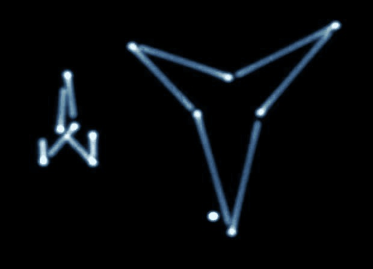
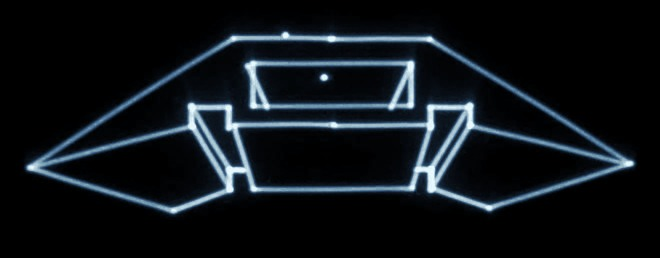<br>
<em>Mine Storm's ship, a mine and the mothership on a real Vectrex (one with unusually wide gaps).</em>
</p>

How *wide* the gaps are differs per Vectrex: component tolerances and age shift the analog timing. The Vectrex in
these photos has exceptionally wide ones. Vectrex_EMU keeps the gaps where they belong, at the size of a better tuned
console by default; **Circuit > Line gaps** sets them from nearly closed to as wide as in the photos.

### 2. Asking the chips directly

Some things can't be seen in a game, so we wrote **test cartridges**: small 6809 programs that ask the hardware a
question and print the answer. Flashed to a cartridge, run on the real Vectrex, photographed - and the emulator was
changed until it printed the same.

<p align="center">
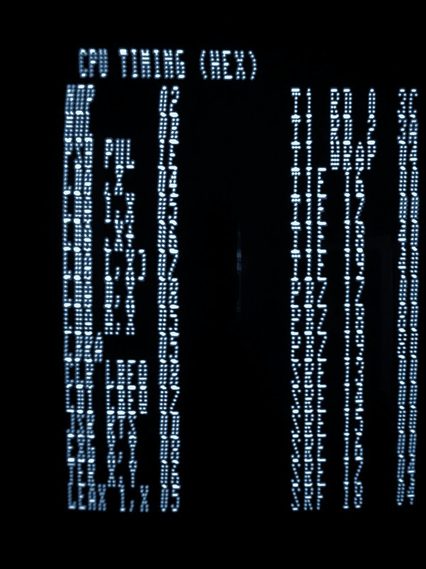
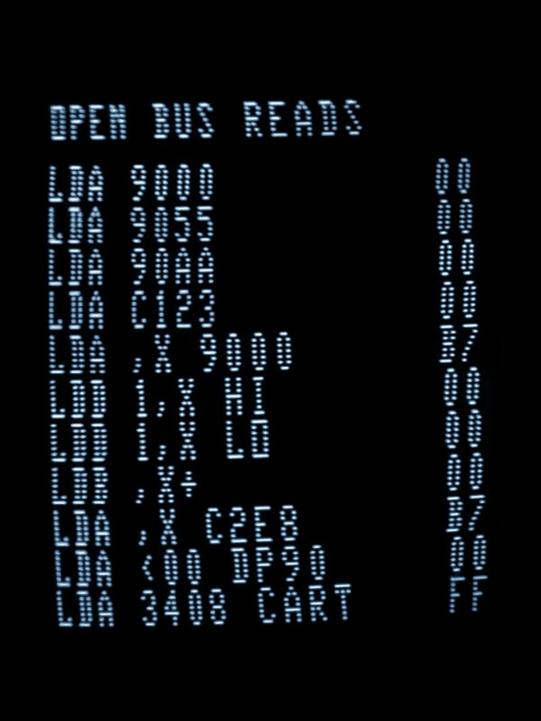
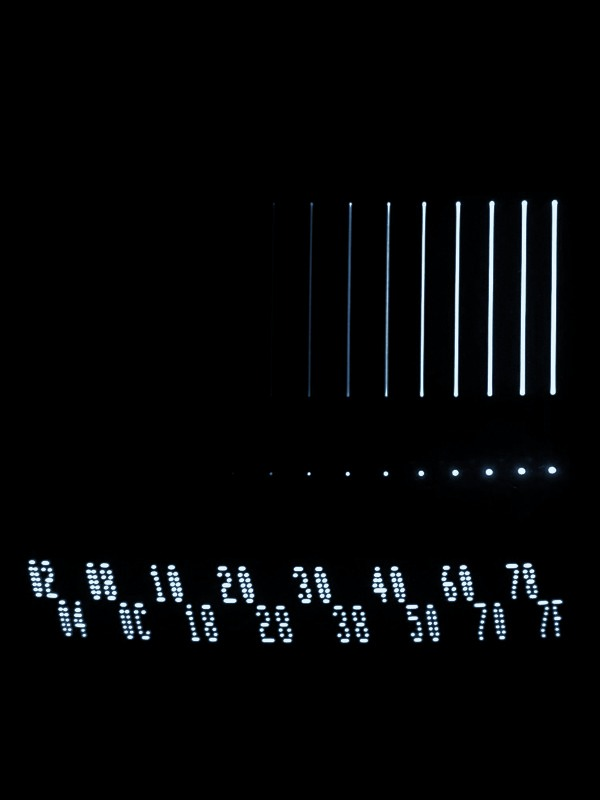<br>
<em>Test cartridges on the real Vectrex: CPU and timer cycles, open bus reads, beam brightness.</em>
</p>

* **CPU timing**: 32 readings of instruction cycles and the 6522's timers and shift register. vecx was off in several
  places (a timer one cycle long, a flag set too early, a timer that stopped when read). All 32 now match.
* **Open bus**: where no chip answers, the real Vectrex returns the last byte on the data bus; vecx returned garbage.
* **Sample and hold**: how fast the Y axis follows a jump - measured and modelled.
* **Brightness**: 16 intensities of bars and dots show where a dim beam disappears on the real tube; the emulator cuts
  off at the same step.

**The Mine Storm bug.** When a mine splits at the wrong moment, Mine Storm reads a stray list of vectors. In the
emulator this froze the game for seconds and drew a long diagonal streak. On the real Vectrex the built-in Mine Storm
shrugs it off, while the same game on a cartridge glitches for a second. The difference is the open bus: with the
measured behaviour, Vectrex_EMU now does what the real machine does, in both cases.

### 3. The beam and the phosphor

A Vectrex's character is in how its phosphor answers the beam. The emulator first drew lines and then made them look
like the Vectrex's, with separate rules for dots, corners and glow. Those rules kept fixing one case and breaking
another. Today the picture works the way the tube does: **the emulator simulates where the spot is, cycle by cycle,
and the light at every place follows from the time the beam spends there, by one law measured on a real Vectrex.**

The measurements behind it:

* **Where the spot is.** Five hand-timed test cartridges (Settle, Timer, Short, Join and Switch), every write to the
  VIA on its own cycle, photographed on the real tube. They show the spot settling slowly and evenly in three stages
  (13.3 cycles in all), a short move settling as a long one, RAMP's and the beam switch's own delays, and the shift
  register switching the beam about 2 cycles after a direct write would. Corners, joins and the BIOS's small text now
  come out as on the tube.
* **How much light.** The **Photo Test** cartridge - sixteen pages, the camera set up once - draws lines at nine speeds
  and four intensities, repeats, crossings and spots. Measured in linear light: the light per unit of line grows as
  a power of the time the beam spends there (0.70 at full intensity, up to 0.90 at the dim end); separate passes and
  crossings add up; a line's width does not grow with intensity; a resting dot grows wider.
* **Dots and corners.** The **Dot Test** (isolated dots, the BIOS's game dots, rests inside lines, corners of 30 to
  135 degrees) and the **Test Cartridge Rev. 4**'s INTENSITY screen, photographed in RAW at many exposures: the dots
  where lines join glow several times brighter than the line.
* **Lag, corners, gaps, the DAC.** The lag, corner, axis, gap and DAC test cartridges. The DAC turned out linear; lines
  drawn at every speed meet a reference placed by a move. Clean Sweep's maze lands within about a pixel of the real
  one.
* **The colour.** The real tube is not white: its light is a cold, bluish white, which the emulator draws at 12000 K
  (see below). Next to a real Vectrex the old green menus made the vectors look greenish, so the default colours are
  blue now.

#### The colour of the light: 12000 K

A Vectrex's lines are not pure white. In the room they look cold, a little blue - and a camera agrees: with its white
balance at 6400 K, the white of a computer screen, every RAW photo of the tube on this page comes out bluish (they are
shown here as shot). Measured in those photos, the lines' red is about 0.62-0.66 of their blue and their green about
0.83-0.89, in the bright cores and the glow alike.

So Vectrex_EMU does not draw white lines. The beam's colour is a colour temperature, **12000 K**: the bluish white
that looked closest to the real machine standing next to it, and the tint the photos measure. Blue stays at full
strength and red and green are turned down, so the lines lose none of their peak brightness. Overlays, the case and
the glass keep their own colours.

<p align="center">
<a href="docs/images/page/dots_compare.jpg">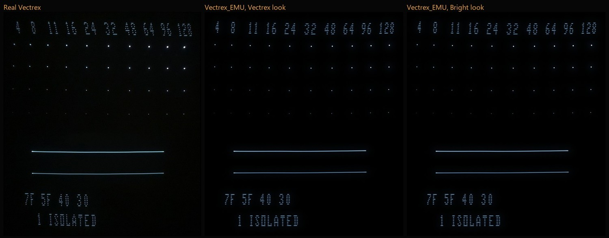</a><br>
<em>The Dot Test cartridge, page 1: the real Vectrex (RAW photo, 1/50 s, as shot at 6400 K), the emulator's Vectrex
look and its Bright look (12000 K).</em>
</p>

<p align="center">
<a href="docs/images/page/vectorblade_logo_compare.jpg">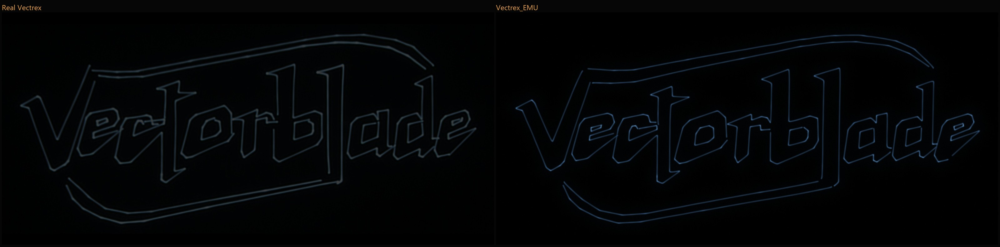</a><br>
<em>Vectorblade's logo: the real tube (left, RAW as shot) and the emulator (right) - the bright spots where the beam
rests at a corner, the thin fast lines between them.</em>
</p>

#### Why the corners are round

On a real Vectrex a fast corner is **round**. Only a corner where the beam waits is sharp, with a bright dot on its tip.
An ordinary emulator draws every corner sharp. The difference is in how the Vectrex moves its beam.

The Vectrex has no picture memory. Two **integrators**, one for X and one for Y, turn a speed set by the game into a
position: while RAMP is on they run at that speed. To draw a corner the game switches RAMP off (the integrators stop),
sets the new speed and switches RAMP on again. The integrators themselves turn a sharp corner.

But they don't move the beam directly. Their voltages go through the deflection amplifiers into the coils of the
yoke, and a coil resists every change of its current. The spot follows the integrators **about 13 cycles (9
microseconds) late, smoothed**; on the real Vectrex we measured three equal lag stages, 13.3 cycles in all. After a
short rest the spot is still on its way to the corner when the integrators set off in the new direction, so it turns
early and cuts the corner in a curve. After a rest of about 24 cycles the spot has arrived and waits: a sharp corner,
and a bright dot, because the beam lights the same place all that time.

<p align="center">
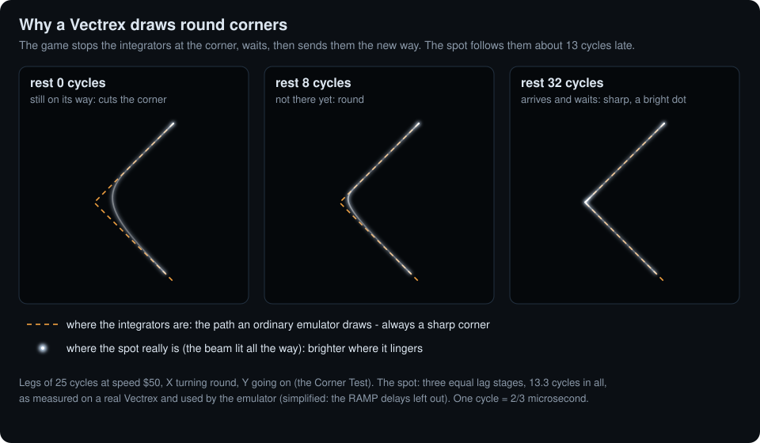<br>
<em>The same corner after rests of 0, 8 and 32 cycles: dashed, the integrators' path (what an ordinary emulator draws);
the light, the spot's path as the emulator computes it.</em>
</p>

An ordinary emulator takes the integrators' values as the beam's position and draws straight lines between them.
Vectrex_EMU follows the spot itself, cycle by cycle through the measured lag, and lights the phosphor along that path,
so the roundness and the dots come out by themselves. The **Corner Test** cartridge checks it: the same corner with the
beam resting 0 to 96 cycles at the tip.

<p align="center">
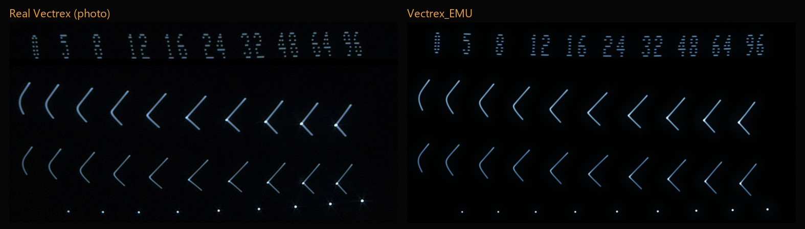<br>
<em>The Corner Test, rests of 0 to 96 cycles: the real Vectrex and Vectrex_EMU. The photo is the RAW at white balance
6400 K (the screen's own white, so its blue is the tube's), with the iPhone lens's blur lightly taken out and set to the
same total light: exposed for the fine detail, the camera shows the lines wider, softer and brighter than the eye
sees them. Round up to about 16 cycles, sharp with a dot from 24.</em>
</p>

#### The test cartridges side by side

The same comparison for whole screens of other test cartridges: the real Vectrex on the left, Vectrex_EMU on the right,
as it draws them today. Every photo is treated the same way: the RAW as shot at 6400 K, the lens's blur lightly taken
out (measured from each photo's own line width, as the eye sees the tube sharper than the camera), and set to the same
total light as the emulator's picture. Click for the full size.

<p align="center">
<a href="docs/images/page/raw/raw_dot_p1.jpg">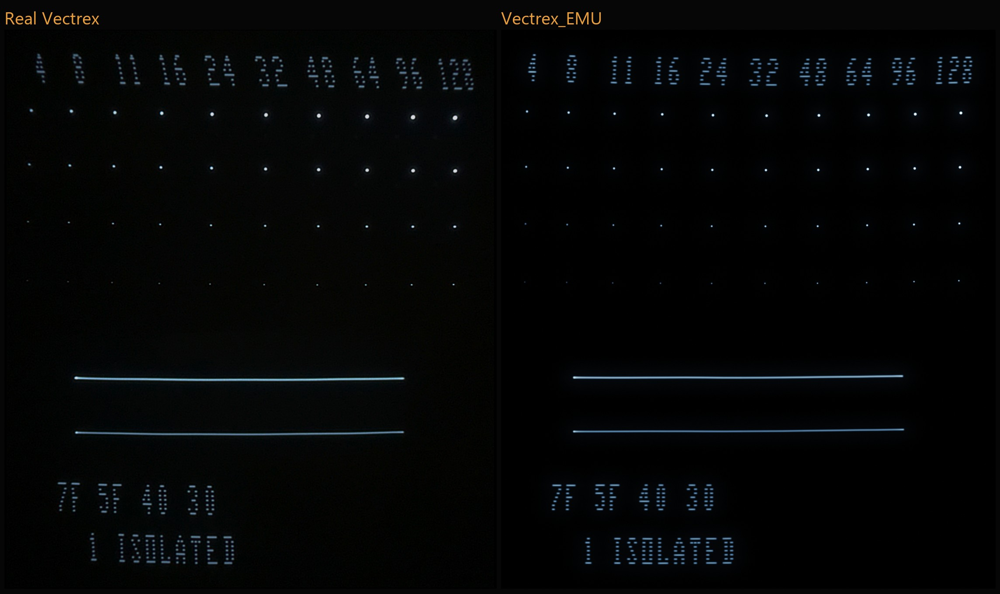</a>
<a href="docs/images/page/raw/raw_dot_p4.jpg">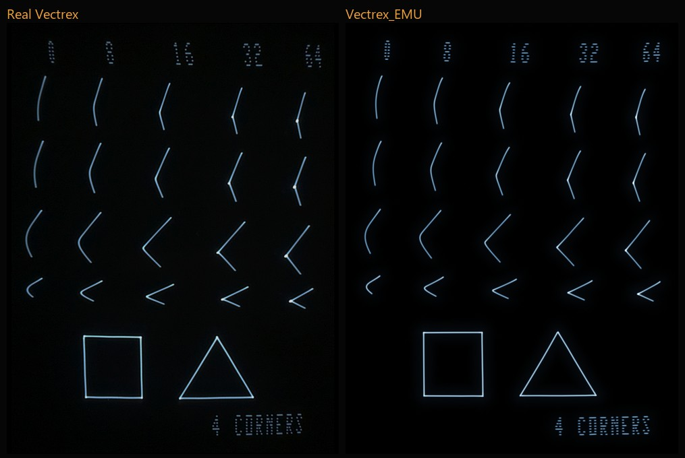</a><br>
<em>The Dot Test: page 1, dots resting 4 to 128 cycles at four intensities; page 4, corners of 30 to 135 degrees with
rests of 0 to 64 cycles.</em>
</p>

<p align="center">
<a href="docs/images/page/raw/raw_intensity.jpg">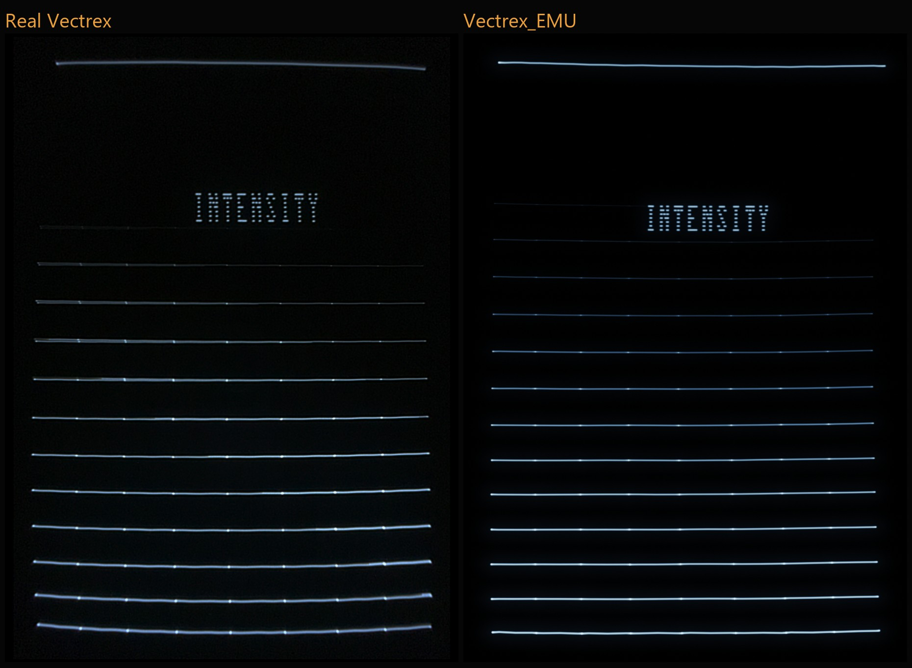</a>
<a href="docs/images/page/raw/raw_dac_p1.jpg">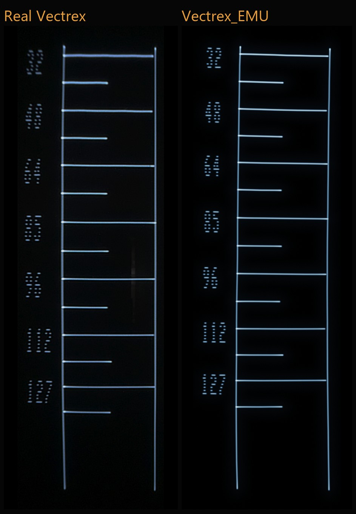</a>
<a href="docs/images/page/raw/raw_gap_p1.jpg">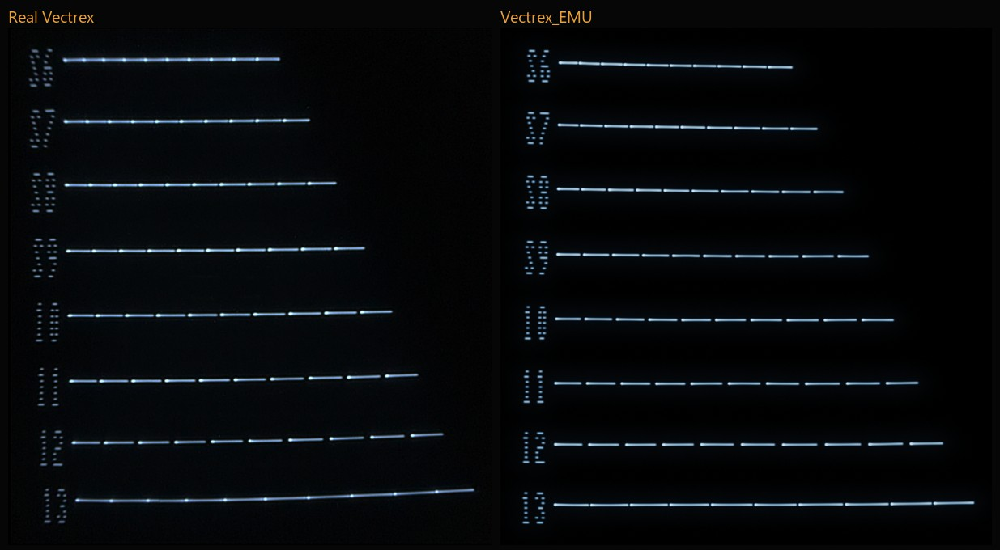</a><br>
<em>The Test Cartridge Rev. 4's INTENSITY screen; the DAC Test, a long and a short line per DAC value - with a
linear DAC the long ones end on the reference line; the Gap Test, rows of joined pieces as Mine Storm draws its ship,
at scales 6 to 13 - the gaps where they join.</em>
</p>

<p align="center">
<a href="docs/images/page/raw/raw_lag.jpg">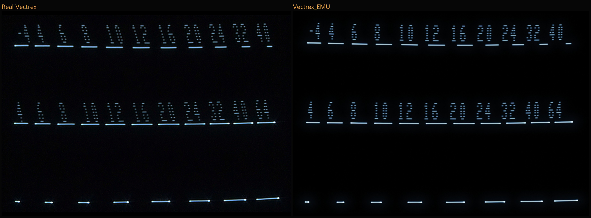</a><br>
<em>The Lag Test: the beam switched on (top row) or off (middle row) -4 to 64 cycles after RAMP - where the lit line
really starts and ends shows where the lagging spot was; the bottom row, whole paths with a dot at each end.</em>
</p>

On an HDR screen the same light continues above white: the brightest dots and lines rise up to the screen's peak where
an ordinary screen rolls off. **Bright** is the same light with the low end lifted and the beam a little wider, for a
phone's small picture.

### 4. The afterglow

A vector screen has no frames; it has phosphor. We filmed the Vectrex title fading to black and measured the light
frame by frame: it drops to about 15 % at once, 4 % after 0.15 s, 1.5 % after 0.5 s, and is gone after about two
seconds. The emulator lights each spot when the beam passes it and lets it fade on that curve, at the screen's own
refresh rate. A moving object leaves one smooth trail, as Mine Storm's mothership does on the real tube; a fast-turning
rotor (Armor Attack's helicopter) flashes position after position. On screen the trail is shown 1.5x as bright as
measured, because a monitor in a lit room shows faint light weaker than the tube does, and its faint end is as visible
on black as through an overlay. On phones the trail was matched to the PC's by eye.

<p align="center">
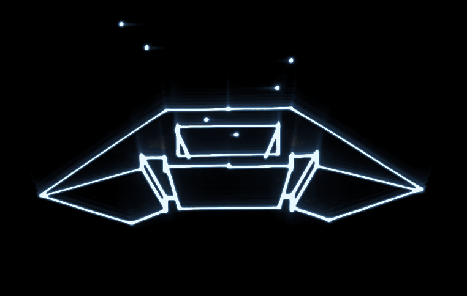<br>
<em>Mine Storm's mothership on the move: its trail of fading phosphor on a real Vectrex.</em>
</p>

A game that runs slower than 50 frames a second keeps its lines glowing between its frames, as the tube does - no
flicker. Games that time their own frames (the Test Cartridge Rev. 4, Polar Rescue, Spinball) stand steady.

### 5. The analog side

* **Drift**: the integrators' zero point wanders, so a shape drawn as one loop doesn't quite close.
* **Mains hum**: the power supply's 50 Hz hum pushes the beam a little. A game that finishes each frame within the
  Vectrex's 30,000-cycle budget runs at 50 frames a second, in step with the hum, and stands still. A busy scene takes
  longer, the game slows to, say, 48 fps, its frames slip against the hum and the picture sways. At 25 fps it is in
  step again. Vectrex_EMU works out the hum at the moment each line is drawn, so games wobble exactly when a real
  Vectrex's do. **Tube > Mains** has 60 Hz for the USA and Canada.

  <p align="center">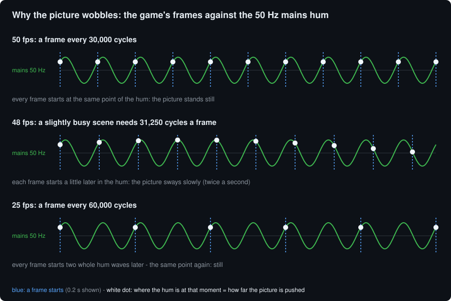</p>
* **Brightness bending**: the high voltage sags with a busy screen; the picture breathes.
* **The trim pots**: every adjustment of a real Vectrex, from the service manual and the boards' parts lists, in the
  **Unit** and **Circuit** tabs. A real Vectrex has no circuit that corrects the yoke, so no two pictures have quite
  the same shape: the picture's shape sliders (skew, keystone, pincushion, linearity) and **Random unit** / **Cranky**
  roll a believable other console.
* **Zero reference**: a zero test cartridge on the real Vectrex showed which zero values draw sharp - and that UVMC2
  games and the PiTrex need the same zero reference as 6809 cartridges.
* **Switching off** makes the picture shrink away with a last flash of the beam.

The imperfections are not a filter over a clean picture: they come out of the emulation.

### 6. The tube's geometry

Most emulators bend the picture with a neat, symmetrical barrel curve. A Vectrex doesn't look like that. A magnetic
yoke draws on a flat-faced tube, and what you see is the sum of small, uneven imperfections: the grid a little narrower
at the top, the bottom edge sagging in a gentle bow, the sides leaning, one corner pulled up. A second Vectrex showed
much the same shape: this is how the tube and yoke were made.

**First, photos of the Test Cartridge grid**, taken with a long lens to keep the camera's own distortion out, fitted
crossing by crossing.

<p align="center">
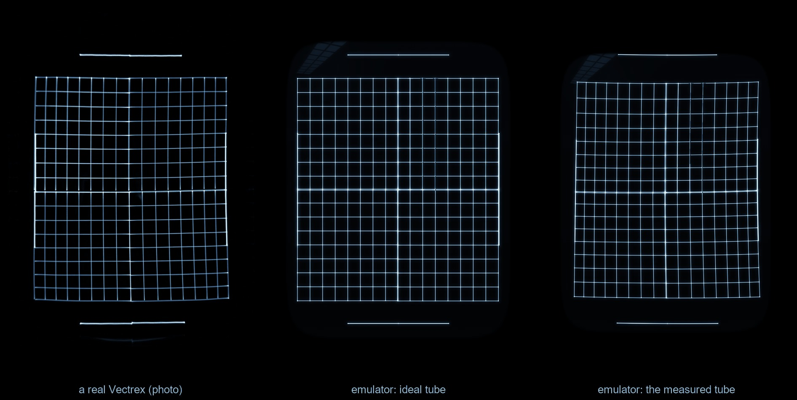<br>
<em>The first measurement: the Test Cartridge grid on a real Vectrex (photo, colour neutralised), the emulator with an
ideal tube, and with the measured one.</em>
</p>

**Then the real sizes.** The whole front of a real Vectrex was traced at three times real size - the matte frame, the
edge of the glass, the Test Cartridge's grid line by line. The anchor is the overlay: a real sheet is 162 x 207 mm and
lies exactly on the case's matte frame, 3.5 mm wide. The opening is 155 x 200 mm, the glass 145.7 x 188.5 mm, a
rounded rectangle with gently bulging sides; the picture's centre sits a little left of and below the glass's centre,
as on the real tube.

<p align="center">
<a href="docs/images/v1.0.5/tube_match.jpg">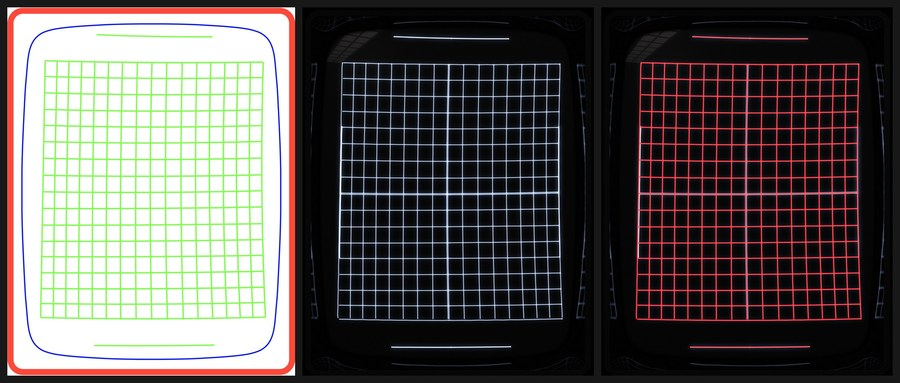</a><br>
<em>The trace of a real Vectrex - the matte frame (red), the edge of the glass (blue), the Test Cartridge's grid
(green) - and the emulator's grid laid under it.</em>
</p>

**Now the Full Grid.** The Test Cartridge's grid covers the middle of the screen; the shape near the glass's edge came
from extrapolation. So we wrote the **Full Grid Test** cartridge: a grid over the whole screen, drawn a third at a time
inside the BIOS's 50 Hz frame (and a 25 fps version in step with the mains), photographed on the real Vectrex
straight on, with a telephoto lens from 1.5 m. The tube map is now fitted to that photo over the whole glass: the
lines lie within 0.03 mm on average and at most 0.4 mm at the very edge of the glass (the earlier map: 0.35 / 2.1 mm).
The Test Cartridge's grid still sets the picture's place and size. The same photo measured the beam's rate: on this
Vectrex the beam moves 1.16 % faster up than down (a Unit setting now), and it showed the case's glossy walls as flat
mirrors, at one angle, that reflect the grid straight and evenly.

<p align="center">
<a href="docs/images/page/fullgrid_side.jpg">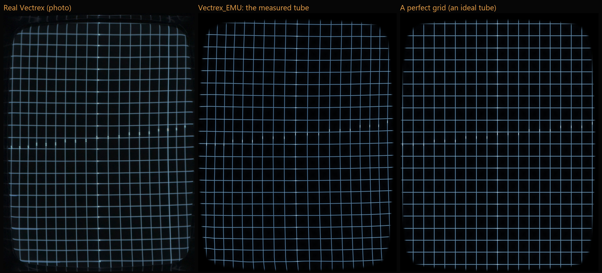</a><br>
<em>The Full Grid Test, each cut to its tube at the same height: the real Vectrex (RAW photo), Vectrex_EMU with the
measured tube, and a perfect grid - every square the same, which is what an ordinary emulator draws. On the real tube the squares narrow towards the
sides (seen through the curved glass), the top is narrower, the bottom sags and the sides lean; the measured tube
follows it, the perfect grid cannot.</em>
</p>

<p align="center">
<a href="docs/images/page/fullgrid.jpg">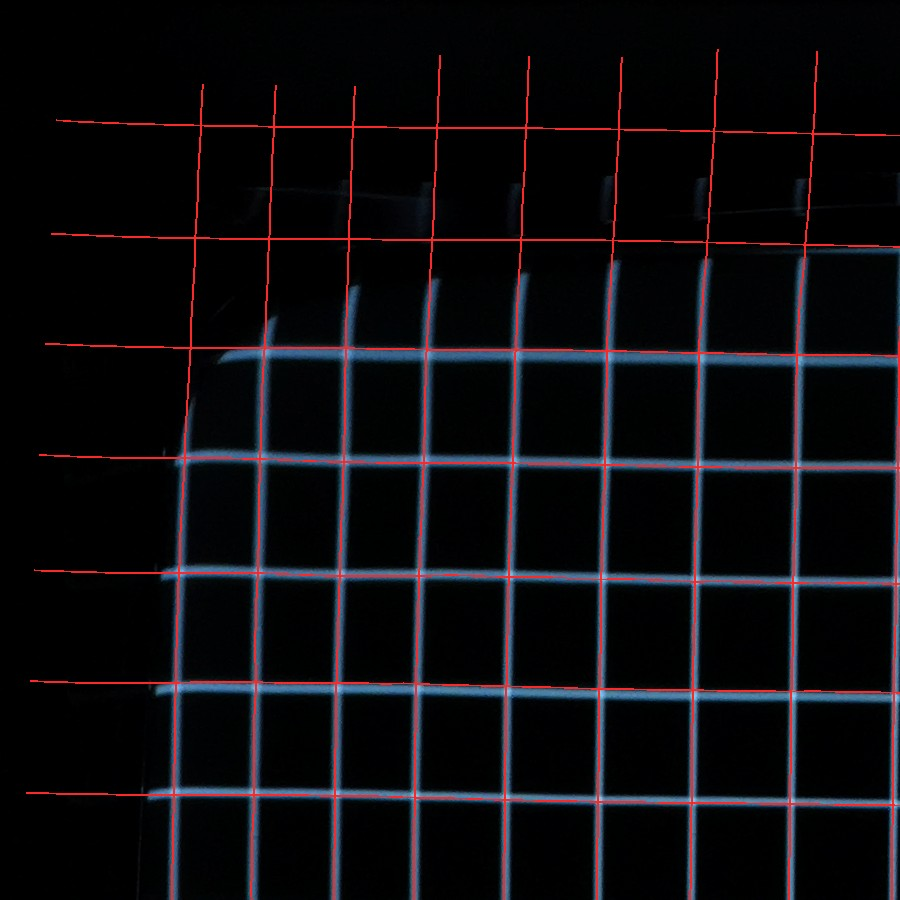</a>
<a href="docs/images/page/fullgrid.jpg">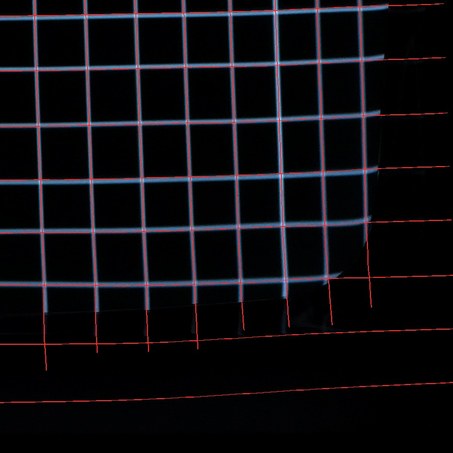</a><br>
<em>The Full Grid Test on a real Vectrex with the emulator's lines in red over it: the top left and bottom right
corners (click for the whole screen; the old map: <a href="testcart/compare/fullgrid50_overlay_old_map.png">here</a>).</em>
</p>

How it is applied:

* **The vectors are bent, not the picture.** Every line goes through the map before it is drawn; long lines are cut
  into short pieces, each keeping its share of the beam's light and its moment in the frame. Nothing is stretched as
  a texture: the lines stay as sharp as the tube draws them.
* **The overlay is not bent.** A real overlay is a flat sheet on the case's frame, so it is drawn exactly there. Its
  position and size sliders move the picture behind it instead. **Parallax** shows the picture a little higher than
  the sheet, as seen from the usual height.
* **Tube > Tube geometry strength**: x1 the measured tube, 0 an ideal one, x2 a more worn one; the centre never moves.
  **Glass curvature**: 1 the glass's face curving away towards its edges, as seen on a Vectrex; 0 even squares.

### 7. Overlays and forty years of scratches

Every Vectrex game came with a printed plastic overlay: see-through colour tints the vectors, solid print adds the
borders, the artwork and the game's name. The emulator lays the sheet over the finished picture: the plastic
multiplies the light that comes through, the print shines in the room's light, and the sheet stays flat.

**Room light** lights the sheet: in an evening room the plastic is nearly black and only the vectors show; in daylight
the colours and the print come up.

<p align="center">
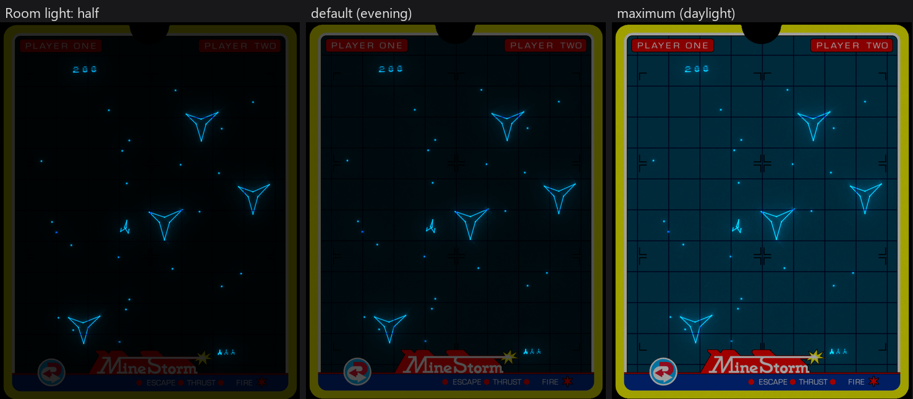<br>
<em>Room light at half, at the default (an evening room) and at the maximum (daylight).</em>
</p>

**The scratches.** A real overlay is forty years old: slightly matte, criss-crossed by fine scratches, here and there
a deeper one. In the dark you hardly see them, until a vector lights them from behind. We compared many rounds of
pictures with photos of the author's own Vectrex and Mine Storm overlay, in the dark, with and without the sheet and
with a flashlight behind it:

* **Which scratches light up.** A scratch catches light that comes from square across it. Every point of light lights
  the scratches that face it: around a bright dot that makes **rings** of glinting scratches; along a line, **random
  hairlines in every direction**. (A first try lit the scratches running along the nearest line: they looked painted
  on, "Van Gogh" as the author put it.)
* **The wear is mostly short and shallow.** 95.5 % of the scratches are 5 - 15 mm long, 4 % 15 - 35 mm, 0.5 % up to
  80 mm, at random angles; 4 % are **scribbles** - a short sweep ending in a little curl, as from a grain of sand
  dragged under the sheet. There are more where hands hold a sheet.
* **Deep damage cuts through the colour**: where a deep scratch is widest a little untinted white light comes through.
  By default there is hardly any (about 15 on a sheet); **Damage** adds it.
* **The plastic glows**: around bright lines the sheet spreads a soft, wide glow in its own colour. It follows moving
  lines at once (checked with the Glow Test cartridge: two full-length lines moving at three speeds).

The recipe: about 77,000 fine scratches, 15,000 medium ones and a few deep ones, drawn into three textures by the
graphics card in a fraction of a second when an overlay is loaded. Each scratch keeps its depth and direction, so the
shader works out its glint for light from any direction. Every sheet gets its own pattern; **New random scratches**
deals another.

<p align="center">
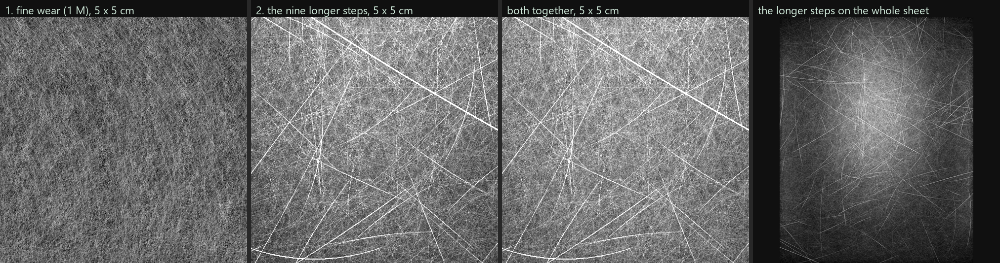<br>
<em>One square of the sheet around the player's ship and a mine: the game, then the scratches as the graphics card
holds them (white = deeper) - fine, medium, damage (shown at x1) and all of them at the defaults.</em>
</p>

<p align="center">
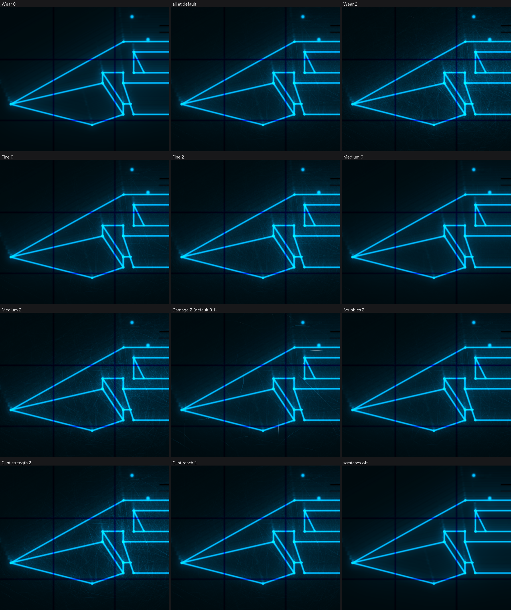<br>
<em>Clean Sweep's player by the yellow box (2x zoom) with the defaults, and with each scratch setting turned down or
up.</em>
</p>

### 8. The room's light

A Vectrex is never seen in the dark. A ceiling lamp shows as a sharp mirror image in the thick glass, as a large soft
glow on the phosphor behind it, and on an overlay as a sheen with every scratch lighting up around it. The emulator's
room has one lamp: an office ceiling light - a long fluorescent fixture with white louvre cells, 5600 K, above and in
front of you.

<p align="center">
<a href="docs/images/page/daylight_clean_sweep.jpg">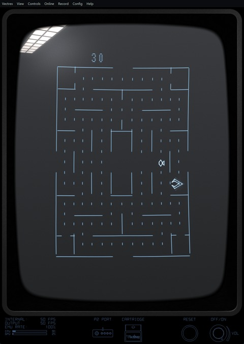</a>
<a href="docs/images/page/daylight_distortion.jpg">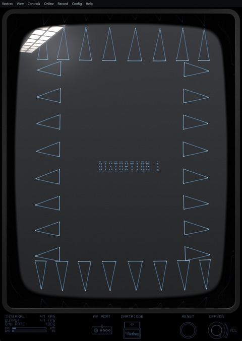</a><br>
<em>Room light at Daylight: Clean Sweep on the bare glass, and the Test Cartridge's Distortion 1, its lines faintly
mirrored in the case's glossy walls.</em>
</p>

* **One room light for everything.** The reflections follow it steeply: barely there in the default evening room,
  clear in daylight. The room's light adds to the phosphor's as light, so the trail and the glow look the same at any
  room light, with or without an overlay.
* **The glass** mirrors the lamp as a gentle dome would: in perspective, a little curved, smaller than the lamp,
  slightly blurred as real glass is never perfectly clean. Without an overlay the glass itself turns slightly grey in a
  bright room.
* **The phosphor** sits behind several millimetres of glass and is more curved, so it shows the lamp much larger,
  squarer, very blurred and shifted inwards (the glass is thicker at the edges), with a fine random grain.
* **The overlay** mirrors the lamp flat; close to the reflection every fine scratch glints, further away only the
  deeper ones that lie across the direction to the lamp.

### 9. Listening

The Vectrex is not quiet. The beam's currents leak into the audio amplifier, so the speaker **buzzes** along with what
is drawn - louder with more lines, at the game's frame rate, never quite silent. We recorded it, together with the
small built-in speaker, the click of the power switch and the crackle of a worn volume knob. The buzz is made from the
actual vectors each frame; all sound plays through a model of that speaker; the DAC's samples (how Spike talks) are
mixed 6 : 1 against the sound chip, the balance the MiSTer core measured on a real console's line-out. Turning the
knob scratches, crackles and now and then cuts out, as an old potentiometer does. The power-on and power-off sounds are
recordings of a real Vectrex.

### 10. Speech: two rare modules

A handful of Vectrex games and demos talk - or sing - through a speech module on the second controller port. The
**VecVoice** (Richard Hutchinson) uses General Instrument's SP0256-AL2; the **VecVox** (Alex Herbert) Magnevation's
SpeakJet. Both were hobbyist boards made in small numbers and are very hard to find today.

The game sends bytes over a serial line it bit-bangs on the sound chip's port (9615 baud); the module answers "ready"
on port 2's button lines. Without the modules on the desk, we worked from documentation and recordings of the real
ones, comparing by ear:

* **VecVoice**: a C port of MAME's faithful SP0256 emulation (Joe Zbiciak and Tim Lindner), with the serial link as
  the MiSTer core models it.
* **VecVox**: how the SpeakJet makes its sounds was never published - the chip has never been read out. So the VecVox
  speaks with the SP0256's voice: every SpeakJet phoneme becomes the nearest SP0256 sound, stretched to the SpeakJet's
  length and sung at its pitch. Its speed law was fitted to a recording of VecVox X-Mas (25.9 s against the
  recording's 25.2 s). A formant synthesizer built from the same recording was tried too; side by side the
  SP0256-based voice sounded more like the real thing.
* **The level** follows the MiSTer core's speech mix, 50 % louder, with an arcade-style bass for big speakers.

### 11. The test cartridges

Every measurement above came from a cartridge written for it, in 6809 assembly, flashed to a real cartridge and
photographed. Sources, builds and 64 KB images for a flash cartridge are in [`testcart`](testcart) (its README
describes every page and how to photograph it); comparisons of photos and emulator pictures are in
[`testcart/compare`](testcart/compare), the measuring scripts in `tools/photo_match`.

| Cartridge | Measures |
|---|---|
| Timing Test | line ends and gaps at 16 scales; Mine Storm's ship as the game draws it |
| CPU Timing, Open Bus, S+H, Brightness | instruction and timer cycles, open bus reads, the Y sample-and-hold, the beam's cutoff |
| Wobble, FPS | the mains-hum wobble at 50 / 48 / 25 fps; the picture at changing frame rates |
| Corner, Lag, Axis, Beam, Gap, DAC | the spot's rests and lag, corners in X and Y, zeroing, the DAC's linearity and bit errors |
| Zero Test | the zero reference as Last Human and the UVMC2 SDK prime it |
| Dot, Switch, Settle, Timer, Short, Join, SR | dot size and bloom; the beam switch against the spot; timer 1 and the shift register; the phosphor's decay |
| Photo Test | sixteen pages on one cartridge: light against speed and intensity, repeats, crossings, the BIOS's shapes and text, refresh rates |
| Full Grid Test (50 / 25 fps) | the tube's shape over the whole glass |
| Glow Test, Ship Test, rotor tests | moving lines for the overlay's glow, Smooth motion and fast objects |
| Test Cart | one cartridge to compare the picture between platforms (`tools/testcart_compare.py`) |
| Input Delay Test | a square while a button is held: the delay from the button to the glass |

---

## Using it

Settings written as **Tube > Afterglow** are in the [Config window](#menus-and-the-config-window) (Tab): the tab,
then the setting.

### What you add

| What | Where | |
|---|---|---|
| **Cartridge ROMs** (`.bin`, `.vec`, `.gam`, `.rom`, VecFever `.v4e`) | `roms` (subfolders too) | your own cartridges |
| **UVMC2 games** (`.um2`) | `roms` | see [UVMC2](#uvmc2-the-ultimate-vectrex-multicart-2) |
| **Game data** for UVMC2 games (Doom's WAD, Quake's `pak0.pak`, vector movies) | `uvmc2/doom`, `uvmc2/quake`, `uvmc2/movies` | your own copy (the shareware Doom and Quake files work) |
| **Speech ROM** (for VecVoice / VecVox) | `system` | `al2.bin`, a free download - see [Speech modules](#speech-modules) |
| **PiTrex SD card** and arcade ROMs | `pitrex`, `pitrex/roms` | Malban's download; your own MAME sets |
| **More overlays, your own pictures** | `overlays`, `system/vectrex_emu/thumbs` | see [Overlays](#overlays), [Your own pictures](#your-own-pictures-for-the-games-list) |

**Vectrex > Get games & extras...** (also in the first-start setup, which shows in red what is missing) fetches the
original GCE games, free homebrew games that have an overlay (public domain releases, Malban's Telengard, and
Vectorblade and the Neon Hawk demo as the MiSTer project shares them with their authors' permission), the speech ROM
and the PiTrex's SD card, unpacked and named as the games list shows them. Each comes from a chain of sources: the
project's own copy (Google Drive, the same files on archive.org), then archive.org, GitHub, Joe Zbiciak's page and the
Wayback Machine; the PiTrex from the newest download on Malban's page. Every download is checked before it is
unpacked; files you have are kept; **Add file...** takes your own download. None of it comes with the emulator.
*The maintainer of Vectrex_EMU does not take responsibility for the sharing of these files: you download them yourself
and take that responsibility.* The disclaimer is shown once, with every file and its sources.

**In the zip**, the same on every system: the program and three folders, each with a note - `system` (the BIOS
`bios.bin` with Mine Storm - Smith Engineering allows it to be copied freely for non-commercial use - and the shipped
box art), `roms` (Last Human, Last Human (UVMC2), UVMC2 Movie Player) and `overlays`. More appear when needed: `uvmc2`
(the UVMC2's SD card, with Bad Apple), `pitrex` (the PiTrex's SD card), `cache` (working files and logs).

**Requirements:** a graphics card with OpenGL (any from the last 15 years), sound, and on Linux an X11 or Wayland
desktop (through XWayland) with PulseAudio or PipeWire. Without a real graphics card (a virtual machine) it still runs,
with a shorter afterglow and no scratches.

### First start

<p align="center"><a href="docs/images/page/setup.jpg">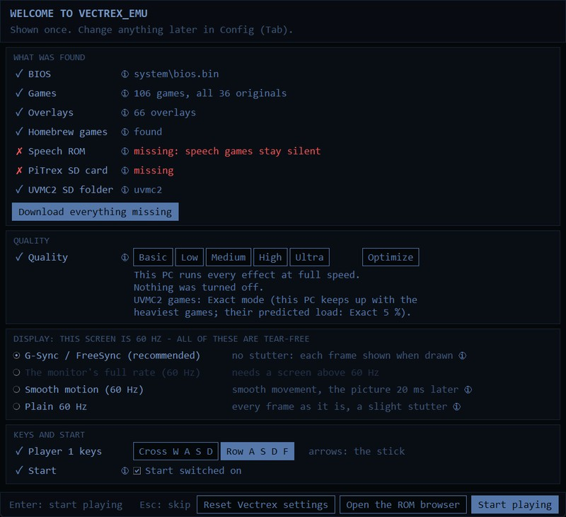</a></p>

The first start shows one page: whether the BIOS, games, overlays, homebrew, the speech ROM and the SD cards were found
(missing in red; **Download everything missing** gets them), the **quality** (a new install runs **Optimize**), the
**display mode** with the best for your monitor chosen, the **player 1 keys** and **Start switched on**. Enter starts
playing, Esc skips it. **Vectrex > Setup wizard...** runs it again.

**Switching on.** As on a Vectrex, the volume knob is the power switch: Page Up, the mouse wheel over the knob below the
picture, a click on it, or any key or controller button while it is off. The tube warms up and the BIOS start screen
plays. Without a cartridge the Vectrex plays its built-in game, **Mine Storm**. **Unit > Start switched on** skips the
knob; **Skip the Vectrex intro** runs the 13-second start screen unseen in a fraction of a second, so the cartridge
starts at once in the same state as after the real intro. A game loaded while the Vectrex is on starts as after
RESET, without the intro.

Then press **L** (or click the cartridge below the picture) and pick a game.

### The window and the control deck

The menu bar: **Vectrex** (games, Get games & extras, the PiTrex, eject, RESET, pause, volume, the setup), **View**
(full screen, HDR, Always on top, sizes, overlay, case, control deck, quality, room light), **Controls** (keys and
controllers, mouse steering, TV mode shortcuts, port 2), **Online**, **Record**, **Config** and **Help**. Alt or F10
opens it from the keyboard; in full screen move the mouse to the top edge or press Alt.

Below the picture sits the **control deck**, the Vectrex's own controls drawn in outline: the **on-screen display**
(the game's frame rate, the pictures the screen gets, the emulation speed EMU RATE - green at 100 % - the volume, CPU
and GPU meters; online: the connection), **P2 PORT** (what is in controller port 2: click for the next device, hold for
a menu), the **cartridge** (click: the games list; right click: eject, again: back in), **RESET** and the **volume
knob** (drag it round, the mouse wheel, Page Up / Down; down to 0 % switches the Vectrex off). PAUSED shows in the
strip, not on the picture, so a paused game makes a clean snapshot. **View > Control deck** hides it all.

<p align="center"><a href="docs/images/page/deck.jpg">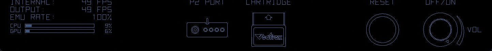</a></p>

### Keys

Only what full screen needs has a key, so the rest of the keyboard is free for the players:

| Key | |
|---|---|
| F11 | full screen on / off |
| L | the games list (Vectrex > Open ROM file for a file dialog) |
| Tab | the Config window (Tab or Esc closes it; hold H to compare with before) |
| O | overlay on / off |
| C | the case on / off |
| P | pause |
| Esc | closes the games list; in full screen: back to the window; in the window: pause (it never quits) |
| Space (held) | fast forward, 4x, no sound (not online, with VecLink or while recording; a player with Space as a control keeps it) |
| Page Up / Page Down | the volume knob in 5 % steps - and the power switch at 0 % |
| Ctrl+Page Up / Down | the speech module's own volume, 0 - 200 % |
| Ctrl+R | the RESET button |
| Ctrl+E | eject the cartridge (Mine Storm) / put it back |
| + / - / 0 | window size / fit the desktop; in full screen: the picture's size |
| 9 | Authentic size: as big as on a real Vectrex |
| F9 | start / stop recording a video |
| F12 | snapshot |
| Ctrl+K | the keyboard types into the UVMC2's or PiTrex's USB port (again: back to the game) |
| Ctrl+T | the online chat |
| F8 | VecLink on one PC: the other Vectrex's window to the front |

These keys can't be given to a player. On a Mac, Command works for the Ctrl shortcuts (see [Mac and Linux](#mac-and-linux)).

### Controls

**Controls > Keyboard and controllers**: each player picks a controller from those connected, by its own name (Xbox,
PlayStation and Switch pads, the Vectrex USB Controller, flight sticks...), or **Keyboard only**. A new controller is
mapped at once: its stick or d-pad is the Vectrex stick, buttons 1-4 the Vectrex buttons. Click a box and press a key
or button, or push the stick the way the row says; Shift+click adds a second; right click clears. Per controller:
**analog stick** or **buttons**, with a **dead zone** and an **endpoint** (full deflection before the stick's end), and
a test field showing what the Vectrex gets. The keyboard always works next to the controller.

Defaults: player 1 - arrows, **A S D F** = buttons 1-4 (W A S D in the setup), Shift = half stick, and the first
controller found. Player 2 - pick a controller or keys. **Mouse steers player 1** makes the pointer's place on the
picture the stick.

**TV mode shortcuts** - every game with a controller alone: hold the stick one way and **all four buttons for a
second**: up the games list, down RESET, left port 2 VecVox / joystick, right the overlay. Switch them off in the
Controls menu for a game that uses that combination. Any button switches a Vectrex that is off back on.

### Menus and the Config window

Everything that sets the look and the sound is in the **Config window** (**Tab**), over the running game. On top, the
**quality** and **this game**'s own settings; below, the tabs:

| Tab | |
|---|---|
| **Tube** | Look (Vectrex / Medium / Bright), phosphor and afterglow, white balance, tube geometry and its strength, glass curvature, glass edge, dither, mains wobble (50 / 60 Hz), brightness bending |
| **Overlay** | on / off, choosing one per game, tint, printed art, parallax, plastic glow, scratches (wear, fine, medium, damage, scribbles, glint strength and reach, new random scratches), position and size |
| **Case** | the plastic case round the tube: on / off, reflections, wear |
| **Room light** | the room's light, the glass catching it, the ceiling light on the glass and on the overlay, the lamp's position (a pad) |
| **Head** | head tracking |
| **Unit** | which Vectrex (Owner's / Ideal / Cranky / Random, export / import), start switched on, skip the intro, the brightness knob, X / Y size, high voltage, centering magnets, yoke rotation, the picture's shape |
| **Circuit** | the service trim pots (DAC offset, integrator rate offsets, the high voltage's ringing) and the analog parts: zero reference, beam, zeroing, lag, DAC, rates, line gaps |
| **Ports** | cartridge hardware, controller port 2 (and the 3D Imager's view, motor sound and note), USB keyboard and mouse, the UVMC2 (games listed, headphone jack, emulation mode, SD folder, calibration), the PiTrex |
| **Sound** | volume, the buzz, the speaker, the speech module's volume and speaker, the 3D Imager's motor |
| **Display** | colours (blue / green), game list (library / simple), screen rate and Smooth motion, rotation, run-ahead, weak-graphics switches, the deck's parts, monitor size, Authentic / Fit |

<p align="center"><a href="docs/images/page/config.jpg">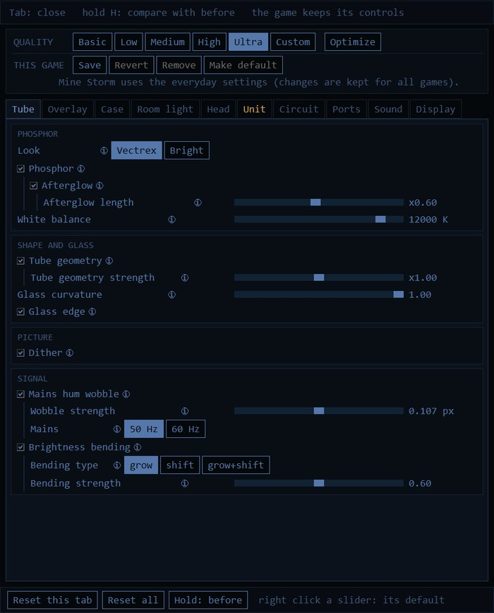</a></p>

* **Sliders**: drag or click; **right click: the default**. The defaults are the faithful values, mostly in the middle.
* **Orange** marks what differs from the default: a setting's text, a stripe on a slider where its default is, a tab's
  name. **Hold H** to see the picture as it was when the window opened.
* **This game's own settings**: nothing is saved to a game unless you press **Save**; **Revert**, **Remove** and
  **Make default** do what they say. An overlay's place and size are always kept per game.
* A gamepad drives it too: LB / RB switch tabs, the d-pad moves and changes.

**Help** explains every option, with **More** buttons for the history and mechanics behind them (the phosphor, the
wobble, the buzz, bending, drift), plus the Vectrex itself, cartridges, bank switching and saving.

Settings are kept in `system/settings.json` next to the program, so the folder is portable. If it can't be written they
go to `%APPDATA%\Vectrex_EMU` (Windows), `~/Library/Application Support/Vectrex_EMU` (Mac) or `~/.config/Vectrex_EMU`
(Linux).

### Quality

The quality profile sets the costly picture effects, never the emulation:

| Quality | | For |
|---|---|---|
| **Basic** | Low, and the lines themselves drawn at half size: a quarter of the drawing work | a Raspberry Pi 5 with busy games |
| **Low** | Medium's cuts, the phosphor at half size (the vectors stay sharp), 30 pictures a second | a Raspberry Pi 5, old laptops with integrated graphics |
| **Medium** | the Vectrex look kept; tube curve, glass edge, scratches, plastic glow, room light and reflections off; the phosphor at three quarters | laptops of recent years |
| **High** | all but the room light and its reflections | a MacBook Air, any discrete graphics card |
| **Ultra** | every effect on | a gaming PC |

**Optimize** (View > Quality, the Config window, the setup) draws a heavy scene with an overlay for a few seconds,
measures each effect on this PC and turns off only what it must for full speed, the costliest first; dropping to 30
pictures a second is the last resort. It says what it changed; **Undo** puts it back. It also picks the UVMC2
emulation mode. Nothing changes by itself while you play. When the emulation does run slower than real time, a small
window says what it finds (on battery, a power-saving mode, the built-in graphics chip, a security tool blocking the
JIT) and what to do.

### The screen

A Vectrex draws 50 pictures a second; most screens show 60. **Display > Screen** (the setup picks the best):

* **G-Sync / FreeSync**: each game frame shown the moment it is drawn, 50 a second, the wobble standing still.
  Detected from the monitor's EDID (a G-Sync module, G-Sync Compatible / FreeSync, DisplayID adaptive sync).
* **Monitor's full rate** (120, 144, 165, 240 Hz...): the afterglow fades in finer steps, moving things update more
  often. With **Smooth motion** (the default) pictures are drawn between the game's frames.
* **Matched to the monitor** (60 Hz): with Smooth motion, smooth movement about 20 ms later; without, every game frame as
  it is.

None of them tear, and the picture is always drawn at the monitor's own resolution. **Run-ahead** (Display, Windows,
6809 games) shows a press about 20 ms sooner in games that answer a frame late. **View > HDR** uses an HDR monitor on
Windows. **View > Authentic (9)** makes the overlay exactly 162 x 207 mm, worked out from the monitor's size; if the
monitor doesn't report it (or reports it wrong), set **Display > Monitor size**. **Display > Rotate** turns the whole
screen for a monitor on its side.

### Overlays

Put overlay files in **`overlays`** next to the program, named like the ROM: `Armor Attack.bin` finds
`Armor Attack.art`.

* **MiSTer `.art`**: the emulator comes with the MiSTer Vectrex core's set ([Vectrex_MiSTer](https://github.com/Videodr0me/Vectrex_MiSTer)'s
  `overlays.zip`), renamed like the games (`overlays/CREDITS.md` names each design's author). New ones can be copied in
  as they are: underscores count as spaces, `(...)` parts, versions and a trailing "Proto" are ignored. The `Tate`
  versions are not needed: **Display > Rotate** turns everything.
* **PNG** with transparency: the sheet 846 x 1080 (or the same proportions), or the whole 1360 x 1080 MiSTer frame.
  Alpha 255 is solid print, 1 - 254 coloured see-through plastic (MiSTer's tools use 51), 0 clear. A PNG cut to a shape
  gets black outside it and a soft edge.
* Several overlays for one game (`Spike.art`, `Spike (red).art`): the plain one is chosen; **Overlay > Choose
  overlay...** picks another, remembered per game.
* **UVMC2 programs** get a Vectrex game's overlay only when they are that game's UVMC2 edition (Last Human (UVMC2));
  any other needs one named for it (`Armor Attack (UVMC2).png`).
* **Mine Storm's overlay** is `overlays/Mine Storm (built in).art`: the [Libretro overlay-borders](https://github.com/libretro/overlay-borders)
  artwork as converted by the [Vectrex_MiSTer](https://github.com/Videodr0me/Vectrex_MiSTer) project. Your own
  `Mine Storm.art` is chosen before it.

*Disclaimer: the overlay artwork is not part of this project and not covered by its licence; it belongs to its
creators and is included unchanged as a courtesy, for non-commercial use. Vectrex is a trademark of its owners; this
project is not affiliated with them, Libretro or MiSTer. On request it will be removed.*

### The games list

**L** or the cartridge below the picture opens the **game library** in the picture's place: your `roms` folder as
cartridges, boxes or overlays, 2 to 6 a row or titles only, with a search and the categories **All, Recent, Games,
UVMC2, PiTrex, Tests** (a `roms/Tests` folder). The PiTrex is first, with its own cartridge and box. The game pauses
while it is open. With a controller: the stick chooses, **button 4** loads, **button 1** goes back. Right click a UVMC2
game for its calibration screen. **Display > Game list: Simple** gives the compact list instead: folders above the
games, BACK to go up; Windows shortcuts, Finder aliases and symbolic links in `roms` work as folders, so you can link
the folder you build your own games in.

<p align="center"><a href="docs/images/page/library_carts.jpg"></a></p>

#### Your own pictures for the games list

Box fronts and cartridge labels for 112 games come with the emulator (`system/vectrex_emu/thumbs/shipped`), matched to
your ROMs by name (case, punctuation and `(...)` / `[...]` parts don't matter; other known spellings in
`shipped/index.txt`). The full set of 280 games is the [artwork-1](https://github.com/hugonl31/Vectrex_EMU/releases/tag/artwork-1)
download: unzip it next to the program (or into RetroArch's system folder). It also has an `extras` folder with Hugo
Bokhorst's label art (PNG), his SVG label reconstructions and the Vectrex logo.

<p align="center">
<a href="docs/images/page/library_placeholder_carts.jpg">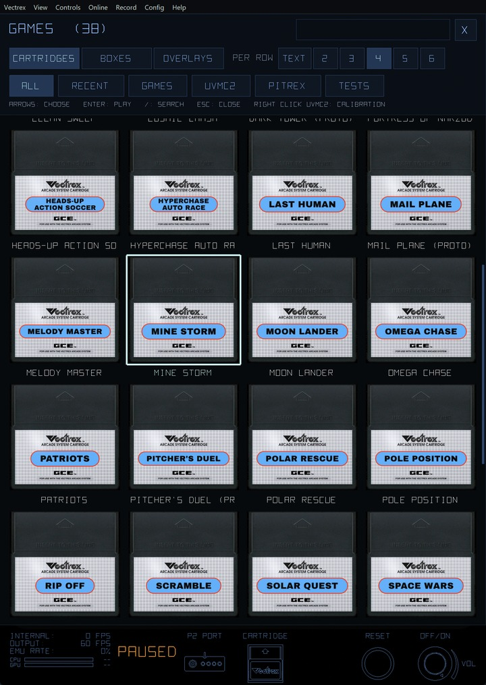</a>
<a href="docs/images/page/library_placeholder_boxes.jpg">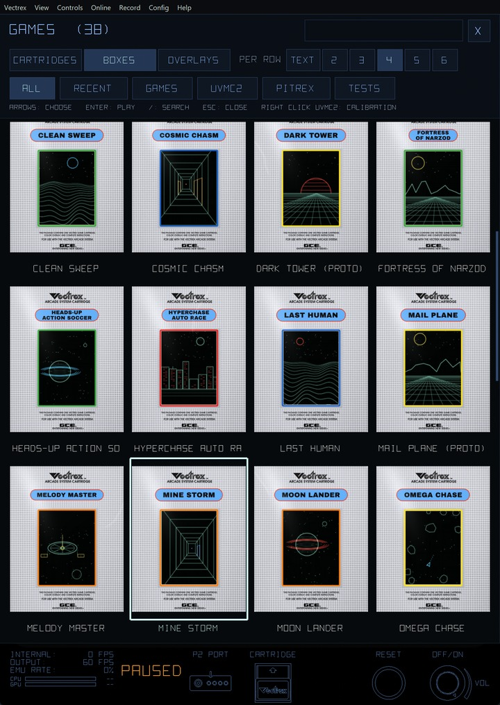</a><br>
<em>Without pictures of your own: the remade labels and boxes that come with the emulator - the game's name on a
GCE-style label, a drawn picture on the box (the same cartridges as the real ones above).</em>
</p>

Your own pictures: a PNG or JPEG named like the ROM without its extension, in a folder under
`system/vectrex_emu/thumbs`. They always come first, then the shipped ones, then the drawn ones.

| Kind | Folder | Size | Notes |
|---|---|---|---|
| **Label** | `labels` | **1000 x 545** px (1.835:1); 600 x 327 and up works | just the label: the emulator puts it on its cartridge |
| **Box** | `boxes` | **800 x 1024** px (25:32); up to 1000 x 1280 | the box front |
| **Cartridge** | `carts` | 840 px wide | a finished picture of the whole cartridge; used instead of a label |
| **Overlay** | `overlays` | 324 x 414 px (162:207) | the Overlays view's tile only |

Keep text 30 px from a label's edge (24 px on a box).

<p align="center">
  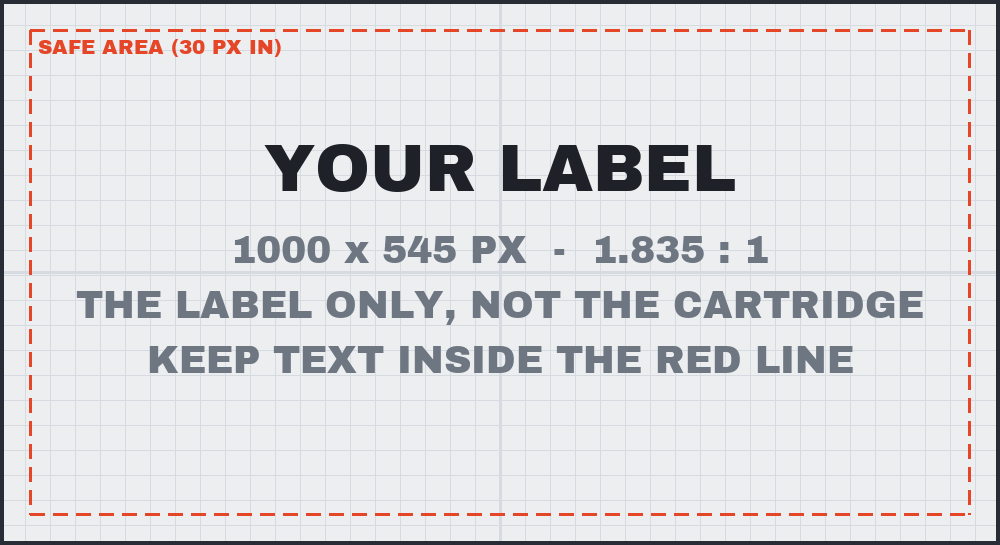
  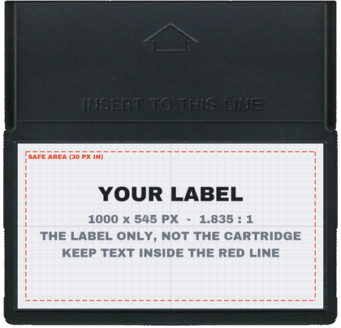
  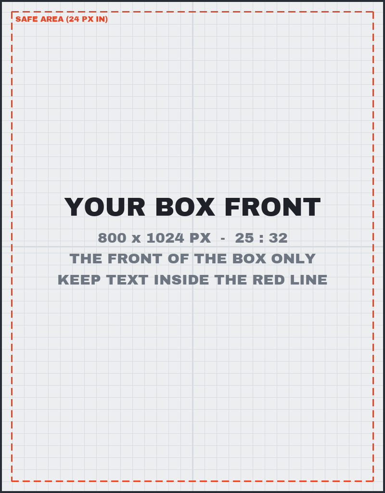
</p>

`system/vectrex_emu/thumbs` is in the program's folder on Windows, Mac and Linux, and in RetroArch's `system` folder for
the RetroArch core.

### Speech modules

**Controls > Port 2** (or Ports > Controller port 2, or the P2 PORT pictogram) plugs in the **VecVoice** or the
**VecVox** instead of a joystick. Both need the speech ROM, which can't be included: the SP0256-AL2's ROM is (c)
Microchip Technology Inc., distributed by Joe Zbiciak with Microchip's permission.

1. Download `al2.bin` (2 KB) from [spatula-city.org/~im14u2c/sp0256-al2](http://spatula-city.org/~im14u2c/sp0256-al2/).
2. Put it in the **`system`** folder (as `al2.bin` or `sp0256-al2.bin`; MAME's bit-reversed `sp0256-al2.bin` works too).
3. Choose the module. It plugs in while the game runs, as on a real Vectrex.

A module answers "ready" on port 2's button 2, so to the game it looks like player 2 holding a button. GCE's original
**Berzerk** then won't start - choose Joystick for it; **Berzerk Ultimate** starts and talks.

**Games that talk** - pick the module the game was written for; the wrong one garbles the speech, as with a real one:

| VecVox (SpeakJet) | VecVoice (SP0256) |
|---|---|
| Berzerk Ultimate (Malban) - talks; Vectorblade (Malban) - talks; Space Frenzy (John Dondzila) - talks; VecFahren (Der Luchs) - talks; VecVox X-Mas - sings; VecTalk (Binary Star), VecVox Demo, VecVox Driver Demo - talk; Brecher, Color Clash, Debris (Revisited), RushHour, Shifted, Spike's Circus, Vectoblox, V:Hockey | B.E.T.H. (Manu) - talks; Verzerk (Alex Herbert) - talks; VecVoice Demo (Richard Hutchinson) - talks; Deathchase; NOX; Pythagorean Theorem (Rob Mitchell); Y.A.S.I. (John Dondzila) |

"Talks" means tested here. From the AtariVox+ list ([AtariAge](https://atariage.com/store/index.php?l=product_detail&p=1045),
[review](https://www.atari7800forever.com/autovox.html)), [vectrex.co.uk](http://www.vectrex.co.uk/news-2009.htm) and
[Revival Studios](https://www.revival-studios.com/vectrex.php); those lists date from 2009-2015 and partly disagree.

### 3D Imager and light pen

GCE's two accessories for controller port 2 - click the P2 PORT pictogram until it shows the one you want, or hold it
and pick:

* **The 3D Imager** (1983): goggles with a spinning disc, half black, half red, green and blue filters. The game drives
  the disc's motor and times its pictures from a hole in the disc, so every line is seen through the filter passing at
  that moment: 3D Mine Storm, 3D Narrow Escape and 3D Crazy Coaster. As on the real goggles the game first spins the
  disc up in the dark (about 13 seconds) while a note shows its speed and you hear its motor. The motor and disc follow
  MAME's model. **Ports > 3D Imager > View**: both eyes in colour (the default), or the left or right eye only - no
  double image without goggles.
* **The light pen** (1983): the mouse is the pen (the pointer turns into a small green pen). It fires when the
  emulated beam passes under it, so Art Master's cursor follows it by its tracking circle, as on a real Vectrex. The
  mouse buttons are buttons 1-3 (Art Master: draw, straight line, menu). For Art Master, AnimAction (its 8 KB
  cartridge RAM found by itself) and Melody Master. Move at a steady pace; too fast and the cursor lets go.

### Cartridge hardware

**Ports > Cartridge hardware**: **Auto** (the default) picks the board by the ROM's size; or choose one:

* **up to 64K** - PB6 drives the EPROM's A15 (bank 1 at power-on).
* **over 64K, up to 256K** - Malban's Vectorblade cartridge (SST39SF020A flash): bank lines PB6 and /IRQ; the flash is
  modelled, so high scores and settings are saved to `<rom>.sav` next to the ROM (the dump itself never changes).
* **exactly 512K** - a 512K flash cartridge with a bank latch (Hugo Bokhorst's v2 board, SST39SF040): A15 = PB6, A16-A18
  from a 74HC377 loaded by a write to $0000-$3FFF; 16 banks of 32K; flash saves as above.
* **other images over 256K** - a 1 MB multi-cart (as Sean Kelly's Multi-Cart): a latch at $7FFF picks the 4K page.
* **Off** - a bone-stock Vectrex: every ROM a plain 32K cartridge.

**Last Human** keeps its calibration, difficulty and high scores on its DS2431 save chip (`<rom>.ds2431`).
**VecFever `.v4e`** files load like any ROM: plain ROMs, a DS2431 save chip, 2 x 48K and 4 x 48K banks. Other VecFever
types are refused with a message.

### UVMC2: the Ultimate Vectrex Multicart 2

The UVMC2 is a cartridge with a computer of its own: an RP2350, two ARM Cortex-M33 cores at 150 MHz. Its games (`.um2`)
hold the Vectrex's 6809 and drive the bus themselves. Vectrex_EMU runs the RP2350 - both cores (with a JIT), PIO, DMA,
timers, PSRAM, the SD card, the USB port and the headphone jack - so the tube, the wobble and the buzz behave as with
any cartridge.

* **Plug and play**: put `.um2` files in `roms`. On a PC with four or more cores the cartridge's cores run on two of
  the PC's.
* **The SD card is a folder**, `uvmc2` next to the program. Doom needs a WAD (`DOOM1.WAD`, the shareware one, works) in
  `uvmc2/doom`, Quake `pak0.pak` in `uvmc2/quake`. A game that misses a file says which and where, and opens the folder.
  **Ports > Choose SD folder...** uses another folder (a copy of your real card).
* **Included**, written for this emulator (MIT, source in [`testcart/uvmc2_movies`](testcart/uvmc2_movies)): the
  **UVMC2 Movie Player** (also **Vectrex > Vector movies**), which plays the PiTrex / VecFever vector movies from
  `uvmc2/movies`; button 4 skips. **Bad Apple is included** (by Malban, bundled with his kind permission); Malban's
  free PiTrex SD card has Bad Apple DE, BlaBla and La Linea too. A `.pcm` next to a movie (raw 16-bit mono, 44100 Hz)
  plays high-quality sound through the Vectrex's speaker (button 3: the headphone jack).
* **Calibration**: the emulator writes a hand-tuned default calibration to the card; to calibrate again, start a game
  with buttons 2 + 3 held (or right click it in the library).
* **Emulation** (Ports): **Exact** (the cartridge cycle for cycle, the default), **Fast** (slower PCs: SDK games'
  drawing lists replayed directly, the same picture), **Dev** (fastest, an ideal beam - for developing, not the real
  picture). Optimize picks one.
* **USB**: the PC's mouse is a USB mouse on the cartridge; after **Ctrl+K** the keyboard types into it. **Headphone
  jack**: clean line out, through the Vectrex's speaker, or off.

### PiTrex: a Raspberry Pi in the cartridge slot

The [PiTrex](http://vide.malban.de) (Malban, Kevin Koster and others) is a cartridge with a Raspberry Pi Zero: the Pi
draws on the Vectrex directly and runs arcade emulators (Asteroids, Battlezone, Tempest, Black Widow, Space Duel,
Tailgunner, the Cinematronics games...), Vectorblade, Elite, a BASIC and a Vectrex emulator of its own. Vectrex_EMU
emulates the whole cartridge: the ARM11 with a JIT (x86-64 and ARM64), its timers and interrupts, the bus, the SD card
and its USB keyboard and mouse.

* **Vectrex > PiTrex > Start the PiTrex** boots its menu (button 4 starts, the stick chooses); **Open PiTrex
  program...** runs one program; **SD card folder...** picks the card (default `pitrex`). The PiTrex is first in the
  games list.
* **The SD card**: Malban's download - **Get games & extras** fetches the newest and unpacks it into `pitrex`.
* **Arcade games need their ROMs**, your own: MAME sets (non-merged or split) in `pitrex/roms`, the AAE ones (Star Wars,
  Major Havoc) in `pitrex/roms/aae`.
* **Ctrl+K** types on its USB keyboard (Elite, GS BASIC).

### Online play

Two players, one Vectrex: the host is player 1 and chooses the game; player 2 joins. For Vectrex games only the
controllers travel - the emulation is exact, so both machines compute the same game to the bit. The **Online** menu:

* **Host with a code...** shows a five-letter code; player 2 types it in **Join with a code...**. A small meeting-point
  server (`tools/vxrelay.py`) puts the two in touch directly (through most home routers) or relays the packets.
* **Host public game...** lists your game in the **game room** under your player name; **Find public games...** shows
  the games waiting for a player 2 and joins with a click.
* **Host on local network (LAN)...**: no meeting point, no internet; the game appears on the other PC under *Games on
  this network*. Two PCs with one cable are enough.
* **Nearby** (no router at all): the host makes a Wi-Fi network of its own - on Windows a Wi-Fi Direct access point
  (`VECTREX-EMU-xxxx`), on Linux NetworkManager's hotspot; on a Mac use Internet Sharing, then Host on local network.
  The others join it in their Wi-Fi settings. Name and password stay the same each time.
* **Host VecLink game...** - see [VecLink](#veclink).

How it plays:

* **Rollback** for Vectrex games: your own controls act at once (2 frames of input delay), the other player's are
  guessed when late and the game quietly run again when the guess was wrong - smooth over Wi-Fi and mobile networks.
  (Windows; the Mac and Linux builds play in lockstep.)
* **UVMC2 and PiTrex games are streamed**: the host plays them and sends each frame's lines and sound; player 2 sees the
  game one network trip later. Player 2 needs the same game file.
* **Saves**: Vectorblade's calibration and Last Human's save chip travel from the host for that game; player 2's own
  saves are never touched.
* The host can **change the game** for both; player 2's copy is found by checksum. A dropout waits ("No connection -
  waiting") until a player leaves. **P** pauses both.
* **Ports**: online, P1 PORT appears beside the cartridge; click a port to take it. For games where two take turns on
  one controller there are **Take port 1 / 2**; a note says how each original game is played by two.
* **Chat** (Ctrl+T): Enter sends, Esc gives the keyboard back; it opens when the other player writes.
* **Player name**: capitals and digits, at most 10, asked once and reserved for you at the meeting point - tied to the
  device, so a fresh install gets it back.
* Both sides compare a checksum of the whole machine twice a second. Both need a version with the same online
  number; the update message says *Online compatible* or *Update needed*.

PCs, iPhones, iPads and Android play together. From the command line:

```
Vectrex_EMU.exe "roms\Armor Attack.bin" --net-online     the host: shows a five-letter code
Vectrex_EMU.exe --net-join KRAVE                          player 2, with that code
```

Without the meeting point: `--net-host` on the host (UDP port 7744 forwarded) and `--net-join ADDRESS`. What the
program sends over the internet, and when: [PRIVACY.md](PRIVACY.md).

### VecLink

Alex Herbert's VecLink cable joins two consoles through controller port 2 (version 2 of the cable). Games made for it
run on two consoles, each with its own screen - his **Berzerk Arena** (2005) in its LINK GAME, and his VecLink example
in VIDE.

* **Online > Test VecLink on this PC** opens a second window, Vectrex B, with the same game and the cable in both.
  Two controllers: one each; one controller or the keyboard: the window in front (**F8** switches). The two consoles
  run in step to the CPU cycle where the cable is read, so the transfer behaves as on two real consoles - test your own
  VecLink code before trying it on hardware.
* **Online > Host VecLink game...**: over the internet, you Vectrex A, player 2 Vectrex B. Each PC runs both consoles
  (the other one unseen) and only the controllers travel.

While the cable is in, port 2 is the cable's: no speech module, light pen or 3D Imager.

### Recording videos and snapshots

**Record > Start recording (F9)** records the game with its sound as an MP4 (H.264 / AAC, 50 pictures a second); F9
stops it. The title bar and the control deck show REC and the time, never in the video. After Stop the video is
finished in the background while you play on. **Record > Snapshot (F12)** saves the picture on the screen as a PNG.
Both go to `Videos/Vectrex_EMU` (Mac: `Movies/Vectrex_EMU`), named by date and time. **Recording settings**: the
folder, the video quality and size, the sound, and whether the control deck is in. ffmpeg comes with the emulator.

### Head tracking

A phone on your desk follows your head with **[SmoothTrack](https://smoothtrack.app/)** (iPhone and Android), and the
game's picture slides a little behind the overlay and the glass as you move - the way the glowing phosphor behind a
real overlay does. The room light's reflections move with you too. Only the picture moves, never the game, so it works
online.

* **Wi-Fi**: in SmoothTrack enter this PC's address (Config > Head shows it) and port **4242**.
* **USB, iPhone**: install **Apple Devices** (or iTunes), plug in and trust the PC, tap *Activate USB Connection* in the
  app; the emulator finds the phone itself.
* **USB, Android**: turn on USB debugging and unpack [Gnirehtet](https://github.com/Genymobile/gnirehtet/releases) into
  the Vectrex_EMU folder; the emulator runs it itself.
* **Config > Head**: Centre, the picture's shift, the reflections' strengths, smoothing per direction, the phone's tilt.
  Only with an overlay.

**Help > Head tracking (SmoothTrack)** walks through it with every link.

### Updates and reports

When a new version is out, a message lists what's new and has **Update now**: the emulator downloads the new version,
installs it over the old one and starts again. ROMs, overlays, SD cards, saves, calibrations and all settings stay (the
settings also backed up as `system/settings_before_<version>.json`); only the program and the included Last Human are
replaced. Not from a folder it can't write to (Program Files): then the message links to the download.

**Help > Debug report** makes one report (version, system, power settings, the speed of the last minutes, the core's
log, the settings - no ROMs, no files, no online key or player name): **Send** gives you a number like `R-7KQ4MZ` to pass
on, **Save as file** puts it in Downloads. An email address is optional. **Help > Copy system info** is for a GitHub
issue.

### Mac and Linux

The same emulator; everything above applies.

* **Mac**: Command works for the Ctrl shortcuts - ⌘E eject, ⌘R RESET, ⌃⌘F full screen (also fn+F11), ⌘Q quits; Page Up /
  Down are fn+↑ / fn+↓ on a MacBook. Retina screens get full resolution, ProMotion 120 Hz. Keep the app, `system` and
  `roms` together. If macOS says the BIOS is missing, it runs the app from a hidden copy: drag `Vectrex_EMU.app` out of
  its folder and back in (or `xattr -dr com.apple.quarantine Vectrex_EMU.app`).
* **Linux**: controllers and sound through SDL2; the program uses the system's own OpenGL driver. No glow, a plain
  picture? Then OpenGL did not start, and the emulator says why.
* **Steam Deck**: the Linux build runs in Desktop Mode; for Game Mode add `Vectrex_EMU` as a non-Steam game - it skips
  the setup and starts switched on, and the TV mode shortcuts do the rest.
* **Raspberry Pi 5**: runs at the Low or Basic quality.

Settings files move between all three systems as they are.

---

## The RetroArch core

The same emulator as a RetroArch core: the 6809 and the analog side, the beam on the phosphor and the tube on the GPU
(glass, ceiling light, case), overlays with scratches and plastic glow, the Vectrex unit, bank switching and saves,
UVMC2 and PiTrex, speech modules, 3D Imager and light pen, a game library over the picture, a control deck (classic,
modern or a slim pop-up one; Auto shows it on a real 4:3 screen), tate mode for handhelds, quality profiles tuned per
device at a game's start, and netplay.

**Install**: each zip has RetroArch's folders (`cores`, `info`, `system`) and an `INSTALL.txt`. The BIOS, overlays and
the UVMC2's SD card go in `<system>/vectrex_emu`; Last Human, its UVMC2 edition and the movie player go with your games;
the speech ROM (`al2.bin` or `sp0256-al2.bin`) in `<system>/vectrex_emu` too. The core writes
`<system>/vectrex_emu/vectrex_emu.log` at every game start.

**Android** (handhelds such as the Retroid Pocket, with **ES-DE**): use RetroArch from retroarch.com or F-Droid (the Play
Store version cannot load a core from a file). *Load Core > Install or Restore a Core*, pick the `.so`. Copy the
`system/vectrex_emu` folder into RetroArch's System/BIOS folder. For ES-DE copy `ES-DE/custom_systems/es_systems.xml`
into ES-DE's `custom_systems` folder: the Vectrex system then starts games with Vectrex_EMU (vecx stays available).
The zip's `config` folder sets Max Users 2 and both ports to "Vectrex controller" for netplay.

**Controls** (RetroPad): stick or d-pad = the joystick, **Y X B A** = Vectrex buttons 1 2 3 4, START = overlay on / off,
RESET on L1, Pause on L2. An optional keyboard mapping (Controls > Keyboard) matches the PC's keys.

**Settings**: *Quick Menu > Core Options*, in submenus as the PC's tabs. Sharpest lines: *Picture size* = your screen's
height in pixels, with Integer Scale on and Bilinear Filtering off. 50 Hz (the game's own rate) needs a screen that can
run at 50 Hz. Slow? Raise the device's performance mode, or use a lower quality profile (Low for small handhelds).
Other options: one eye for the 3D Imager, *Fill skipped lines*, threaded emulation for busy games at 120 Hz. **Netplay**:
Vectrex games through RetroArch's own (rollback); UVMC2 and PiTrex games in lockstep.

---

## Building from source

For tinkerers - the [releases](https://github.com/hugonl31/Vectrex_EMU/releases) are built from the same sources by the
GitHub workflow (`.github/workflows/build.yml`), which also checks that each one starts.

* **Windows**: `build_exe.bat` builds the core (`build_core.bat`, needs Visual Studio Build Tools with C++), installs
  PyInstaller if needed and makes `Vectrex_EMU.exe` (needs Python 3.12 from python.org). `run_from_source.bat` runs
  straight from the sources after `build_core.bat`.
* **macOS / Linux**: `build_mac.sh` (the python.org Python 3.12) and `build_linux.sh`.

| Path | |
|---|---|
| `src/core/` | the core (C): `vecx.c` bus and analog model, `e6809.c` CPU, `e8910.c` / `psg.c` sound chip, `sp0256.c` / `speakjet.c` speech, `imager.c` 3D Imager, `veclink.c`, `ds2431.c` save chip; the UVMC2 (`cm33.c`, `cm33_jit.c`, `rp2350.c`, `uvm2_cart.c`, `usbhost.c`); the PiTrex (`arm11*.c`, `pitrex_cart.c`, `pitrex_usb.c`) |
| `src/frontend/` | the PC program (Python): `vectrex_emu.py` window, input, sound, menus; `deck.py` the Config window and setup; `vecrender.py` the OpenGL renderer; `tubemap.py` the tube map; `library.py` the games list; `help_text.py` the Help; `native/` C helpers for the line build |
| `libretro/` | the RetroArch core and the renderer shared with the phone apps |
| `android/`, `ios/` | the Android and iPhone / iPad apps |
| `testcart/` | the test cartridges (6809 assembly) and the photo comparisons; `uvmc2_movies/` the UVMC2 Movie Player (C, MIT) |
| `tools/` | the meeting point (`vxrelay.py`), `photo_match` (the measurements), test tools |
| `system/`, `overlays/`, `sounds/`, `package/` | the BIOS, Mine Storm's overlay, the power sounds recorded on a real Vectrex, the release folders |
| `docs/` | the pictures, and [TECHNICAL.md](docs/TECHNICAL.md) - what the emulator models, number by number |

---

## Credits and license

Vectrex_EMU is free software under the **GNU General Public License v3** ([LICENSE.md](LICENSE.md)), the license of the
vecx emulator it is built on. What the program sends over the internet, and when: [PRIVACY.md](PRIVACY.md).

* **vecx** - the original emulator core.
* **MAME** - the SP0256 synthesizer in `src/core/sp0256.c` is ported from MAME's sp0256.cpp (BSD-3-Clause, Joseph
  Zbiciak and Tim Lindner); the 3D Imager's motor and disc follow MAME's model and numbers (Mathis Rosenhauer,
  BSD-3-Clause).
* **The MiSTer Vectrex core** (Dar, Sorgelig, alanswx, Videodr0me) - the DAC sound mix, the power-on seed, the VecVoice
  link and the speech level (Sorgelig's audio compressor table) follow it; its `.art` overlay format and overlays;
  Mine Storm's overlay (Libretro artwork, see [Overlays](#overlays)).
* **Malban** - the analog delays measured for VIDE, Vectorblade's cartridge, and the Bad Apple vector movie
  (`uvmc2/movies/BadApple.bin`, from his PiTrex SD card), bundled with his permission.
* **The PiTrex** (Malban, Kevin Koster and the PiTrex team) - the cartridge and its programs; the emulator runs their SD
  card as it comes, downloaded from Malban's page.
* **The overlays** - the authors of each design are listed in `overlays/CREDITS.md`.
* **Title artwork and pictures**: Simon Quincey (his Vectrex 2D Front Cover Box Art pack), used with permission - on the
  games list's boxes and cartridge labels (`system/vectrex_emu/thumbs/shipped`, and the full set,
  [artwork-1](https://github.com/hugonl31/Vectrex_EMU/releases/tag/artwork-1)).
* **Box and label design** by Hugo Bokhorst - every box and label of the games list (the silver paper, the layout, the
  small print), Last Human's and Robot Arena's labels and boxes, and the full set's `extras` (his labels, their SVG
  reconstructions, the Vectrex logo).
* **Fonts**: the labels' small print is set in **TeX Gyre Heros** (GUST e-foundry, GUST Font License / LPPL,
  `art/fonts`). The drawn box's bottom text (`art/GCE_bottom_text.tif`, by Hugo Bokhorst) is made with **Clean Sweep
  Label** - URW Gothic Book (urw-base35-fonts, URW Software / URW++) modified by Hugo Bokhorst to match the Clean Sweep
  box, AGPL-3.0 with the URW font exception - and **Clean Sweep Tagline** by Hugo Bokhorst; the program uses only the
  picture made from them. **Archivo Black** (c) 2017 The Archivo Black Project Authors, SIL Open Font License 1.1
  (`libretro/fonts/OFL.txt`) - the titles on the drawn cartridges and boxes.
* **The SP0256-AL2 ROM** is (c) Microchip Technology Inc., distributed by Joe Zbiciak with Microchip's permission; it is
  not part of this project.
* **The Vectrex BIOS**: Smith Engineering allows it to be copied freely for non-commercial use.
* **FFmpeg** (GPL) - the static FFmpeg 7 builds from the imageio-ffmpeg package make the videos; its source is at
  [ffmpeg.org](https://ffmpeg.org/download.html).
* **stb_truetype** and **stb_image** by Sean Barrett (public domain / MIT) - drawing titles, reading pictures.
* **libretro.h** - the libretro API header, (c) The RetroArch team, under its own licence statement.
* **SmoothTrack** and **Gnirehtet** are separate tools, not included; head tracking reads SmoothTrack's OpenTrack-format
  data.

Vectrex_EMU by Hugo Bokhorst, developed with Claude (Anthropic) as development assistant and programmer.
