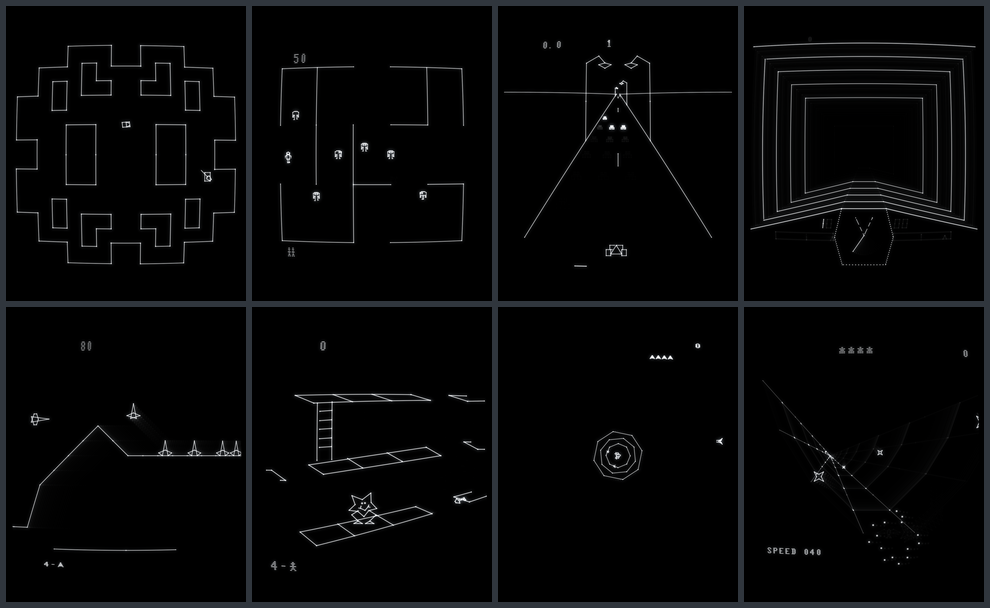

# Vectrex_EMU

**A Vectrex emulator that doesn't try to be perfect. It tries to be a Vectrex.**

The Vectrex (GCE / Milton Bradley, 1982) is the only home console that ever drew its games with a real
vector beam: one electron beam, steered by analog circuits, tracing every line straight onto the
phosphor of its own built-in 9-inch screen. Most emulators show what the games *meant* to draw: clean,
sharp lines on black. A real Vectrex never looks like that. Its lines are made of moving light; corners
glow where the beam rests; shapes don't quite close because the analog circuits drift; text has gaps;
the picture wobbles with the mains hum; everything leaves a fading trail; and the speaker buzzes along
with whatever is on screen.

**Vectrex_EMU is built to show all of that** - measured on a real Vectrex, not guessed.

Windows, macOS (Intel and Apple Silicon) and Linux. Downloads: [Releases](../../releases)
(Mac and Linux), or build the Windows exe with one double-click (see [Building](#building)).

**Author:** Hugo Bokhorst ([@hugonl31](https://github.com/hugonl31)) - the idea, the real Vectrex, every
photo, recording and measurement, and every call on how it should look, sound and feel. 
**Development assistant and programmer:** Claude (Anthropic).

---

## The story: measuring a Vectrex

The project started from **vecx**, a long-standing open-source Vectrex emulator, and from one rule:
*nothing gets changed because it "looks nicer" - only because a real Vectrex does it.* So every step was
the same loop: look at the real machine, measure it, change the emulator, compare again.

### 1. Photographing the beam

The first surprise was how different a real Vectrex looks up close. We took long series of close-up
photos of the real tube, game by game, and laid them next to the emulator. The lines of Mine Storm's
ship stop short of their corners; the mines open up at their inner points; the corners where the beam
rests for a moment shine as bright dots; fast lines are thinner than slow ones.

 
<em>Left: a real Vectrex (one with unusually wide gaps). Right: Vectrex_EMU. Note the short lines, the open corners and the bright resting dots.</em>

Those gaps turned out to be timing: the 6809 CPU, the 6522 VIA timer and the analog integrators that
move the beam all start and stop a few cycles apart. The emulator now runs every instruction's bus
access in the exact cycle the real chips do, with the measured analog delays - and the gaps appear in
the same places.

How *wide* they are is another matter: it varies from one Vectrex to the next. Component tolerances
and age shift the analog timing, so some machines show wide gaps and others barely any. The Vectrex in
these photos has exceptionally wide ones. Rather than copy this one machine, Vectrex_EMU takes a
compromise: the gaps are there, in the right places, but at the size of a well-tuned Vectrex - so they
are smaller than in the photos.

 
<em>Mine Storm's mothership: real (left) and emulated (right).</em>

### 2. Filming the glow

A vector screen has no frames; it has *phosphor*. We filmed the Vectrex title fading to black and measured
the light frame by frame: the glow drops to ~15 % at once, then fades over about two seconds along two
curves. The emulator lights the phosphor at the exact moment the beam passes each spot and lets it fade
along that measured curve, sixty times a second, whatever frame rate the game runs at. A moving object
leaves a real trail, not a stack of copies - checked against Mine Storm's big mothership, which on the
real tube leaves one smooth trail.

 
<em>Mine Storm's mothership on the move: the trail of fading phosphor it leaves on a real Vectrex (left) and in Vectrex_EMU (right).</em>

A word about the photos: a CRT is very hard to photograph faithfully. The camera's exposure decides how
much of the glow it catches, so the bloom and the brightness in a photo are never quite what the eye
sees - the real tube's bloom looks different in person. The emulator was therefore tuned by eye too,
over many rounds with the real Vectrex and the emulator on an IPS monitor side by side, until the two
looked very much alike in real life.

Even the brightness was measured: a test page of bars and dots at 16 intensities showed exactly where a
dim beam disappears on the real tube (10 lines and 10 dots still visible).

### 3. Listening

The Vectrex is not quiet. The beam's currents leak into the audio amplifier, so the speaker **buzzes**
along with what is drawn - louder with more lines, at the game's frame rate, never quite silent. We
recorded it, together with the small built-in speaker's sound, the click of the power switch and the
crackle of a worn volume knob. All of it is in: the buzz is generated from the actual vectors each frame,
the sound plays through a model of that speaker, and turning the knob (which is also the power switch)
scratches, crackles and sometimes cuts out, as an old potentiometer does.

### 4. Asking the chips directly

Some things can't be seen in a game, so we wrote **test cartridges**: small 6809 programs that ask the
hardware a question and print the answer on screen. They were flashed to a real cartridge, run on the
real Vectrex, photographed - and then the emulator was changed until it printed the same numbers.

 
<em>Test cartridges on the real Vectrex: CPU and timer cycles, open bus reads, beam brightness.</em>

* **CPU timing**: 32 measurements of instruction cycles and the 6522's timers and shift register. vecx
  was off in several places (a timer running one cycle long, a flag set too early, a timer that stopped
  when read). All 32 now match.
* **Open bus**: what the CPU reads where no chip answers. The real Vectrex returns the last byte on the
  data bus; vecx returned garbage. That tiny detail decides a famous glitch (below).
* **Sample and hold**: how fast the Y axis follows a jump - measured, modelled.
* **Brightness**: where a dim beam disappears - see above.

### 5. The Mine Storm bug

Mine Storm, the game built into every Vectrex, has a rare bug: when a mine splits at the wrong moment,
the game reads a stray list of vectors. On the emulator this froze the game for seconds and drew a long
diagonal streak. We logged sessions until it happened, traced it to the exact instruction - and then
tested the real hardware: on the real Vectrex, the built-in Mine Storm shrugs it off, while the same
game on a cartridge glitches for a second or two. The difference is the open bus. With the measured
open-bus behaviour, Vectrex_EMU now does exactly what the real machine does - in both cases.

### 6. The analog side

Things no digital emulator has, because they are analog:

* **Drift**: the integrators' zero point wanders, so a shape drawn as one loop doesn't quite close -
  calibrated against photos of test patterns on the real tube.
* **Mains hum**: the beam wobbles with the 50 Hz mains (60 Hz in America); a game at exactly 50 fps
  stands still, any other frame rate ripples - as on the real machine.
* **Brightness bending**: the high voltage sags with a busy screen; the picture breathes.
* **The tube**: curved glass, glow around resting spots, a soft round spot - and switching off makes the
  picture shrink away with a last flash of the beam, as the real one does.

The result is not a "filter" laid over a clean picture: the imperfections come out of the emulation.

---

## What it looks like

 
<em>Original GCE games in Vectrex_EMU.</em>

Below the picture sits the Vectrex's own control panel, drawn in green outlines: the **on-screen display**
(the game's frame rate, the monitor's, the emulation speed, the volume), a **cartridge** you click to
open the **ROM browser**, the **RESET** button and the **volume knob**, which - as on the Vectrex - is
also the power switch.

 
<em>The panel below the picture: on-screen display, cartridge, RESET and the volume knob.</em>

 
<em>Click the cartridge: the ROM browser, drawn into the picture (it works in full screen too).</em>

## Features

* Cycle-exact 6809 bus timing, the 6522 as measured, Malban's analog delays (as measured for VIDE)
* Real-time phosphor with the measured afterglow, bloom, glow, curved glass, mains wobble, drift, bending
* The buzz, the built-in speaker, the power switch and a worn volume knob
* Fixed 60 Hz (tear-free on any monitor), the monitor's full rate (120 / 144 / 240 Hz), or G-Sync /
  FreeSync; always at the monitor's full resolution (4K, Retina)
* Two players, keyboard and any controllers at once (Xbox / PlayStation / Switch pads, the Vectrex USB
  controller, flight sticks), mapped per controller with dead zones and endpoints
* Bank-switched cartridges: 64K (PB6), Malban's Vectorblade cartridge with its flash save, the Multi-Cart
* Every look and sound setting adjustable and explained in the built-in Help

---

## Getting started

* **Mac** (Intel and Apple Silicon): download `Vectrex_EMU-mac-app.zip` from [Releases](../../releases),
  unzip it and open `Vectrex_EMU.app` (the first start needs one extra click, see [Mac and Linux](#mac-and-linux)).
* **Linux** (x86-64): download `Vectrex_EMU-linux-bin.zip` from [Releases](../../releases), unzip it and
  start `./Vectrex_EMU`.
* **Windows**: download this project (Code > Download ZIP), unzip it and double-click `build_exe.bat` -
  it builds `Vectrex_EMU.exe` (see [Building](#building)).

Then put your cartridge ROMs (`.bin`) in a folder called `roms` next to the program, and turn the volume
knob up to switch the Vectrex on. Without a cartridge it plays its built-in game, Mine Storm.

**On Windows** `Vectrex_EMU.exe` is all you need: the emulator core, the BIOS (with Mine Storm) and the
power-on/off sounds are inside it. Copy it anywhere; next to it only a `Vectrex_EMU.conf` appears.
`Vectrex_EMU.exe GAME.bin` starts with a cartridge, Ctrl+O opens one; it starts again with the cartridge
used last (if that file is gone: Mine Storm).

## Mac and Linux

The same emulator runs on macOS and Linux. Everything in this README applies; only the start differs.
On both, the BIOS is not built into the program: it sits in the **`bios` folder next to it**
(`bios/bios.bin`, in the zip). The `roms` folder and `Vectrex_EMU.conf` sit next to the program,
as on Windows; if that folder can not be written to, the settings go to `~/Library/Application Support/Vectrex_EMU`
(Mac) or `~/.config/Vectrex_EMU` (Linux).

**Mac** (Intel and Apple Silicon, macOS 10.13 or later): unzip and keep `Vectrex_EMU.app`, `bios` and
`roms` together in one folder. The app is not signed by Apple, so the
first start is blocked. Right-click (or Ctrl+click) the app > **Open** > **Open**. On macOS 15 or later:
double-click it once, then **System Settings > Privacy & Security > Open Anyway**. After that it starts normally.
Or in Terminal, once: `xattr -dr com.apple.quarantine Vectrex_EMU.app`. (Until then macOS may run a downloaded app from a hidden copy that can not see the `bios` and
`roms` folders; the app finds its real folder by itself, and if it ever says the BIOS is missing: drag
`Vectrex_EMU.app` out of its folder in Finder and back in.) The shortcuts work with Command as well as
with control: ⌘O ROM browser, ⌘E eject, ⌘R RESET, ⌘P pause, ⌘+ / ⌘− / ⌘0 size, ⌃⌘F full screen (also fn+F11),
⌘Q quits (settings saved); Page Up / Down are fn+↑ / fn+↓ on a MacBook. The right mouse button is
Ctrl+click on a one-button mouse or trackpad. On a Retina screen the picture is drawn at the screen's full resolution (its pixels, not
macOS's points: twice as sharp), found by itself; it follows the window to another screen. Display > Screen at the full rate uses the monitor's rate
(120 Hz ProMotion); the fixed 60 Hz is paced by the clock there.

**Linux** (x86-64, glibc 2.35 or later: Ubuntu 22.04, Debian 12, Fedora 36 and later...): unzip and start `./Vectrex_EMU` (or double-click it). It needs an X11 or Wayland desktop
(through XWayland) with OpenGL (Mesa or a GPU driver) and PulseAudio or PipeWire for sound - every
normal desktop has them. If the unzipping tool dropped the program's run permission: `chmod +x Vectrex_EMU`.

Controllers work on both through SDL2: an Xbox, PlayStation or Switch pad shows up like the Xbox pad
on Windows; any other joystick (the Vectrex USB controller, flight sticks) by its own name, with
its axes and buttons, mapped in Vectrex > Controls as on Windows. Settings files move between all three
systems as they are.

## Switching on

Like a real Vectrex it **starts switched off**: turn the volume knob up (Page Up, the mouse wheel over
the knob below the picture, or a click on its right half) and it clicks on, the tube warms up and the
BIOS start screen plays. **Vectrex > Start switched on** skips the knob; **Vectrex > Skip the Vectrex
intro** runs the BIOS start screen (the VECTREX logo, its tune and the game's title, ~13 s) unseen in a
fraction of a second at every power on, so the cartridge starts at once - in the same state as after the
real intro (the core's live flag bit 4 with a power on: it runs until the CPU first executes code below
$F000). Both are saved.

## Help

**Help** in the menu bar opens a help window: every menu option explained, with **More** buttons that
unfold the history and the mechanics behind it (the phosphor, the mains wobble, the buzz, bending, the
analog drift), plus the Vectrex itself (CPU and cycles, RAM, the 6522, the sound chip and its limits),
cartridges, bank switching and saving. The text lives in `src\frontend\help_text.py`.

## Menu bar

Every option is in the menu bar (Vectrex, Display, Tube, Sound, Help); options that are on have a tick,
the few that also have a key show it. Values (volume, bloom, afterglow length, wobble, bending, buzz)
open a small slider window: drag or click on the bar to set it, **right click for the default**, Esc
closes it. In full screen there is no menu (with G-Sync Windows menus are hidden there): the keys
below, the knob and the cartridge work there.

**Volume knob on screen** (Display menu, default on): the Vectrex's own panel as simple green
outlines in the strip right below the picture, lined up with its right edge - in the window and in
full screen alike: the volume knob with its position marker, OFF/ON and VOLUME, and the RESET button.
Mouse wheel over the knob or a click on its right / left half turns it up / down (down to 0 % switches
the Vectrex off); a click on RESET presses it.

**Cartridge on screen** (Display menu, default on): a Vectrex cartridge below the middle of the
picture. Click it (or Ctrl+O): the ROM browser opens over the picture with all ROMs in the folder
**`roms` next to `Vectrex_EMU.exe`** (subfolders too; `.bin`, `.vec`, `.gam`, `.rom`; no folder or no
ROMs: the list is empty). The game runs on behind it but gets no input. Up / Down choose, Left / Right
a page, the mouse wheel or the arrow buttons scroll; Enter, a double click or the plug loads the chosen
ROM (a power cycle with it); Esc, the X or a click outside closes it. Drawn in the picture, so it works
in full screen with G-Sync too.

**Display > Screen:** fixed 60 Hz (default: smooth and tear-free on any monitor), the monitor's full
rate (vsync on every refresh - 120, 144, 165, 240 Hz...: the afterglow fades in finer steps and moving
things update more often; on a 60 Hz monitor the same as 60 Hz), or G-Sync / FreeSync (one screen
frame per game frame: no tearing, the wobble stands still at 50 fps; needs such a monitor). Always at
the monitor's own resolution (e.g. 4K).

**On-screen display** (Display menu, default on): INTERNAL (the game's frames per second), MONITOR
(the screen's refresh), EMU RATE (green 100 %, orange / red when the PC can not keep up), VOLUME -
below the picture on the left.

## Keys

Only what full screen needs has a key, so the rest of the keyboard is free for the players:

| Key | |
|---|---|
| F11 | full screen on/off |
| Esc | closes the ROM browser; in full screen: back to the window; in the window: quit |
| Ctrl+O | the ROM browser (the Windows file dialog: Vectrex > Open ROM file) |
| Ctrl+E | eject the cartridge (Mine Storm) |
| Ctrl+R | the RESET button (RAM kept: the BIOS warm-starts the cartridge, no intro) |
| Ctrl+P | pause |
| Page Up / Page Down | the volume knob in 5 % steps - and, as on the Vectrex, the power switch: turned down to 0 % it clicks off (the tube fades to black), turned up from 0 % it switches on (a cold start, also for carts that ignore RESET), with the real power-off / power-on sounds. While turning it scratches like a worn potentiometer; now and then it stops on a dead spot: the game goes silent, the buzz goes on - turn it again. |
| Ctrl++ / Ctrl+- / Ctrl+0 | window size / start size; in full screen: the picture size |

(The mouse pointer hides in full screen 2 s after it last moved.)

## Controls

**Vectrex > Controls** (in the window): both players - the 1st and the 2nd controller port. Each
player picks a **controller** from the ones connected, listed by their own names (e.g. "Vectrex USB
Controller", "Logitech Extreme 3D"; Xbox-type XInput pads and other USB gamepads / joysticks), or
**Keyboard only**. A controller belongs to one player: the other player's list does not offer it.
A controller first chosen is mapped at once: its X / Y axes = the Vectrex stick, its buttons 1-4 = the
Vectrex buttons 1-4 (an Xbox pad: the left stick and X Y A B); a hat / d-pad is the stick too.

**The keyboard always works as well**, next to the controller: the buttons add up, and a direction
key overrides the stick on its own axis (holding the stick up while pressing Right = up-right; pressing
A while the stick is held = button 1 with the stick still held). No switching needed to try a game on the keyboard.

Click a box, then press a key / a controller button, or push the stick the way the row says (Up: push
up...: that picks the axis and its direction); Shift+click adds a second; right click clears (a stick
box: back to the default axis). The emulator's own keys (F11, Esc, Page Up / Down, Ctrl+...) can not be
taken. Each controller keeps its own mapping: switching controllers needs no new mapping.

**Stick:** per controller **analog stick** or **buttons**. Analog: a bar per axis (X, Y) shows the real
stick (ring) and what the Vectrex gets (fill); drag the inner handles for the **dead zone** and the outer
ones for the **endpoint** - the stick position that already gives full deflection, so a joystick with a
long travel does not need to be pushed all the way (right click: back to 20 % dead zone, full travel).
**Link X and Y** (on by default) moves both axes' handles together; untick it to set them apart.
Buttons: the Up / Down / Left / Right (and Half stick) rows take controller buttons instead of axes -
full deflection, half with the half button. A hat / d-pad works as the stick in both modes. The **test
field** per player shows the stick (ring), the dead zone (dark square), the endpoints (dashed), what the
Vectrex gets (dot, with the x / y values) and buttons 1-4 lighting up. Reset to defaults.

Defaults: player 1 - arrows, A S D F = buttons 1-4, Shift = half stick, and the first controller found.
Player 2 - keyboard only, no keys: pick a second controller, or keys of your own. A chosen controller
that is unplugged is shown as "not connected" (the keyboard still works) and is used again when it is
plugged back in. The keys only count while the emulator's window is in front.

**Settings** (window size, full-screen picture size, look, sound, volume, controls, the last ROM) are saved in
`Vectrex_EMU.conf` next to `Vectrex_EMU.exe`, so the folder is portable: copy it and the settings
come along. If that folder cannot be written (e.g. under Program Files) they go to
`%APPDATA%\Vectrex_EMU\Vectrex_EMU.conf`. Nothing else is written: no logs, no recordings.

## Cartridge hardware

**Vectrex > Cartridge hardware (bank switching)** (on by default, saved): the emulator also models the
bank-switching cartridge boards, chosen by the ROM's size:

* **up to 64K** - PB6 drives the EPROM's A15 (3.3K pull-up: an input PB6 reads high, bank 1 at power-on).
* **over 64K, up to 256K** - Malban's Vectorblade cartridge (SST39SF020A flash): two bank lines, PB6 and
  the cartridge port's /IRQ (low while an enabled VIA interrupt flag is set), bank = PB6 + 2 x (/IRQ
  high), 64K per bank of which the cartridge shows $0000-$BFFF; power-on bank 3. The flash is modelled
  (program, sector / chip erase, ID): the game's high scores and settings are saved to `<rom>.sav` next
  to the ROM, the dump itself is never changed.
* **1 MB** - Sean Kelly's Multi-Cart: a latch written at $7FFF picks the 4K page the cartridge window
  starts at; power-on page 0 (the menu); the RESET button keeps the page.

Off: a bone-stock Vectrex - every ROM is a plain 32K cartridge (the first 32K of the file, no bank
switching), so bank-switched games do not start. Changing it puts the cartridge in again (power cycle).

## What it models (in detail)

* **Analog delays** (as Malban measured them for VIDE): the X integrator gets a new DAC value 15 cycles
  late, Y its sample 14, the integrators start 12 / stop 12.3 cycles after RAMP switches (Malban: 15), timer 1 runs N+2 cycles (6522 data sheet: N+1.5), the beam zeroes
  5 cycles after /ZERO. Cycle-timed code (Vectorblade's sprites and star field) needs them, and they put
  the BIOS raster text where photos of a real Vectrex show it. `VT_ANALOGDLY=0` switches them off;
  `VT_RAMPDLY=on,off` and `VT_XYZDLY=x,y,zero` change single delays.
* **Bus timing**: a 6809 reads and writes the VIA in the instruction's last cycle. The core runs each
  instruction once as a dry run to learn its length, runs the VIA and the analog side up to its last
  cycle, then executes it. With Malban's delays this gives the dark line ends of a real Vectrex (photos
  of a real Vectrex: Mine Storm's mines open at their inner corners, the ship's lines ~20 % short).
  `VT_WRITETIME=1` = only the writes late, `0` = the old instant reads and writes.
* **Line ends** (fitted to photos of the test cart `testcart\timing_test.bin`, 2026-10-12):
  the BIOS polls timer 1 every 7 cycles, so /BLANK comes 10-16 cycles after a line's timer ends,
  depending on the line's length. With timer 1 running N+2 cycles (`VT_T1EXTRA=1`) and the
  integrators stopping 12.3 cycles after it (`VT_RAMPOFF`; a fraction = one more cycle at that share
  of the speed) the dark line ends fall where the real Vectrex has them: at scales $0B-$0C and
  $12-$13 (one period of the poll loop apart; 11.8 matched the test lines' sizes best, 12.3 gives
  Mine Storm's ship - drawn at $0C - its ~15 % short lines); Mine Storm's mothership closed but for
  its wing corners now and then.
  Wherever the beam rests the glass glows softly around the spot (Tube > Corner glow, strength 0.014, chosen side by side with a real tube
  by default; 1.6 game px wide, full from 18 cycles of rest). (`VT_BEAMFADE`, a fade-out trace
  after /BLANK, is off: it gave all text a shadow.)
* **Open bus**: a read where no chip answers (the $C000-$C7FF hole, $8000-$BFFF, an empty cartridge
  slot) returns the last byte on the data bus, as measured on a real Vectrex with
  `testcart\openbus_test.bin` (2026-10-14): $00 - the BIOS byte at $FFFF, read in the 6809's idle
  cycle just before the access - except after `,R` indexing (no idle cycle), which gets the next
  opcode. (vecx returned garbage in the hole and $FF elsewhere.) It matters for Mine Storm's own bug:
  a split mine can land in the shot mine's slot, which then gets type 4 and a stray vector list
  address ($3408); with no cartridge Draw_VLp now reads the next opcode ($30 / $2F) as the end of the
  list and nothing shows, as on the real Vectrex - before, $FF bytes drew a long diagonal streak and
  froze the game for seconds. (MAME has the same symptom open, bug 05784.)
* **Afterglow length**: the measured decay (see the phosphor section) runs at x0.6 by default (Tube >
  Afterglow length; chosen side by side with a real tube).
* **Afterglow joining** (Tube > Afterglow joining, default 0.5, chosen side by side with a real tube): a fading spot (older than the hold)
  spreads to its neighbours every screen frame, keeping half of its brightness, so the copies a moving
  object leaves - one per game frame - join into one smooth trail, as on the tube (Mine
  Storm's big mothership leaves "a singular trail, not a bunch of snapshots"); sharp,
  not blurred. Light brighter than a line (corner spots) spreads only as a line does. One step reaches
  1 px in an 820 px high window at 60 Hz (scaled with the window and the refresh rate). Lines being drawn
  and the measured fade times are unchanged. (A screen frame per game frame - G-Sync - did not change the
  copies.) The glow only grows during its first 35 ms after the hold (2 screen frames): it joins the
  copies but keeps the vector's size - unlimited, a fading bullet or text swelled into a blob.
  **Afterglow overlap** (Tube > Afterglow overlap, default 0.8 px in an 820 px window, scaled; chosen side by side with a real tube): the fading
  light - not the lit lines - is averaged over a small spot, as overlapping light adds up on the tube: the
  copies' steps and the corner dots at a shape's tips (Mine Storm's mothership wings) blend into a smooth
  gradient. Tube > Afterglow softness blurs the afterglow progressively instead (default 0: off).
* **Dim beams, the cutoff** (measured with `testcart\bright_test.bin`, a photo and a count by
  eye on a real Vectrex): from intensity 63 up the beam's brightness is 0.55 + 0.45 x Z/127, as before; below,
  the tube's cutoff: lines are dark up to Z = 27 and grow as ((Z - 27) / 36.5)^1.7 ($20 very faint, $18
  dark: 10 of the page's 16 bars, as counted on the tube); a spot resting long (40+ cycles) has a sharper
  onset from Z = 23 ($20 clear, $18 dark: 10 dots). Short rests keep the line cutoff, so Vectorblade's
  faintest background stars (intensity 15 and 31, 3-cycle dots) stay (almost) dark, its 47 ones dim.
  Faint beams are also thinner (down to 0.45x).
* **Bloom of long bright rests**: a spot's energy = rest cycles x its intensity's brightness. Corners
  in every game stay at or below ~18 (Spinball's dots 26); above 20 the spot widens (up to 2x) and
  glows more (up to 2.5x), fully at 38 - Vectorblade's enemy shots (intensity 127, 38 cycles in one
  spot) are glowing dots as bright as the player's shot bars, as on the real tube.
* **6522, measured** with `testcart\cputime_test.bin` on a real Vectrex (all 32
  readings now equal): instruction cycles as the 6809 datasheet; timer 1 runs N+2 cycles (flag and PB7);
  after running out in one-shot mode timer 1 shows $FFFF for a cycle and reloads from its latch (vecx
  kept counting down; `VT_T1RELOAD=0/1/2`); the shift register's flag rises at the end of the 8th bit,
  2 cycles after it leaves (vecx: as it left); reading T2's low counter only clears its flag (vecx
  stopped timer 2: a game reading it froze in Wait_Recal).
* **Y sample-and-hold**: the Y hold capacitor charges through the multiplexer, closing 70 % of the gap
  to the DAC per cycle (`VT_YSHK`, 1 = instant as vecx): measured with `testcart\sh_test.bin` on a
  real Vectrex - connected for 4 cycles after a 191-step jump it stays ~1.5 steps short,
  from 6 cycles on it has settled. Normal games keep it connected longer: no line moves.
* **6522 details**: reading T1's low counter only clears the timer flag (timer 1 keeps running); the
  shift register's first bit leaves the cycle after it is written.

All fitted to photos, a video and a sound recording of a real Vectrex:

* **Beam:** a soft round spot; brightness and width follow the time the beam spent per pixel
  (fast sweeps thin and a little fainter; wherever the beam rests - every corner, every dot such as a shot or a star - 100 % white, the lines just under it (~87 %), the same width - the difference is in brightness only, as in photos of a real Vectrex); everything pure white, phosphor afterglow, bloom.
* **Analog drift:** the integrator zero reference (closed shapes drawn as one loop do not quite
  close), the BIOS raster text offset, the 6522 shift register at one bit per two cycles (the BIOS
  characters as wide as on the tube).
* **Mains hum wobble:** the beam follows the 50 Hz mains phase at the moment each line is drawn; a
  game running at exactly 50 or 25 fps stands still, any other frame rate wobbles at its beat.
  Tube > Mains picks 50 Hz (Europe, the default) or 60 Hz (USA, Canada): on 60 Hz mains a 50 fps game
  ripples at the 10 Hz beat instead of standing almost still.
* **Brightness bending:** the high voltage sags with the beam load, the picture grows / shifts.
* **Sound:** the Vectrex buzz (follows what is drawn, never stops: the BIOS recalibrates every
  frame), all sound through a model of the small built-in speaker.
* **Phosphor in real time:** the screen runs at a fixed 60 Hz whatever the game's frame rate. Every
  line lights the phosphor at the moment the beam drew it, to its commanded brightness; then the spot
  fades as measured on a real Vectrex (a video of the title text going dark): at once to ~15 %, 4 %
  after 0.15 s, 1.5 % after 0.5 s, gone after ~2 s. A spot drawn again is lit again, it does not add up: an
  object is just as bright standing still as moving, only where it was a trail fades. Only what the
  beam draws lights up: a fast object at a low frame rate leaves separate fading copies, a slow one an
  almost smooth trail, as on the tube. On a 60 / 120 / 240 Hz monitor it uses vsync (no tearing); on other refresh rates it
  is paced by the clock, which a G-Sync / FreeSync monitor shows without tearing.
* **Emulation speed:** EMU RATE in the on-screen display shows how fast the emulation runs against a
  real Vectrex: green 100 %; orange below 99 % (the PC can not keep up: the game runs
  slow, the sound breaks up); red below 90 %.
* **Resolution:** always the monitor's real pixels (Windows display scaling such as 150 % does not
  matter): full screen renders at the desktop resolution (e.g. 3840 x 2160), the window at its own
  size.

## Building

download the project (GitHub: Code > Download ZIP), unzip, double-click
`build_exe.bat`: it builds the core (`build_core.bat`, needs Visual Studio Build Tools with C++), installs
PyInstaller if needed and makes `Vectrex_EMU.exe` (needs Python 3 from python.org). `run_from_source.bat`
runs the emulator straight from the sources (after `build_core.bat`). The BIOS (`bios/bios.bin`, with Mine
Storm) is in the project: Smith Engineering allows it to be copied freely for non-commercial use.

**macOS and Linux:** `build_mac.sh` (on a Mac, the python.org Python 3.12) and `build_linux.sh`; the GitHub
workflow `.github/workflows/build.yml` builds both, and on each it checks the OpenGL picture with
`tools/snapshot_test.py`. The platform side (OpenGL context, keys, controllers, sound) is
`src/frontend/osdep.py`; on Windows the program uses the Windows APIs as before.

## Folder

| Path | |
|---|---|
| `Vectrex_EMU.exe` | the emulator, self-contained (front end, core, BIOS and sounds packed with PyInstaller) |
| `core\vectrex_core.exe` | the emulator core (vecx, GPL), packed into the exe when it is built |
| `bios\bios.bin` | the Vectrex BIOS (with Mine Storm) |
| `roms\` | your cartridges: the ROM browser lists them (the cartridge on screen, L) |
| `sounds\` | the power-on / power-off sounds, recorded on a real Vectrex |
| `src\core\` | core sources (C): `vecx.c` CPU bus + analog model, `e6809.c` CPU, `e8910.c`/`psg.c` AY sound, `live.c` the frame pipe, `vtest.c` main (also a scripted test harness), `ds2431.c` (a 1-Wire save chip), `bot.c` (a test player) |
| `src\frontend\` | `vectrex_emu.py` window, input, sound, settings; `vecrender.py` OpenGL beam renderer |
| `build_core.bat` | rebuild the core with Visual C++ 2019 or newer |
| `build_exe.bat` | rebuild the exe with PyInstaller (`python -m pip install pyinstaller`); packs `core\`, `bios\` and `sounds\` into it |
| `run_from_source.bat` | run from the Python sources (Python 3.12 with tkinter) |

The core is the vecx emulator (GPL, see `src\core\LICENSE.md`).

Vectrex_EMU by Hugo Bokhorst, developed with Claude (Anthropic) as development assistant and programmer.
